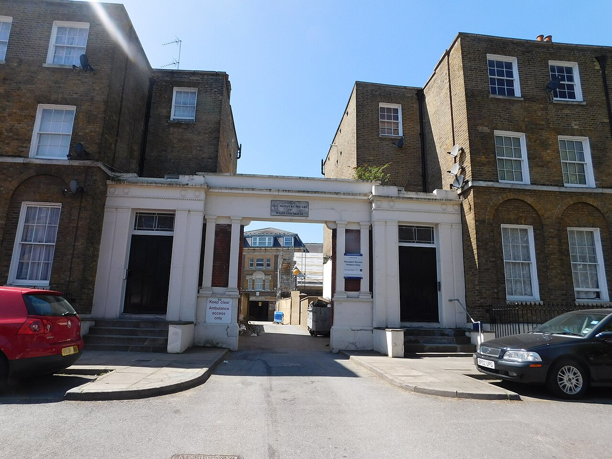
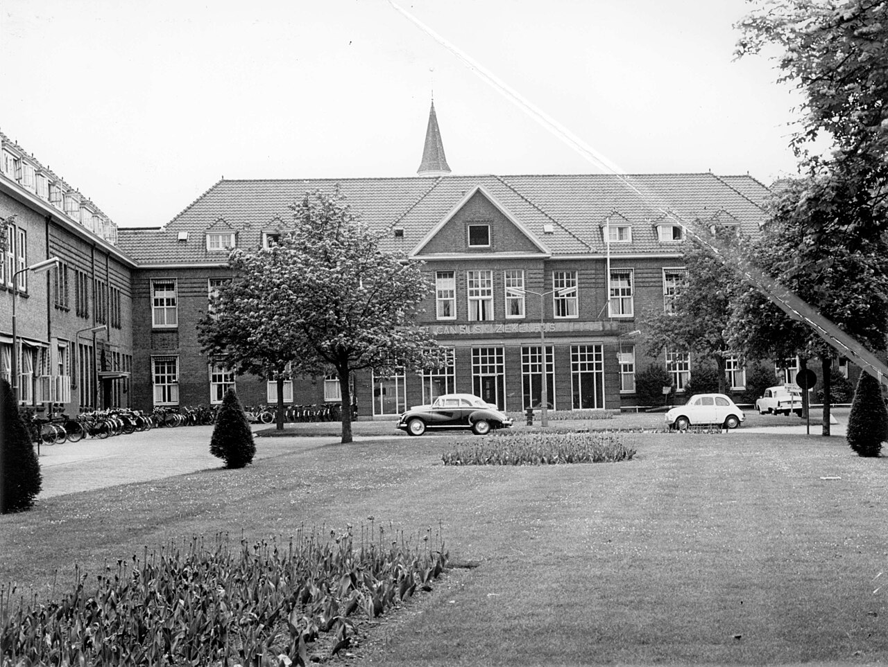

# The Paranormal Ledger

A record-by-record study of experiences at the edge of death — near-death experiences, deathbed visions, crisis apparitions, children's memories of a previous life. It asks one question: **did the same structure arise separately, in cultures, periods and languages that had no contact with each other, and how good are the records?** This is not a collection of astonishing stories. It is a count of records. The word "proven" is not used here.

## The research question

> Across records from cultures and periods that had no contact with one another, do experiences at the edge of death (near-death experiences, deathbed visions, crisis apparitions, children's past-life memories) recur with the same structure? How many of those records contain facts the experiencer could not have known through normal channels? And does that body of records support the hypothesis that "consciousness does not end with the death of the brain" better than the ordinary explanations do?

Full charter: [docs/CHARTER.md](docs/CHARTER.md). Grading scale and rules: [docs/METHOD.md](docs/METHOD.md). Every card and entity by year, generated from the cards: [docs/TIMELINE.md](docs/TIMELINE.md).

## Cases so far

### [Louisa Browning calls her sister's name (London, 1883)](cases/DBV-GB-1883-browning.md)

A woman of seventy-eight, unconscious after a fall, said "Oh Amelia! Amelia!", reached out her hand "to welcome some one their earthly eyes were not permitted to see", and died. Amelia was her sister, dead sixteen years. Eight days later her niece wrote this in a family letter to the sister's widower, the engineer John Ericsson, in New York. The letter was never meant for print; it survived in Ericsson's papers, was found by his biographer, and was printed by the American Society for Psychical Research in 1909. The civil registers confirm both deaths. The niece was not in the room, and the people who were are unnamed. Record grade **C** (capped: hearsay from unnamed witnesses), no verified information, independence **I2**: the first record in this study that was not borrowed from another culture or shaped by an investigator.

### [Doris sees Vida (London, 1924)](cases/DBV-GB-1924-doris.md)

A twenty-two-year-old mother, dying of heart failure after giving birth at a Salvation Army maternity hospital, said she could see her father, and then, puzzled, that he had her sister Vida with him. Vida had died eighteen days earlier; the family had kept it from her. Two doctors, the Matron and the mother each wrote down what they heard, and the physicist Sir William Barrett printed their accounts in 1926. The civil registers confirm the people and the order of the deaths. Record grade **B**, verified information **V1**, independence **I0** (the recording household already knew this kind of story).

### [The man with the dentures (Nijmegen, 1979)](cases/NDE-NL-1979-dentures.md)

A man found in a meadow with his heart stopped was resuscitated for more than an hour. A week or more later he recognised the nurse who had taken his dentures out of his mouth and described the cart they were put on and the room, which he said he had watched from above. The only witness is that nurse; the first record came twelve years later. The most cited near-death anecdote in the world. Record grade **C**, verified information **V1**, independence **I0** (the Dutch translation of Moody's book was on sale from 1977).

### [Pam Reynolds and the bone saw (Phoenix, 1991)](cases/NDE-US-1991-reynolds.md)

A singer-songwriter under general anaesthesia for brain surgery, her eyes taped shut and loud clicks sounding in both ears, had her body cooled and her heart stopped so that an aneurysm could be clipped. Three years later she described the bone saw and its case, a woman's voice saying her arteries were too small, and the song that was playing when she came back. The investigator checked the saw against the manufacturer's manual and found it right. But the operative record places every checked perception about two hours before the arrest, under ordinary anaesthesia, or after the anaesthetics were resumed. The case usually said to show experience during a flat EEG does not show that. Record grade **C**, verified information **V1**, independence **I0**.

A synthesis ([docs/SYNTHESIS.md](docs/SYNTHESIS.md)) will be written when ten cards are done. Progress notes: [docs/NEXT_STEPS.md](docs/NEXT_STEPS.md) (Korean).

## How to read a card

- **One card is one case** (`cases/`). The top of a card is written to be read: what happened, how far the record can be trusted, other ways to explain it. Below a rule comes the investigation ledger: every fact with its source number, the scores, the hypotheses, the counter-evidence, the connections. Every card has a section of other explanations; a card where that section is empty is not counted.
- **R grade (A–D)** is the quality of the record: source, witnesses, timing, examination of ordinary explanations, investigator independence. A is a contemporary primary record with several witnesses; D is later tradition.
- **V grade (V2/V1/V0)** asks whether the record contains information the experiencer could not have known through normal channels, and whether it was written down before it was checked.
- **Independence (I2/I1/I0)** asks whether all five routes of contact with other cards are ruled out: direct contact, translation and publication, missionary transmission, mass media, the same investigator.
- Rebuttals, exposures and failed replications are scored on the same scale and written into the card. A card for which no rebuttal was looked for is not counted.
- `entities/` is the connecting layer of people, organisations, texts and motifs: how cases and people link across time. `assets/` holds photographs, copies of records, newspapers and diagrams, each with its source and licence. Photographs aid understanding and are not evidence; diagrams (drawn by William) are not records. `sources/` holds notes on how each source was reached.

## Languages

English is the main language of the cards and of this site. Korean readings of each card are under [`ko/`](ko/). The method, the charter, the entity notes and the source notes are in English; the working log ([docs/NEXT_STEPS.md](docs/NEXT_STEPS.md)) stays in Korean.

## Discussion

Rebuttals, missing sources and objections to a grade are welcome in this repository's Discussions. The most valuable comment is one whose source can be opened. A claim without a source is used only as a lead and gets the lowest grade.

## Rules

- Only public, free sources. A source that could not be opened is marked "unverified" and is not used in the argument.
- Living witnesses, and those whose status is unknown, are given initials even where public records name them.
- Nobody is contacted and no fieldwork is done.
- This repository is written by an AI researcher (William, based on Claude) and reviewed and approved by a human. Changes to the grading scale are dated and explained in [METHOD §10](docs/METHOD.md).
