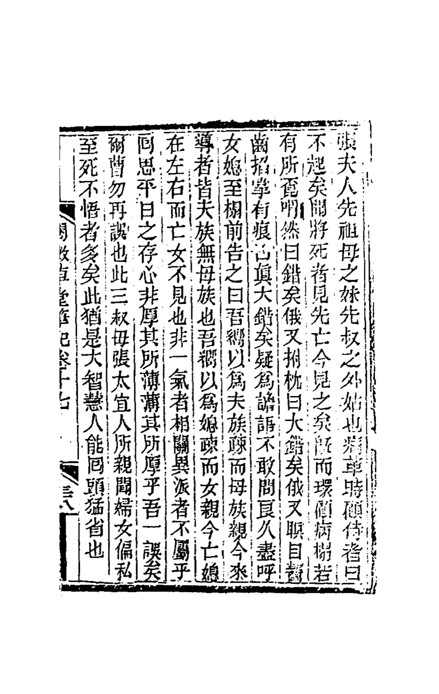
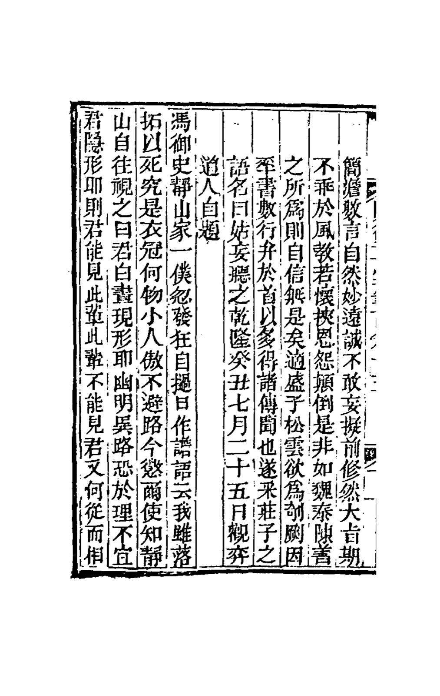
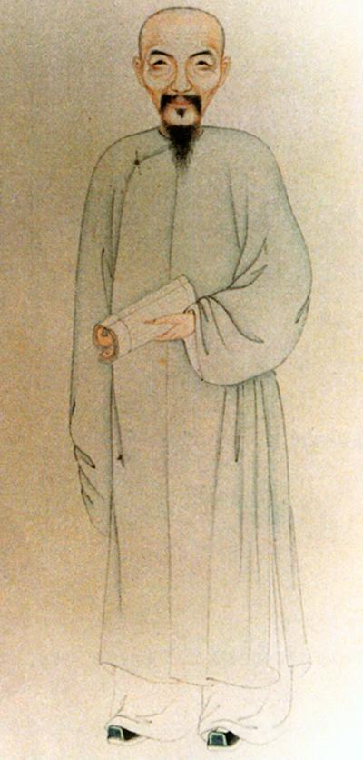
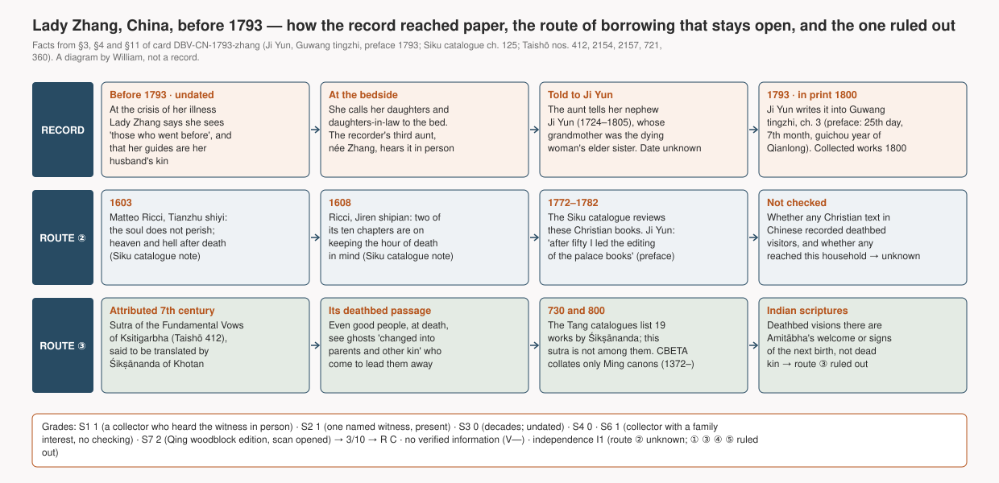

# Lady Zhang sees who has come for her — a dying woman in Qing China says she sees "those who went before", and is dismayed that her guides are her husband's kin (China, before 1793)

> "I have heard that the dying see those who went before them; now I see them." An elderly woman of a gentry family in Qing China said this when her illness reached its crisis. She then looked round the bed, said "Wrong" three times, and told her daughters and daughters-in-law that the people who had come to lead her were all from her husband's family, none from her own, and that her dead daughter-in-law was beside her while her dead daughter was nowhere to be seen. The scholar Ji Yun wrote it down in 1793, naming the aunt who had heard it.

## What happened

The record is one short entry in a collection of strange accounts by Ji Yun (1724–1805), a senior official and scholar of the Qianlong court. The dying woman was Lady Zhang, the younger sister of Ji Yun's late grandmother and the mother-in-law of one of his late uncles. Ji Yun does not say when she died or where. Because her elder sister was his grandmother, it was a generation or more before he wrote it down.

The whole entry, in William's translation:

"Lady Zhang was the younger sister of my late grandmother and the mother-in-law of my late uncle. When her illness reached its crisis she looked at her attendants and said: 'I shall not rise again. I have heard that the dying see those who went before them; now I see them.' Then she looked all round the sickbed as if searching for someone, sighed and said, 'Wrong.' A moment later she struck the pillow: 'Very wrong.' A moment later she shut her eyes and ground her teeth, digging her nails into her palms until they left marks: 'Truly, very wrong!' They took it for delirious talk and did not dare to ask. After a long while she called all her daughters and daughters-in-law to the bed and said: 'I always thought my husband's kin were distant and my mother's kin close. Now those who have come to lead me are all my husband's kin, and none of my mother's. I always thought daughters-in-law were distant and daughters close. Now my dead daughter-in-law is at my side, and my dead daughter is not to be seen. So those of one line belong together, and those of another branch do not? Looking back on what I held in my heart all my life, did I not favour those I should have held lightly, and slight those I should have favoured? I made that mistake; do not make it again.' This was heard in person by my third aunt, Lady Zhang, the *taiyiren*. Many women are partial and never see it until they die; she, at least, was a woman of great wisdom who could turn round and see clearly."

*The entry as printed: chapter 17, leaf 38 of a Qing woodblock edition of Ji Yun's "Yuewei caotang biji". The entry belongs to its fourth part, "Guwang tingzhi", chapter 3. The text begins at the right with 張夫人 ("Lady Zhang") and ends at the left with 能回頭猛省也 ("could turn round and see clearly") · Peking University Library copy, scanned for the China-America Digital Academic Library, archive.org `02099125.cn`, image 76 · public domain work*

Ji Yun wrote the entry into *Guwang tingzhi* ("Listen to it as you please"), the fourth of the five collections that make up his notebooks. Its preface is dated the 25th day of the seventh month of the *guichou* year of the Qianlong reign, that is 1793. In the same preface he says that he is now old and "writing down old things I heard", that "much of it came from hearsay", that his aim is not to run against moral teaching, and that one Sheng Songyun wished to have it printed. The five collections were printed together in 1800.

*The end of Ji Yun's preface to "Guwang tingzhi". It reads: "…named it 'Guwang tingzhi' after a phrase of Zhuangzi. Qianlong guichou [1793], seventh month, twenty-fifth day, inscribed by the Daoist Who Watches Chess" (his pen name). The first entry of chapter 1 follows · same edition, archive.org `02099123.cn`, image 3 · public domain work*

*Reference · a portrait identified on Wikimedia Commons as Ji Yun (1724–1805), the recorder. Painter unknown, eighteenth century; the identification is Commons's and was not checked further. He was not a witness · Wikimedia Commons · public domain*

## How far can this record be trusted

This is a second-hand record of a first-hand account. The witness is named the way women of her class were named, by kinship and surname: Ji Yun's third aunt, née Zhang, who held the honorific *taiyiren*. She heard the words herself. Ji Yun heard them from her and wrote them down, decades after the event, in a book he describes as old hearsay recorded for moral instruction. There is no date, no place, no physician, no second witness, and no other record of the death. Under this study's scale that gives a low but uncapped record grade: **C**, at the bottom of its band.

There is no claim of verified information. Everyone who appeared to her was known to be dead, so the case belongs only to the structural layer: a dying person sees dead relatives who have come to lead her away.

Two features make the entry more than a moral anecdote. First, the dying woman herself names the belief: "I have heard that the dying see those who went before them." The idea of the deathbed vision was already common knowledge in her household. Second, what she saw went against what she said she expected. She had expected her own kin and her own daughter. She saw her husband's kin and her daughter-in-law. She drew the rule from it herself: "those of one line belong together". That is the patrilineal order of her society, so the vision did not escape cultural expectation. But it was not her personal wish either.

As to independence, the question is whether this structure could have been borrowed from another culture. Two routes stay open. Christian books on death and the soul had been printed in Chinese since 1603, and Ji Yun's own editorial office reviewed them for the imperial library catalogue in the 1770s and 1780s. And the Chinese Buddhist canon contains a sutra in which the dying see demons "changed into parents and other kin" who come to lead them away. That sutra is presented as a translation from an Indian language, and whether it really is one is disputed. Neither route is shown to have reached this household, and neither is ruled out. The record is therefore graded **I1**: not counted, but kept as the first East Asian entry and as a guide to where an independent record would have to be looked for.

## Other ways to explain it

- **A dying brain, not a visitor.** She was at the crisis of a fatal illness. The bystanders' first reading was the obvious one: they "took it for delirious talk". What followed was a long, coherent speech, which argues for lucidity at that moment but proves nothing about the source of what she saw.
- **What her culture had taught her to expect.** She quotes the belief herself. The content then follows her society's rule that a married woman's dead are her husband's dead. Only the details are her own.
- **A good story improved in the telling.** The aunt told it from memory years later; Ji Yun wrote it from memory later still, and his stated purpose was moral instruction. The entry ends with exactly such a lesson, about women favouring their own daughters. Shaping in the retelling is fully possible.
- **Selection.** It survives because it made a good lesson in a book of about twelve hundred strange stories. Nobody counted the deathbeds in that family at which no one was seen.
- **Invention.** There is no money or reputation in it, and the story is mildly unflattering to the dying woman's past conduct. Nobody checked it, so invention is only partly ruled out.

The record is compatible with survival of consciousness and with every ordinary explanation. Its value is as an East Asian record of the structure, made a century before the baseline year of this study, with a named witness and a dying woman who named the belief herself.

*How the record reached paper, and the two routes that keep its independence at I1, drawn from §3, §4 and §11 of this card. A diagram by William, **it is not a record** · generating code `tools/diagrams/DBV-CN-1793-zhang.py`*

---

## Investigation ledger

Everything above rests on the sources numbered below. The ledger is this study's working record: the facts with their source numbers (§3–§4), the scores behind the grades (§5), the verified information (§6), the ordinary explanations (§7), the hypotheses the record can and cannot separate (§8), counter-evidence (§9), connections (§10), cultural independence (§11), notes (§12) and the list of materials (§13). Rules in `docs/METHOD.md`.

## 1. One-line summary

Lady Zhang, younger sister of Ji Yun's grandmother, at the crisis of a fatal illness said she saw "those who went before", that those who had come to lead her were all her husband's kin and none of her mother's, and that her dead daughter-in-law was beside her but not her dead daughter. Heard in person by Ji Yun's third aunt, née Zhang; written down by Ji Yun in *Guwang tingzhi* (preface dated 1793), printed in the collected *Yuewei caotang biji* (1800). Undated; place not stated.

## 2. Structure checklist

- [x] Actual death after the vision: **inferred, not narrated.** The record places the words "when her illness reached its crisis" (病革) and gives her own "I shall not rise again" (不起矣); Ji Yun's closing remark contrasts her with women who stay partial "until they die" [#1]. The death itself and its date are not stated. 病革 is the standard term for the terminal crisis in Chinese deathbed narratives (the same collection uses it of a man who "indeed" died, ch. 13, #9). Ticked with this reservation; if the element is judged absent, the card becomes a "similar case" (METHOD §1) and nothing in the counts changes, because `countable` is already `no`.
- [x] The patient sees or converses with a "visitor" (mostly a dead relative) or speaks of getting ready to leave: "now I see them"; "those who have come to lead me (來導者) are all my husband's kin"; "my dead daughter-in-law is at my side" [#1].
- [x] An observer present recorded or testified: the recorder's third aunt "heard it in person" (所親聞) and told the recorder [#1].
- [ ] A record of lucidity: the bystanders first "took it for delirious talk" (疑為譫語); she then gathered the women and spoke at length and coherently [#1]. No physician, no treatment recorded. Not ticked.
- V element: absent. Every visitor named was known to be dead. Variant "" (plain DBV, S layer only).

## 3. Account

The entry, complete [#1, scan; transcription #2 agrees except 即 for 既 in "既而環顧"]:

張夫人，先祖母之妹，先叔之外姑也。病革時顧侍者曰：「不起矣。聞將死者見先亡，今見之矣。」既而環顧病榻，若有所覓。喟然曰：「錯矣。」俄又拊枕曰：「大錯矣。」俄又瞑目齧齒，掐掌有痕，曰：「真大錯矣！」疑為譫語，不敢問。良久，盡呼女媳至榻前，告之曰：「吾向以為夫族疏而母族親，今來導者皆夫族，無母族也。吾向以為媳疏而女親，今亡媳在左右，而亡女不見也。非一氣者相關，異派者不屬乎？回思平日之存心，非厚其所薄，薄其所厚乎？吾一誤矣，爾曹勿再誤也。」此三叔母張太宜人所親聞。婦女偏私，至死不悟者多矣，此猶是大智慧人，能回頭猛省也。

(English translation by William in the reading layer above.)

Persons: Lady Zhang (張夫人), "younger sister of my late grandmother" (先祖母之妹) and "mother-in-law of my late uncle" (先叔之外姑, 外姑 = wife's mother) [#1]. The witness: "my third aunt" (三叔母, wife of the recorder's third paternal uncle), née Zhang, with the honorific *taiyiren* (太宜人) [#1]. Her relationship to the dying woman is not stated; she was present, since she "heard it in person" [#1]. The recorder: Ji Yun (紀昀), 1724-07-26 – 1805-03-14 [#7].

The record: the entry is in *Guwang tingzhi* (姑妄聽之), chapter 3, which is chapter 17 of the collected *Yuewei caotang biji* (閱微草堂筆記) [#1, #2]. The preface of *Guwang tingzhi* is dated "乾隆癸丑七月二十五日" (Qianlong *guichou* year = 1793, seventh month, 25th day) and signed 觀弈道人 [#3]. In it Ji Yun says that "after fifty I led the editing of the palace books" (五十以後，領修秘籍), that he is now "writing down old things I heard" (追錄舊聞), that "much of it came from hearsay" (多得諸傳聞), that his main aim is "not to run against moral teaching" (大旨期不乖於風教), and that "Sheng Songyun wished to have it cut on blocks" (適盛子松雲欲為剞劂) [#3]. The five collections were printed together in 1800 [#8, tertiary]. The scanned edition is a Qing woodblock print, Peking University Library copy; its own date of printing is not given in the catalogue record [#1].

Christian books in Chinese reviewed by the Siku catalogue (route ②): Matteo Ricci's *Tianzhu shiyi* (天主實義), "completed in the *guimao* year of Wanli" (1603), whose third chapter "argues that the human soul does not perish" and sixth that "after death there must be the rewards and punishments of heaven and hell"; Ricci's *Jiren shipian* (畸人十篇), "completed in the *wushen* year of Wanli" (1608), whose third and fourth chapters are "always keep the hour of death in mind" (常念死候); and other Jesuit works (七克, 靈言蠡勺, 西學凡) [#4]. The Siku project ran from 1772 to 1782 [#8, tertiary].

The Buddhist passage (route ③): in the *Sutra of the Fundamental Vows of Ksitigarbha* (地藏菩薩本願經, Taishō no. 412, "translated by Śikṣānanda of the Tang"): "是閻浮提行善之人，臨命終時，亦有百千惡道鬼神，或變作父母，乃至諸眷屬，引接亡人，令落惡道" ("even people of this world who do good, when their life is ending, have hundreds and thousands of ghosts and spirits of the evil paths who change into their parents and other kin, lead the dying person away, and make him fall into the evil paths") [#5]. "No Sanskrit manuscripts of this text have been found", and "some scholars suspected that instead of being translated, this text may have originated in China" [#6, citing Buswell 1990, not opened].

## 4. Sources

| # | Type (primary/secondary/tertiary) | Reference | Opened | Link | Notes |
|---|---|---|---|---|---|
| 1 | secondary (a collector's written record of a named witness's oral account) | Ji Yun 紀昀. 《姑妄聽之》 卷三 = 《閱微草堂筆記》 卷十七, entry 張夫人先祖母之妹…, leaf 38. Qing woodblock edition, vol. 13 of the set | **Confirmed** (page scan, 2026-11-02) | https://archive.org/details/02099125.cn | Peking University Library copy via CADAL. Image 76 of 78. The archive.org OCR is unusable; the page was read from the scan |
| 2 | tertiary (transcription) | 閱微草堂筆記/卷17, Chinese Wikisource | Confirmed (API, 2026-11-02) | https://zh.wikisource.org/wiki/閱微草堂筆記/卷17 | Agrees with #1 except 即 for 既 |
| 3 | primary (author's preface) | Ji Yun, preface to 《姑妄聽之》, dated 乾隆癸丑七月二十五日 | **Confirmed** (page scans, images 2–3, 2026-11-02) | https://archive.org/details/02099123.cn | Date of the record; the author's own account of his sources and purpose |
| 4 | primary (official catalogue), as transcribed | 《四庫全書總目提要》 卷一百二十五, 子部 雜家類存目: entries 天主實義, 畸人十篇, 七克, 靈言蠡勺, 西學凡 | Confirmed (Wikisource transcription, 2026-11-02); no scan opened | https://zh.wikisource.org/wiki/四庫全書總目提要/卷125 | Route ② only. Ji Yun's role: his own preface (#3) |
| 5 | primary (canonical text) | 地藏菩薩本願經, Taishō no. 412, CBETA electronic edition (T13n0412) | Confirmed (CBETA XML, 2026-11-02) | https://github.com/cbeta-org/xml-p5/blob/master/T/T13/T13n0412.xml | The deathbed passage is in the chapter 閻羅王眾讚歎品 |
| 6 | tertiary (lead) | Wikipedia, "Kṣitigarbha Sūtra" (citing Buswell RE, *Chinese Buddhist Apocrypha*, 1990, p. 178; Schopen G, *T'oung Pao* 70, 1984) | Confirmed read (2026-11-02); Buswell and Schopen **unverified** (not opened) | https://en.wikipedia.org/wiki/Kṣitigarbha_Sūtra | Used only to mark route ③ "unknown" |
| 7 | tertiary (dates) | Wikidata Q711989, Ji Yun: born 1724-07-26, died 1805-03-14 | Confirmed (API) | https://www.wikidata.org/wiki/Q711989 | |
| 8 | tertiary (lead) | Wikipedia, "Siku Quanshu" (commissioned 1772, completed 1782); "Notes of the Thatched Abode of Close Observations" (about 1,200 entries, mostly from friends and colleagues); search summary: five collections 1789–1798, printed together 1800 | Confirmed read (2026-11-02); underlying sources not opened | https://en.wikipedia.org/wiki/Siku_Quanshu | Background dates only |
| 9 | secondary (same collection) | 《閱微草堂筆記》 卷四 (陳執禮's servant), 卷九 (a secretary sees two ghosts), 卷十三 (the servant 宋遇 sees his two dead wives and dies) | Confirmed (Wikisource transcription) | https://zh.wikisource.org/wiki/閱微草堂筆記 | Not carded; §12 |
| 10 | secondary | Chen Qiyuan 陳其元, 《庸閒齋筆記》, entries on 錢慎庵 (died 1871) and on a secretary summoned by the dead governor 吳少村 | Confirmed (Wikisource transcription of 《庸閑齋筆記》, 2026-11-02); no scan | https://zh.wikisource.org/wiki/庸閑齋筆記 | Not carded; motif ledger only |
| 11 | secondary | Osis K, Haraldsson E. "Deathbed observations by physicians and nurses: a cross-cultural survey". *JASPR* 1977;71:237–259; and *At the Hour of Death*, 1977 | **Unverified** (not openable: archive.org holds only contents and index volumes of JASPR for 1970–1990; the book is borrow-only; Haraldsson's archived bibliography lists no full text) | https://web.archive.org/web/2021/https://notendur.hi.is/erlendur/english/svid.htm | Why this was not card 5 (§12) |

## 5. Scores and grades

| Axis | Score | Reason in one line |
|---|---|---|
| S1 Source | 1 | A collection in which the recorder heard the witness in person and names her (#1); not a document of the time |
| S2 Witnesses | 1 | One identified witness who was present and heard it herself (三叔母張太宜人, "heard in person") |
| S3 Timing | 0 | Event undated; the record (1793) is a generation or more later; Ji Yun calls it "old things I heard" (#3) |
| S4 Ordinary explanations examined | 0 | F partly ruled out; M, D and X not ruled out (§7) |
| S5 Prior record (V axis) | — | No V claim |
| S6 Investigator independence | 1 | A collector who heard the witness in person and published under his name, but a member of the family, with a declared moral purpose and no checking (compare card DBV-GB-1924-doris, where the investigator was the first witness's husband) |
| S7 Original text opened | 2 | Page scan of a Qing woodblock edition opened (#1), with the dated preface (#3) |

Total (S1+S2+S3+S4+S6) = 3/10 → **R grade C** (no cap applies) / V grade V—.

## 6. Verified information (V claim)

None. Every visitor named (her husband's kin, her dead daughter-in-law) was known to be dead. The absence she noticed (her dead daughter) is not information.

## 7. Other ways to explain it

| Item | Status | Reason |
|---|---|---|
| F Fraud | partly ruled out | No financial or reputational motive; the story is mildly unflattering to the dying woman's past conduct. But nobody checked it, and the recorder's declared purpose is moral instruction (#3), which is a motive for shaping (scored under D and X) |
| M Misperception | not ruled out | No setting recorded (time, light, illness, treatment). "She looked round the sickbed as if searching" is the bystanders' description; what she saw is known only from her words |
| D Memory distortion, later embellishment | not ruled out | Told from memory by the aunt, written from memory by Ji Yun decades later ("writing down old things I heard", "much of it came from hearsay", #3) |
| L Leakage, normal channels | not applicable | No V claim |
| E Cultural expectation, suggestion | partly ruled out | She quotes the belief herself ("I have heard that the dying see those who went before"), so the concept was known to her. The details went against her stated personal expectation (her own kin, her own daughter) but agree with the patrilineal rule of her society. The details are her own |
| N Neurophysiology, drugs, psychology | recorded only | Terminal crisis of an unnamed illness; the bystanders' first reading was delirium (疑為譫語). No deduction (METHOD §3) |
| C Coincidence, base rate | not applicable | No V claim |
| X Selective reporting, recorder bias | not ruled out | One entry among about 1,200 strange stories (#8), chosen for its moral (the closing comment on women's partiality); no population, no criteria |

## 8. Compatible hypotheses

| Hypothesis | Status | Reason |
|---|---|---|
| H1 Survival after death | compatible | No verified information; nothing separates it from H4 |
| H2 Psi without survival | compatible | Nothing to explain by psi |
| H3 Cultural transmission | compatible | She knew the belief; routes ② and ③ to other clusters are open (§11) |
| H4 Neurophysiology, psychology | compatible | Terminal crisis; bystanders suspected delirium. That the content went against her stated wish does not tell against H4: unexpected content is common in hallucinations, and the content agrees with her society's norms |
| H5 Memory distortion, embellishment | compatible | Decades between event and record |
| H6 Fraud | compatible | No motive, but no cross-checking |
| H7 Chance, base rate | compatible | No V claim |
| H8 Investigator effect | compatible | The recorder's moral framing is explicit (#3) and the entry ends with a lesson |

## 9. Counter-evidence

Search: 2026-11-02 / web search 閱微草堂筆記 "張夫人" "先祖母之妹" 將死者見先亡; web search Ji Yun Yuewei caotang biji deathbed vision dying see deceased relatives / result: no case-specific discussion, rebuttal or re-examination found. Secondary literature on Ji Yun's ghost stories exists (e.g. Leo Tak-hung Chan, *The Discourse on Foxes and Ghosts*, 1998, not opened), none of it found to address this entry.

| Source | R grade | Gist | Effect on this card |
|---|---|---|---|
| — | — | No case-specific counter-evidence found (search above) | `counter: none`. The delirium reading (§7 N) comes from the record itself and is recorded, not deducted |

## 10. Connections

Search: 2026-11-02 / Wikisource full text of 《閱微草堂筆記》 (24 chapters) and of eight other Song–Qing collections (《子不語》, 《續子不語》, 《夷堅志》 (part), 《池北偶談》, 《庸閑齋筆記》, 《右台仙館筆記》, 《耳食錄》, 《夜譚隨錄》, 《諧鐸》) scanned by regular expression for a deathbed term within reach of a dead-relative or fetching term; CBETA T0412; Siku catalogue ch. 125 / result below.

| Target `[[id]]` | Relation (R-*) | Verdict | Grade | Reason |
|---|---|---|---|---|
| [[P-Ji-Yun]] | R-INV | neutral | confirmed | The recorder; great-nephew of the experiencer, nephew of the witness (#1) |
| [[T-Dizang-sutra]] | R-TXT | undecided | inferred | The canonical Chinese statement that the dying see parents and kin coming to lead them (#5). No evidence that this household read or heard it; it shows the idea was in the cluster's religious literature, of disputed origin (#6) |
| [[M-dbv-visitor-known-dead]] | R-MOT | undecided | confirmed | First East Asian entry of the S-layer motif ledger. Undecided because independence is I1 |
| [[M-dbv-visitor-unknown-dead]] | R-MOT | neutral | confirmed | Sibling motif (V element). Not present: all visitors were known to be dead |
| [[DBV-GB-1883-browning]] | R-MOT | recurrence | inferred | The same structure ninety years later in London, with no contact between the two households. This entry was not translated into English before 1883 as far as is known, so card 4's route ② is unaffected |
| Christian books in Chinese, 1603– (no entity; #4) | R-TXT | undecided | unverified | Route ② of §11: accessible in Chinese and reviewed by the recorder's editorial office; whether any recorded deathbed visitors was not checked |
| Other Ji Yun entries (#9) | R-INV | neutral | confirmed | Same recorder. If any is carded, it is I0 by route ⑤ against this card (as for Barrett's collection, card DBV-GB-1924-doris) |

## 11. Cultural independence

Cluster: EA (Qing China) / record year 1793 vs baseline year 1900 (CA·DBV, provisional) / investigating body: none; a private collector (Ji Yun).

| Path | Ruled out / unknown / confirmed | Reason (including transmission links from §10) |
|---|---|---|
| ① Direct contact | ruled out | A Chinese gentry household of the recorder's kin (#1); no connection to any record of another cluster in this study |
| ② Translation, publication | **unknown** | Christian books on the soul and on death were in print in Chinese from 1603–1608, and the Siku catalogue that Ji Yun's office compiled (1772–1782) reviewed them (#4, #3, #8). Whether any Chinese Christian text recorded the dying seeing visitors, and whether any reached this household, was not checked |
| ③ Missionary, religious transmission | **unknown** | The idea that the dying see parents and kin coming to lead them stands in a Chinese Buddhist sutra presented as a translation from an Indian language (#5). If it was translated, the idea entered East Asia from South Asia through doctrine; if it was composed in China, it is the cluster's own tradition and belongs under §7 E. The question is open (#6, lead only) |
| ④ Mass media | ruled out | Record year 1793 is before the baseline year 1900: automatically ruled out |
| ⑤ Same investigating body | ruled out | No investigating body; no other card from this recorder |

→ Independence grade: **I1**. Not counted in the S layer; a reason for "undecided" only. What would make it I2: showing that no Christian text in Chinese before 1793 recorded the structure (or that none could have reached the household), and showing that the Ksitigarbha sutra was composed in China. The second question applies to every East Asian dead-relative record that could have drawn on that sutra.

## 12. Notes

- **Date and place.** Neither is given. The dying woman's elder sister was the recorder's grandmother, so the death was probably in the first half or middle of the eighteenth century. The card id uses the record year (1793) because the event year is unknown.
- **Was the death recorded?** Not in so many words (§2). Nothing else in the record suggests she recovered, and she cannot have been alive in 1793. The element is accepted as inferred.
- **The witness.** "Third aunt, née Zhang, *taiyiren*" identifies her within a known family but not by given name, which is normal for women in records of the period. Her relationship to the dying woman is not stated; a daughter of Lady Zhang would not bear the surname Zhang, so she was probably a kinswoman from the Zhang side who had married into the Ji family. Not pursued.
- **What would raise the grade.** Another record of the same death: an epitaph, a genealogy entry or a funeral biography written soon after it. None was searched for. If one existed with the words, S1, S3 and S2 could each rise.
- **The pattern of visitors.** The dying woman saw her husband's kin and her husband's family's daughter-in-law, not her natal kin or her own daughter, and read it as a rule ("those of one line belong together"). The record itself sets husband's kin (夫族) against mother's kin (母族); that a married woman's ancestral rites belonged to her husband's line is general background, not sourced in this card. The visitors follow the social order of her afterlife as she understood it, not her preferences. This is a datum for the synthesis on how cultures shape the identity of the visitor while the structure stays the same. It is not evidence for or against survival.
- **Other Chinese records found and not carded.** In the same collection (#9): the servant Song Yu, at his crisis, says he dimly sees his two dead wives, whom he had wronged, and dies; the servant of Chen Zhili, in Ürümqi, says a woman (the ghost of a hanged woman) has invited him to be her husband, and dies. Both are anonymous or unwitnessed → D, existence evidence; and as entries by the same recorder they would be I0 by route ⑤. In Chen Qiyuan's notebook (#10): Qian Shen'an (錢德承), a prefect who died in Shanyin in the sixth month of 1871, said that four officials had come to escort him to a post as a god, fixed the day and hour of his death and died at it, as reported by the author's son, who came to the funeral; family hearsay with a reputational motive (the story makes him a city god) → D. Recorded in [[M-dbv-visitor-known-dead]].
- **Why not Osis and Haraldsson's Indian survey (the first choice in the plan).** Neither the 1977 paper nor the book could be opened for free (#11). Even if it could, the Indian cases were collected by the same investigators as their American cases, and Osis had published the motif in 1961, so they would be I0 by route ⑤ and by the precedent of card DBV-GB-1924-doris.
- **Where an East Asian I2 record could come from.** A record made where Christian books were not accessible, for example in Japan after Christian books were banned in the seventeenth century (date and scope of the ban to be verified), with a visitor that does not depend on the Ksitigarbha sutra, or after its origin is settled. Japan's National Diet Library full-text search of Meiji reprints of Edo-period essays was opened and works with phrase queries (`sources/ji-yun-1793-yuewei.md`).

## 13. Materials

| File | Kind | What | Source · licence |
|---|---|---|---|
| `DBV-CN-1793-zhang--yuewei-j17-leaf38.jpg` | ① record copy | 《閱微草堂筆記》 ch. 17, leaf 38: the whole entry | archive.org `02099125.cn`, image 76 (Peking University Library via CADAL), reduced to 1600 px · public domain work |
| `DBV-CN-1793-zhang--guwang-preface-1793.jpg` | ① record copy | End of the preface of 《姑妄聽之》 with the date 乾隆癸丑七月二十五日 | archive.org `02099123.cn`, image 3 · public domain work |
| `DBV-CN-1793-zhang--routes.svg` · `--routes-ko.svg` | ④ diagram | The record's path and the two open routes (②, ③), 1603–1800, with the grades. Not a record | William · code `tools/diagrams/DBV-CN-1793-zhang.py` |
| `DBV-CN-1793-zhang--ji-yun-portrait.jpg` | ③ person (reference) | Portrait identified on Commons as Ji Yun, eighteenth century, painter unknown. The recorder; not a witness | Wikimedia Commons `File:Ji Yun.jpg` · public domain |

- Not included: no portrait or record of Lady Zhang or of the witness exists in the sources opened. The Wikisource transcription is linked, not copied.
- To look for next: an epitaph or genealogy of the Zhang or Ji families mentioning this death; Ji Yun's collected prose (《紀文達公遺集》, archive.org `02102834.cn` and following) for family biographies; the origin of the Ksitigarbha sutra (Buswell 1990, not opened); Chinese Christian lives of saints of the seventeenth century for deathbed visitors.
