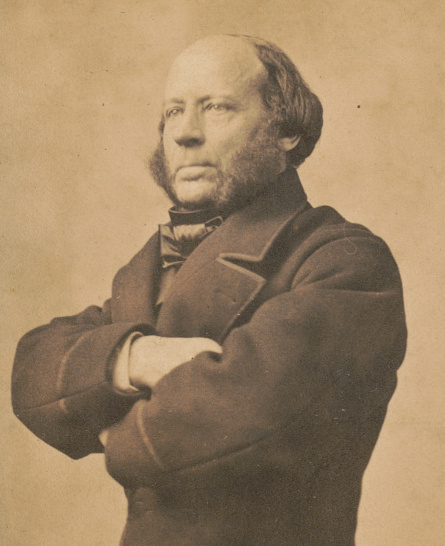
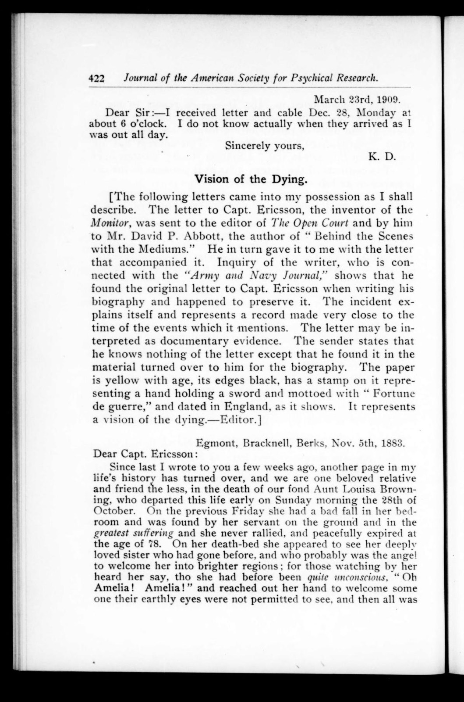
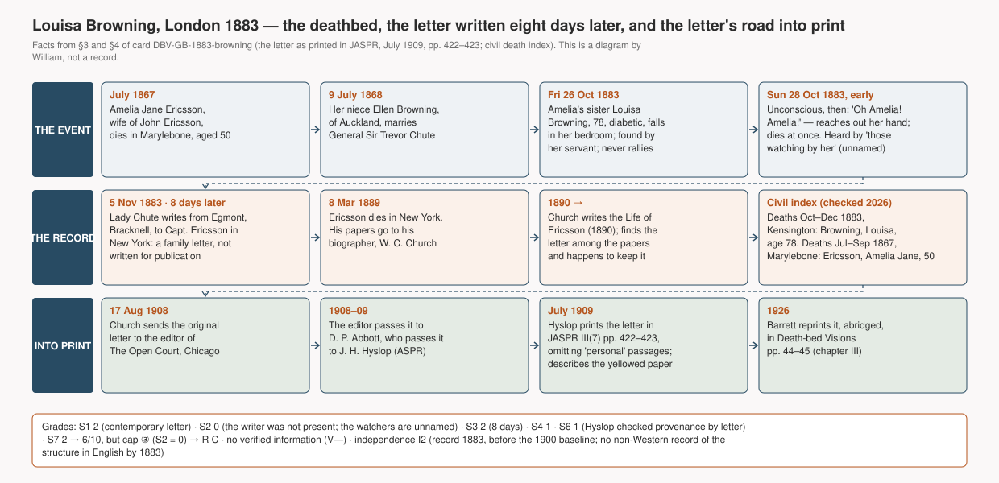

# Louisa Browning calls her sister's name — a woman of seventy-eight, unconscious after a fall, says "Oh Amelia! Amelia!", reaches out her hand and dies; her niece writes it down eight days later (London, 1883)

> Early on Sunday morning, 28 October 1883, an old woman who had been lying unconscious since a fall two days before suddenly said "Oh Amelia! Amelia!", reached out her hand "to welcome some one their earthly eyes were not permitted to see", and died. Amelia was her sister, dead sixteen years. Eight days later her niece put this into a family letter to the sister's widower in New York, the engineer John Ericsson. The letter was never meant for print. It survived because Ericsson was famous.

## What happened

Louisa Browning was seventy-eight and had been "a perfect skeleton from diabetes" for years. On Friday 26 October 1883 she had a bad fall in her bedroom, was found on the floor by her servant "in the greatest suffering", and never rallied. Early on the Sunday she died. The civil death index for the last quarter of 1883 has her: Browning, Louisa, aged 78, registered in the Kensington district of London.

What happened at the bedside is known from one paragraph. Those watching by her heard her, "tho she had before been quite unconscious", say "Oh Amelia! Amelia!"; she reached out her hand "to welcome some one their earthly eyes were not permitted to see, and then all was over." Amelia was her sister, Amelia Jane Ericsson, who had died in Marylebone in July 1867 at the age of fifty.

*Reference · John Ericsson (1803–1889), the Swedish-American engineer who designed the USS Monitor, photographed in New York in the 1860s. He was Amelia's husband and the person the letter was written to; he was not at the deathbed · Charles D. Fredricks & Co., Library of Congress, via Wikimedia Commons · public domain*

Amelia's husband was John Ericsson, the engineer of the Civil War ironclad *Monitor*, who lived in New York. On 5 November 1883, eight days after the death, Louisa's niece Ellen, Lady Chute, wrote to him from her house, Egmont, at Bracknell in Berkshire. Ellen had been born a Browning, "of Auckland", and had married General Sir Trevor Chute in 1868. Her letter is family news: another page of her life "has turned over", the aunt's fall, the servant, the diabetes, the age, and then the paragraph above, with her own gloss that the sister "probably was the angel to welcome her into brighter regions". She signed it "Yours very sincerely, Ellen Chute".

Ericsson kept the letter. When he died in 1889 his papers went to his biographer, William Conant Church, who found the letter while writing the *Life* and "happened to preserve it". In August 1908 Church sent the original to the editor of *The Open Court* in Chicago, who passed it to David P. Abbott, the author of *Behind the Scenes with the Mediums*, who passed it to James H. Hyslop of the American Society for Psychical Research. Hyslop printed it in the Society's *Journal* in July 1909 under the heading "Vision of the Dying", with a note on how it had reached him and a description of the object itself: "The paper is yellow with age, its edges black, has a stamp on it representing a hand holding a sword and mottoed with 'Fortune de guerre', and dated in England, as it shows." He wrote to Church to confirm the provenance, and he said that he had left out "incidents in the letter that have a personal character". Church's covering letter, also printed, identifies the people: Lady Chute was "the wife of General Sir Trevor Chute of the British Service, K.C.B.", Amelia was "the wife of Capt. Ericsson", and "Mrs. John Ericsson died July, 1867."

*Page 422 of the* Journal of the American Society for Psychical Research*, vol. III no. 7, July 1909: Hyslop's note and the first part of the letter of 5 November 1883. The second part and Church's covering letter are on page 423 · scan from the archive.org copy · published in the United States in 1909, public domain*

In 1926 William Barrett reprinted the letter, shortened, in *Death-bed Visions*, and that is where most later readers have met it. Every version in print goes back to the single printed transcript of 1909; the manuscript has not been seen for this card.

*The event, the record and the road into print, drawn from §3 and §4 of this card. A diagram by William, **it is not a record** · generating code `tools/diagrams/DBV-GB-1883-browning.py`*

## How far can this record be trusted

The strength of this case is the date on the letter. It was written eight days after the death by a family member, for a family reader, with no thought of psychical research and no audience to impress. Nothing was collected, interviewed, or rewritten from memory years later. The identities check against the civil registers: a Louisa Browning aged 78 died in Kensington in the last quarter of 1883, and an Amelia Jane Ericsson aged 50 died in Marylebone in the third quarter of 1867, exactly as Church said.

Its weakness is just as plain. Ellen Chute was not in the room. She wrote from Bracknell about an aunt who died in Kensington, and she reports what "those watching by her" heard. She does not name them, and none of them ever wrote anything down. The record is therefore a contemporary document of hearsay from unnamed people who were present. Under this study's scale that puts the witness axis at zero and caps the record at grade **C**, however good the letter is otherwise. What would lift it is a statement from anyone who was at the bedside; none is known.

There is no claim of verified information. Louisa knew perfectly well that her sister had died sixteen years earlier, so the case belongs only to the structural layer of this study: a dying person greeting a dead relative who seems to have come for her. As to independence, the record was made in 1883, before the year from which mass-media exposure is assumed (1900); no investigator shaped it; no English translation of a non-Western deathbed text existed yet; and the idiom is the writer's own Christianity, not an imported doctrine. It is graded **I2**, the first record in this study with that grade. It cannot be counted on its own, because a capped C card does not enter the count, but a second C card of the same quality in the same cluster would fill the Western European slot under the pairing rule of METHOD §8.

Two things about the letter's survival deserve notice. It exists because its recipient was famous: a biographer kept it, and a chain of editors found it striking enough to pass on. That is selection, and it is why the "selective reporting" item below stays open. And the printed text is Hyslop's 1909 transcript with "personal" passages removed; what was removed is unknown.

## Other ways to explain it

- **A dying brain, not a visitor.** Louisa had diabetes "for many years", had suffered a bad fall two days earlier, and had been "quite unconscious". Low or high blood sugar, a head injury, and the opiates a doctor of 1883 would probably have given are each enough to produce a last cry of a beloved name and a reaching gesture. The letter records none of her treatment. This explanation is fully live; the study deducts nothing for it, because a brain state and a visitor look the same from the bedside.
- **The watchers read a vision into two words and a gesture.** All that is recorded is that she said her sister's name and reached out. "Appeared to see" is the household's interpretation, written down by someone who was not there.
- **What a Victorian family expected to see.** Ellen Chute herself supplies the frame: the sister as "the angel to welcome her into brighter regions". The content fits the expectation exactly; only the name and the gesture are Louisa's own.
- **Distortion in the retelling.** Eight days is short, and the letter is the first record; this one is unlikely. But the printed text is an abridgement made in 1909, and the manuscript has not been seen.
- **Invention.** There is no motive: a private condolence letter to a relative abroad, preserved by accident. Nobody checked the watchers, so fraud is "partly" rather than fully ruled out by the rules.

The record is compatible with survival of consciousness and with every ordinary explanation; it contains nothing that could separate them. Its value to the study is as a dated, unprompted, pre-1900 record of the structure in Western Europe, not as evidence of anything beyond the structure.

---

## Investigation ledger

Everything above rests on the sources numbered below. The ledger is this study's working record: the facts with their source numbers (§3–§4), the scores behind the grades (§5), the verified information (§6), the ordinary explanations (§7), the hypotheses the record can and cannot separate (§8), counter-evidence (§9), connections (§10), cultural independence (§11), notes (§12) and the list of materials (§13). Rules in `docs/METHOD.md`.

## 1. One-line summary

Louisa Browning (78), unconscious after a fall, said "Oh Amelia! Amelia!" (her sister, dead since 1867), reached out her hand and died, Kensington, London, early on 28 October 1883. Her niece Ellen, Lady Chute, who was not present, wrote this to the sister's widower John Ericsson from Bracknell on 5 November 1883; the letter was printed by Hyslop in the Journal of the ASPR in July 1909.

## 2. Structure checklist

- [x] Actual death after the vision: died "then all was over", moments after the words [#1].
- [x] The patient sees or converses with a "visitor" (mostly a dead relative) or speaks of getting ready to leave: called her dead sister's name twice and reached out her hand; "appeared to see" is the watchers' reading [#1]. Ticked, with that reservation recorded in §7 M.
- [x] An observer present recorded or testified: "those watching by her heard her say"; their account reached paper through Ellen Chute within eight days [#1]. The observers themselves are unnamed and never testified (§5 S2).
- [ ] A record of lucidity: "had before been quite unconscious"; no medication or physician's record [#1].
- V element: absent — the visitor's death (1867) was known to the patient. Variant "" (plain DBV, S layer only).

## 3. Account

Louisa Browning fell in her bedroom on Friday 26 October 1883, was found on the floor by her servant "in the greatest suffering", "never rallied", and "peacefully expired at the age of 78" early on Sunday 28 October 1883 [#1]. She had been "so weak and helpless, in fact a perfect skeleton from diabetes from which she has suffered for many years" [#1]. The death index records Browning, Louisa, age 78, Kensington registration district, December quarter 1883, vol. 1a p. 11 [#5]. On her deathbed "she appeared to see her deeply loved sister who had gone before"; "those watching by her heard her say, tho she had before been quite unconscious, 'Oh Amelia! Amelia!' and reached out her hand to welcome some one their earthly eyes were not permitted to see, and then all was over" [#1]. The writer adds that the sister "probably was the angel to welcome her into brighter regions" and that Louisa "was quite prepared to go" [#1].

The letter is dated "Egmont, Bracknell, Berks, Nov. 5th, 1883", addressed "Dear Capt. Ericsson", opens "Since last I wrote to you a few weeks ago", refers to an earlier report of the aunt's weakness ("as I before told you"), and is signed "Ellen Chute" [#1]. Hyslop printed it with the statement "I omit incidents in the letter that have a personal character and have no bearing on the incident" [#2].

Amelia, named in the letter, was Amelia Jane Ericsson, wife of John Ericsson, who "died July, 1867" [#3]; the death index records Ericsson, Amelia Jane, age 50, Marylebone, September quarter 1867, vol. 1a p. 376 [#6]. Louisa Browning "was the sister of Amelia" [#3]. Lady Chute "was the wife of General Sir Trevor Chute of the British Service, K.C.B., and one of the Chutes of 'Chute Hall'" [#3]; Trevor Chute (1816–1886) married "Ellen Browning, of Auckland" on 9 July 1868 and died at Binfield, Berkshire, on 12 March 1886 [#7]. John Ericsson (1803–1889) died in New York on 8 March 1889 [#8].

Chain of custody: Church, "connected with the 'Army and Navy Journal'", found the original letter "when writing his biography" of Ericsson "and happened to preserve it"; he "knows nothing of the letter except that he found it in the material turned over to him for the biography" [#2]. On 17 August 1908 he sent it to the editor of *The Open Court*, Chicago [#3]; the editor sent it to David P. Abbott, who gave it to Hyslop "with the letter that accompanied it" [#2]. Hyslop describes the paper as "yellow with age, its edges black", stamped with "a hand holding a sword and mottoed with 'Fortune de guerre'", and "dated in England" [#2]. Printed in the *Journal of the American Society for Psychical Research*, vol. III no. 7, July 1909, pp. 422–423, under "Vision of the Dying" [#2]. Reprinted, abridged (the fall, the diabetes and the gloss omitted), by Barrett in 1926, pp. 44–45 [#4].

## 4. Sources

| # | Type (primary/secondary/tertiary) | Reference | Opened | Link | Notes |
|---|---|---|---|---|---|
| 1 | primary (contemporary private letter) | Ellen Chute, letter to Capt. John Ericsson, "Egmont, Bracknell, Berks, Nov. 5th, 1883" | Confirmed as printed in #2 (the manuscript itself not seen) | see #2 | The editor omitted passages "of a personal character" |
| 2 | secondary (official printing of #1, with the editor's provenance note) | Hyslop JH (ed.). "Vision of the Dying". *Journal of the American Society for Psychical Research* 1909;3(7):422–423 | **Confirmed** (full text and page scans, 2026-10-31) | https://archive.org/details/sim_journal-of-the-american-society-for-psychical-research_1909-07_3_7 | Public domain (US, 1909). Scans of pp. 422–423 in `assets/` |
| 3 | primary (covering letter) | William Conant Church, letter to the editor of *The Open Court*, New York, 17 August 1908, with postscript identifying the persons | Confirmed as printed in #2, p. 423 | see #2 | Church (1836–1917), Ericsson's biographer [#8] |
| 4 | secondary (reprint) | Barrett WF. *Death-bed Visions*. London: Methuen, 1926, pp. 44–45 (chapter III) | **Confirmed** (Wellcome full text; per-page OCR lines of canvases 0060–0061) | https://iiif.wellcomecollection.org/presentation/v2/b29813992 | Abridged; dates the Open Court letter correctly, cites "p. 422" |
| 5 | primary (civil index) | GRO death index, England and Wales, December quarter 1883: Browning, Louisa, 78, Kensington, 1a 11 | **Confirmed** (FreeBMD search, 2026-10-31) | https://www.freebmd.org.uk/cgi/search.pl | Name, age and quarter match #1; district Kensington, not Bracknell |
| 6 | primary (civil index) | GRO death index, September quarter 1867: Ericsson, Amelia Jane, 50, Marylebone, 1a 376 | **Confirmed** (FreeBMD, 2026-10-31) | https://www.freebmd.org.uk/cgi/search.pl | Matches "Mrs. John Ericsson died July, 1867" [#3] |
| 7 | tertiary (lead) | Wikipedia, "Trevor Chute": born Tralee 31 July 1816; K.C.B.; "on 9 July 1868, he married Ellen Browning, of Auckland"; died Binfield 12 March 1886. Wikidata Q7839091 | Confirmed read (API extract, 2026-10-31); underlying sources not opened | https://en.wikipedia.org/wiki/Trevor_Chute | Used only for the marriage and the Browning maiden name |
| 8 | tertiary (dates) | Wikidata: John Ericsson Q435290 (1803-07-31 – 1889-03-08); James H. Hyslop Q1425168 (1854–1920); William Conant Church Q2578310 (1836–1917); Amelia Jane Byam Q104852892 (no dates) | Confirmed (API) | https://www.wikidata.org/wiki/Q435290 | Dates only |
| 9 | secondary | Church WC. *The Life of John Ericsson*. 2 vols. New York: Scribner, 1890 | **Unverified** (not opened; title and date from general bibliography, not checked) | — | Whether the letter is quoted in it is unknown |
| 10 | tertiary (catalogue records) | First English translations of non-Western deathbed texts: *Buddhist Mahâyâna Texts* (Sacred Books of the East XLIX), Oxford 1894 (archive.org `buddhistmahy01cowe`); *The Garuda Purana* (Wood & Subrahmanyam), Allahabad 1911 (`in.ernet.dli.2015.45762`; a 1908 series volume also listed); Evans-Wentz, *The Tibetan Book of the Dead*, 1927 (`the-tibetan-book-of-the-dead_202401`) | Confirmed (archive.org catalogue, 2026-10-31); texts not opened | https://archive.org/advancedsearch.php | Used in §11 route ② only |
| 11 | tertiary | Cobbe FP. "The Peak in Darien", 1882 (opened for the DBV baseline; see [[M-dbv-visitor-unknown-dead]]) | Confirmed earlier (2026-10-25) | https://archive.org/details/peakindarienocta00cobbrich | Within-cluster print of the motif; §7 E, §11 |
| 12 | tertiary (disambiguation) | Wikipedia, "Louisa Browning" — a schoolmistress who died at Haverstock Hill in 1887 | Confirmed read (search result, 2026-10-31) | https://en.wikipedia.org/wiki/Louisa_Browning | **A different person**; not this case |

## 5. Scores and grades

| Axis | Score | Reason in one line |
|---|---|---|
| S1 Source | 2 | A private letter written eight days after the event, preserved and printed as a document (#1, #2); the manuscript's existence and appearance described by the editor |
| S2 Witnesses | 0 | The writer was not present (Bracknell vs. Kensington, #1 #5); the people who were ("those watching by her") are unnamed and never testified → hearsay from unnamed observers |
| S3 Timing | 2 | 28 October → 5 November 1883: eight days |
| S4 Ordinary explanations examined | 1 | F partly ruled out; M, E partly ruled out; D ruled out; X not ruled out (one item) — §7 |
| S5 Prior record (V axis) | — | No V claim |
| S6 Investigator independence | 1 | No investigator at the time of the record; Hyslop (ASPR) verified the provenance by letter in 1908–09 and published, without any inquiry of the witnesses |
| S7 Original text opened | 2 | JASPR 1909 opened in full (text and page scans); Barrett 1926 reprint opened; the manuscript itself not seen |

Total (S1+S2+S3+S4+S6) = 6/10 → would be B / **cap ③ applied (S2 = 0) → R grade C** / V grade V—.

## 6. Verified information (V claim)

None. The visitor's death (July 1867) was known to the patient and to everyone present.

## 7. Other ways to explain it

| Item | Status | Reason |
|---|---|---|
| F Fraud | partly ruled out | No motive: a private condolence letter to a relative abroad, found by chance in the recipient's papers twenty-five years later (#2); no later exposure found (§9). But the watchers were never cross-checked by anyone |
| M Misperception | partly ruled out | Part of the setting is recorded (in bed, early morning, previously "quite unconscious", several people present, #1) but not the lighting, the treatment or who exactly heard what. What was perceived is two words and a gesture; "appeared to see" is an inference |
| D Memory distortion, later embellishment | ruled out | First record within eight days (S3 = 2). Caveat: the printed text is an abridgement of 1909 (#2) and the manuscript has not been seen |
| L Leakage, normal channels | not applicable | No V claim |
| E Cultural expectation, suggestion | partly ruled out | The frame is the writer's own Christian expectation ("the angel to welcome her into brighter regions", #1), in print in English before 1883 (#11); the details — the sister's name twice and the outstretched hand — are the patient's own |
| N Neurophysiology, drugs, psychology | recorded only | Long-standing diabetes, a fall two days before with "greatest suffering", unconsciousness (#1); no record of medication. Hypoglycaemia or hyperglycaemia, head injury and opiates are each sufficient for a terminal utterance of a loved name. No deduction (METHOD §3) |
| C Coincidence, base rate | not applicable | No V claim |
| X Selective reporting, recorder bias | not ruled out | The letter survived because its recipient was famous and was forwarded because its content was striking (#2); no population, no collection criteria |

## 8. Compatible hypotheses

| Hypothesis | Status | Reason |
|---|---|---|
| H1 Survival after death | compatible | Nothing in the record supports it over H4: no verified information |
| H2 Psi without survival | compatible | Nothing to explain by psi |
| H3 Cultural transmission | compatible | The structure matches the writer's own Christian expectation; whether the patient's words were shaped by that expectation cannot be told from two words |
| H4 Neurophysiology, psychology | compatible | Diabetes, a fall, unconsciousness, probable medication (§7 N) |
| H5 Memory distortion, embellishment | **unfavourable** | First record within eight days of the event (S3 = 2) |
| H6 Fraud | compatible | No motive and no exposure, but no cross-checking of the watchers, so the rule for "unfavourable" is not met |
| H7 Chance, base rate | compatible | No V claim; nothing to be a coincidence |
| H8 Investigator effect | **unfavourable** | No investigator existed when the record was made; the only later editing (Hyslop 1909) is declared and concerns "personal" passages |

## 9. Counter-evidence

Search: 2026-10-31 / web search "Louisa Browning" Ericsson Chute 1883 death-bed vision Amelia; archive.org catalogue (Open Court 1889–1908, JASPR 1909); Barrett 1926 ch. III; JASPR 1909 pp. 422–424 / result: no case-specific rebuttal, reply or re-examination found. The only "Louisa Browning" in reference works is a schoolmistress who died in 1887 (#12), another person.

| Source | R grade | Gist | Effect on this card |
|---|---|---|---|
| — | — | No case-specific counter-evidence found (search above) | `counter: none`. The ordinary medical reading (§7 N) comes from the letter itself and is recorded, not deducted |

## 10. Connections

Search: 2026-10-31 / Barrett 1926 ch. III (full OCR), JASPR 1909-07 (full text), FreeBMD, Wikidata, Wikipedia "Trevor Chute" / result below.

| Target `[[id]]` | Relation (R-*) | Verdict | Grade | Reason |
|---|---|---|---|---|
| [[P-Browning-Louisa]] | R-PER | neutral | confirmed | The experiencer; identity confirmed in the death index (#5) |
| [[P-Chute-Ellen]] | R-PER | neutral | confirmed | The recorder; niece of the experiencer; wife of Sir Trevor Chute (#3, #7); not present |
| [[P-Hyslop-JH]] | R-INV | neutral | confirmed | Received the letter in 1908–09, verified provenance by letter, published it (#2). Post-record: no effect on content except declared omissions |
| [[O-ASPR]] | R-INV | neutral | confirmed | Publishing body, 1909 |
| [[P-Barrett-WF]] | R-TXT | neutral | confirmed | Reprinted the letter, abridged, in 1926 (#4). Post-record |
| [[M-dbv-visitor-known-dead]] | R-MOT | undecided | confirmed | First entry of the S-layer motif ledger |
| [[M-dbv-visitor-unknown-dead]] | R-MOT | neutral | confirmed | Sibling motif (the V element). Not present here |
| [[DBV-GB-1924-doris]] | R-MOT | recurrence | inferred | Same cluster, forty-one years later, a different family; the 1883 letter was unpublished until 1909, so it could not have reached the 1924 recorders before the event; any influence would run the other way and does not concern this card |
| John Ericsson (no entity) | R-PER | neutral | confirmed | The recipient; his fame is the reason the letter survived (§7 X) |
| Cobbe 1882 (T- entity not written; see #11) | R-TXT | neutral | confirmed | Within-cluster print of the deathbed-vision motif a year earlier. No evidence that the writer read it; the structure here is the cluster's own Christian expectation, older than any collection. Scored under §7 E, not as a transmission route (METHOD §5, note of 2026-10-31) |

## 11. Cultural independence

Cluster: EU-W / record year 1883 vs baseline year 1900 (CA·DBV, provisional) / investigating body: none at the time of the record; ASPR published in 1909.

| Path | Ruled out / unknown / confirmed | Reason (including transmission links from §10) |
|---|---|---|
| ① Direct contact | ruled out | The experiencer and the watchers: an elderly Englishwoman's household in Kensington (#1, #5). No connection to any record of another cluster in this study. The recorder's New Zealand origin (#7) leaves no trace in the content, which is the household's own Christian idiom |
| ② Translation, publication | ruled out | No record of this structure from another cluster was accessible in English at the time: the first English translations of the principal non-Western deathbed texts postdate the record (1894, 1908–1911, 1927; #10). Within-cluster print (Christian deathbed literature; Cobbe 1882, #11) is the cluster's own tradition and is scored under §7 E and H3 |
| ③ Missionary, religious transmission | ruled out | The idiom is the writer's own Christianity; no outside doctrine |
| ④ Mass media | ruled out | Record year 1883 is before the baseline year 1900: automatically ruled out |
| ⑤ Same investigating body | ruled out | No investigating body produced the record; the ASPR received it twenty-six years later and printed it with declared omissions only |

→ Independence grade: **I2**. First I2 record in this study. Note the limit: I2 says only that the structure was not borrowed from another cluster; the record's own quality is C (cap ③), so it does not enter the S-layer count alone (`countable: no`). Two C cards with S7 = 2 and I2 in the same cluster may be converted into one B (METHOD §8); this card is the first half of such a pair for EU-W.

## 12. Notes

- **Where was Ellen Chute?** She wrote from Bracknell; the death was registered in Kensington (#5), and the aunt was found "by her servant". She is therefore taken as not present. If a statement from any of the watchers were found, S2 would rise to 1 or 2 and the cap would lift (R would be B). None is known.
- **Identity of Louisa Browning.** Age 78 and the December quarter 1883 match the letter exactly (#5). Whether "Browning" was her maiden or married name is unknown; Amelia's Wikidata entry gives the surname Byam (#8, no dates), which would make Louisa a married Browning, and Ellen Browning (#7) a relative of her husband. Not pursued.
- **The manuscript.** Last known with Hyslop (ASPR, 1909). Whether it is in the ASPR's archives, or whether *The Open Court* ever printed it, was not searched. Church's biography (#9) not opened.
- **Hyslop's omissions.** The printed text leaves out "personal" passages. Nothing suggests they concerned the vision, but the omission is a fact about the source.
- **Names.** All persons died in the nineteenth or early twentieth century (#5, #6, #7, #8) and are named. Lady Chute's own death date is unverified, but she was married in 1868. The watchers and the servant are unnamed in the record.
- **Not a Barrett-collected case.** Barrett only reprinted it; the record's provenance is independent of the SPR. This is why it was chosen as the first S-layer DBV card outside the SPR's own collecting (NEXT_STEPS, session 7).
- **Other pre-1900 cases in Barrett ch. III checked and not carded**: De Morgan 1863 (*From Matter to Spirit*, pp. 184–185, archive.org `frommattertospir00demorich`, opened): "John L—" sees his grandmother "with such a great company", told to the narrator by the mother, undated, anonymous → D. *Atlantic Monthly*, March 1879, "Ghost Stories", p. 289 (archive.org `sim_atlantic_1879-03_43_257`, opened): "Mrs. G—", daughters Minnie and Ada, smallpox; anonymous literary anecdote → D. Both recorded in [[M-dbv-visitor-known-dead]] as existence evidence only.

## 13. Materials

| File | Kind | What | Source · licence |
|---|---|---|---|
| `DBV-GB-1883-browning--jaspr-1909-p422.jpg` | ① record copy | JASPR vol. III no. 7 (July 1909) p. 422: heading "Vision of the Dying", Hyslop's provenance note, first part of the letter | archive.org `sim_journal-of-the-american-society-for-psychical-research_1909-07_3_7`, leaf 49 · public domain (US 1909) |
| `DBV-GB-1883-browning--jaspr-1909-p423.jpg` | ① record copy | p. 423: end of the letter, Hyslop's omission note, Church's covering letter of 17 August 1908 with postscript | same, leaf 50 · public domain |
| `DBV-GB-1883-browning--chain.svg` · `--chain-ko.svg` | ④ diagram | Event, record and road into print, 1867–1926, with the grades. Not a record | William · code `tools/diagrams/DBV-GB-1883-browning.py` |
| `DBV-GB-1883-browning--john-ericsson-1860s.jpg` | ③ person (reference) | John Ericsson, 1860s, New York. The recipient of the letter; not a witness | Charles D. Fredricks & Co., Library of Congress LCCN 2016646196, via Wikimedia Commons · public domain |

- Not included: a portrait of Sir Trevor Chute (Te Papa, on Commons) — not a party to the record; no portrait of Louisa Browning or Ellen Chute found (Commons search "Trevor Chute", 2026-10-31); Barrett 1926 pp. 44–45 (Wellcome, view-only statement) — linked only; the manuscript letter — not seen.
- Newspaper and archive search: not made. A London death notice of October 1883 would be in the paid British Newspaper Archive; the free archives that block bots are listed in NEXT_STEPS → **unverified**.
- To look for next: the ASPR archive for the manuscript; *The Open Court* 1908–09 for a printing; Church 1890 for a quotation; any Chute family papers (Chute Hall, Co. Kerry; "Egmont", Bracknell).
