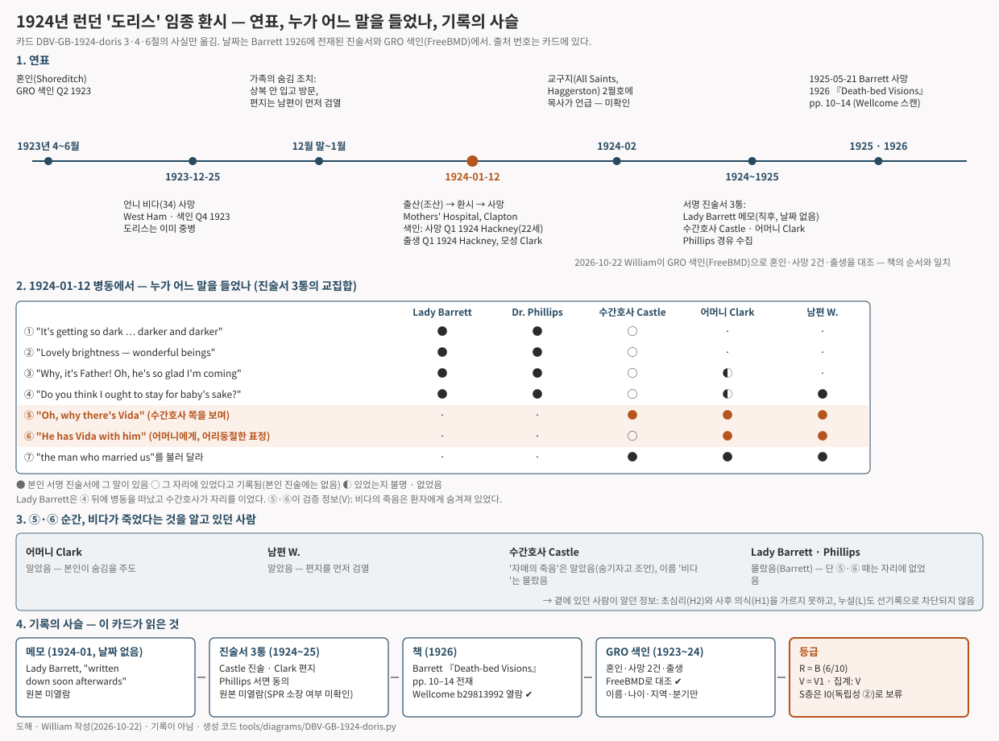

# Doris sees Vida — a dying mother at the Mothers' Hospital, Clapton, sees her father and the sister whose death had been kept from her (London, 1924)

> January 1924, a maternity hospital in north-east London. A twenty-two-year-old mother, dying after giving birth, looked towards one part of the ward and said, "Why, it's Father!" A little later, with a puzzled expression, she added, "He has Vida with him." Her sister Vida had died eighteen days earlier. The family had kept that death from her to the end.

## What happened

Doris was twenty-two. She had married in 1923, less than a year before, and in January 1924 she gave birth at the Mothers' Hospital in Clapton, a maternity hospital run by the Salvation Army. The baby came early but safely. The mother did not. Serious heart failure set in during labour, and the doctors knew she could not be saved.

*The front buildings of the Mothers' Hospital on Lower Clapton Road, London, in 2018. A house built in 1824 served as the hospital's frontage; the wards stood behind it. The hospital closed in 1986 and the site is now housing. This is not a photograph from 1924 · Paul the Archivist, Wikimedia Commons · CC BY-SA 4.0*

One of the hospital's obstetric surgeons was Florence Barrett, known then as Lady Barrett. The Resident Medical Officer, Dr Phillips, sent an urgent message asking her to come. After seeing other patients she went back to the ward, and what she heard there she wrote down "soon afterwards". That note is the first record of the case.

According to the note, Doris first held out her hands and thanked her for bringing the baby, and asked whether it was a boy or a girl. Then, looking up towards the brightly lit open part of the ward, she said, "Oh, don't let it get dark—it's getting so dark . . . darker and darker." Her husband and mother were sent for. Suddenly Doris looked eagerly towards one part of the room and smiled. "Oh, lovely, lovely." Asked what was lovely, she answered in a low, intense voice, "Lovely brightness—wonderful beings." Then, almost with a joyous cry: "Why, it's Father! Oh, he's so glad I'm coming; he is so glad." Her baby was brought for her to see. She looked at it and asked, "Do you think I ought to stay for baby's sake?" Then she turned back towards the vision. "I can't—I can't stay; if you could see what I do, you would know I can't stay." To her husband, who had come in, she said, "You won't let baby go to anyone who won't love him, will you?" Then she gently pushed him to one side: "Let me see the lovely brightness."

*Lady Florence Barrett (1867–1945), the first recorder and a witness. She was an obstetric surgeon at the hospital at the time. Date of photograph unknown · Wellcome Collection L0004411, Wikimedia Commons · CC BY 4.0*

Lady Barrett left shortly after. From then on the Matron, Miriam Castle, kept watch at the bedside with the mother and the husband. In the Matron's account, the husband was leaning over Doris and speaking to her when she pushed him aside and said, "Oh, don't hide it; it's so beautiful." Then she turned away from him towards the Matron on the other side of the bed and said, "Oh, why there's Vida." The mother described the same moments in a letter. Doris saw her father and said, "I can see Father; he wants me, he is so lonely." She looked at the same spot again and said, "with rather a puzzled expression", "He has Vida with him," and then, turning to her mother, "Vida is with him."

Vida was Doris's elder sister. She was thirty-four and had been an invalid for some years. She died on 25 December 1923 in West Ham, in east London. Doris was already in hospital and very ill. The Matron thought it unwise for her to be told of her sister's death, and the family followed that advice. They put off their mourning and visited in ordinary clothes. In case a friend outside should mention the bereavement in a letter, every letter was held back until the husband had seen who it was from. That is why the mother was startled when Doris said "Vida". Afterwards Doris asked, with great difficulty, to see "the man who married us". He was sent for, but by the time he arrived she could no longer speak. She lived for about another hour. To the last she seemed aware both of the bright forms she saw and of the people at her bedside: she arranged with the Matron that her premature baby should stay in hospital until it was strong enough to be cared for at home.

*The north-east of George Washington Bacon's 1920 pocket map of London. ① The Mothers' Hospital on Lower Clapton Road, Clapton, where Doris gave birth and died ② West Ham, where her sister Vida died eighteen days earlier ③ Haggerston, with All Saints church, where Doris married in 1923 ④ Highbury, from where her mother wrote her letter. The numbered markers were added by William and show approximate positions · George Washington Bacon, 1920 · Geographicus, Wikimedia Commons · Public domain*

There is a reason this story became a book. Lady Barrett's husband was Sir William Barrett, a physicist and one of the founders of the Society for Psychical Research in 1882. For years he had been collecting cases in which the dying appeared to see people they did not know to be dead. When he heard his wife's account he asked Dr Phillips in writing whether she agreed with the notes, and he obtained the Matron's signed statement and the mother's letter. Barrett died in May 1925. The case appeared the following year as the first case in chapter II of his posthumous book *Death-bed Visions*.

*Sir William F. Barrett (1844–1925), who collected the case and published it. Portrait from a 1907 publication · James Creelman, Wikimedia Commons · Public domain*

I looked for anything outside the book that could confirm the story. The civil registration indexes of births, marriages and deaths for England and Wales are free to search. They contain a Vida M. Clark, aged 34, whose death was registered in West Ham in the last quarter of 1923. A Doris G. Bargery, aged 22, whose death was registered in Hackney in the first quarter of 1924. A girl surnamed Bargery, mother's maiden name Clark, born in Hackney in the same quarter. And the marriage of Doris G. Clark and Stanley Bargery, registered in Shoreditch in the second quarter of 1923. The order of the two deaths, the two ages, the places of the marriage and of the birth all match the book. But an index gives only names, ages and places. It says nothing about a vision.

*Diagram · The timeline from the marriage to the book, who heard which words, who knew of Vida's death, and the chain of records. Drawn by William from sections 3, 4 and 6 of the ledger below; **it is not a record** · generating code `tools/diagrams/DBV-GB-1924-doris.py`*

## How far can this record be trusted

This study does not ask whether an event is astonishing. It asks how good the record is. By that measure this case is fairly good. Four people wrote separately: a doctor's note made soon after the event, another doctor's written agreement, the Matron's signed statement, and the mother's letter. The case was in print within two years. The official indexes confirm that these people existed and that the sisters died in the order the book gives. On this study's scale for the quality of a record, A to D, it is a **B**.

The key question is a single one. Did Doris's words contain a fact she could not have known? They did: that her sister was dead. So the case counts as one with "verified information". But it does not reach the top grade, for two reasons. First, at the moment Doris said "Vida", people who knew what that meant were standing beside her. The mother, the husband and the Matron all knew of the sister's death. The words were not written down in a dated document and then checked; they were written afterwards, by people who already understood them. Second, the sister had been ill for years, and nobody asked whether Doris might simply have guessed. So the verification grade is **V1**, the middle of three.

One more thing needs saying. The first recorder was Barrett's wife. Barrett had already written about this kind of case in a 1917 book, and the pattern "the dying see someone they did not know had died" had circulated in English psychical research since 1882. What this study is trying to count is whether the same story arose separately in cultures that had no contact with each other. In that count this case cannot stand as the British sample, because the recording household already knew the pattern. The British sample has to come from records outside the Society for Psychical Research. So the independence grade is **I0**. The case goes into the count of verified information, not into the count of independent occurrence.

I found no published criticism aimed at this particular case. That does not mean fraud is "ruled out". The absence of an exposure is not the same as a check by an investigator with no stake in the result.

## Other ways to explain it

- **Memory may have been tidied.** Lady Barrett's note was made "soon afterwards" but carries no date. The Matron and the mother wrote after they knew what the words meant, and at Barrett's request. Small differences between the statements remain on the page: the sister died "three weeks" before, or "2 weeks and 4 days"; the baby is "him" in the note but a girl in the birth index; the husband is "W." in the book and "Stanley" in the marriage index.
- **Someone may have told her.** The family's concealment is recorded in detail. But nobody investigated which members of the hospital staff knew, or who had been near the patient.
- **It may be chance.** Dying people often say they see family who went before. The sister had been ill for a long time.
- **It may be a chosen story.** Barrett collected cases that supported survival after death and published them without saying how he chose. The first reporter was his wife.
- **It may be the work of a dying brain.** Heart failure after childbirth, lack of oxygen. A bright light and the faces of family can be explained that way. The detail of the sister cannot be explained by that alone.

So this record is **compatible** with the hypothesis that consciousness continues after death. It cannot leave that hypothesis standing alone. A case in which the dying person states a fact known to those at the bedside never can. A death kept secret is usually a death the family knows.

---

## Investigation ledger

Everything above rests on the sources numbered below. The ledger is this study's working record: the facts with their source numbers (§3–§4), the scores behind the grades (§5), the verified information (§6), the ordinary explanations (§7), the hypotheses the record can and cannot separate (§8), counter-evidence (§9), connections to people, places and motifs (§10), cultural independence (§11), notes (§12) and the list of materials (§13). The scoring rules are in `docs/METHOD.md`.

## 1. One-line summary

On 12 January 1924, at the Mothers' Hospital, Clapton, London, Doris ("Mrs. B." in the book), a 22-year-old mother dying of heart failure after a premature delivery, said that her father had come and then, puzzled, that "He has Vida with him". Her sister Vida had died 18 days earlier and the family had carefully kept it from her. The obstetric surgeon Lady Barrett (notes), the Resident Medical Officer Dr Phillips (written agreement), the Matron Miriam Castle (signed statement) and the mother Mary C. Clark (letter) each recorded it, and William Barrett reprinted them in his 1926 book. The England and Wales civil registration indexes (GRO) confirm the order of the sisters' deaths, the birth and the marriage.

## 2. Structure checklist

- [x] Required 1: actual death after the vision — during and just after the vision; "She lived for another hour" after Lady Barrett left [#1 p.11]. Died 1924-01-12 [#4 p.12]. GRO death index 1924 Q1 Hackney, age 22 [#6]
- [x] Required 2: a visitor — her dead father ("Why, it's Father! Oh, he's so glad I'm coming"), her dead sister Vida, "wonderful beings". She addressed her father: "I am coming" [#1 p.10, #3 p.12, #4 p.13]
- [x] Required 3: recorded by observers who were present — two doctors (Lady Barrett's notes, Phillips's agreement), the Matron's statement, the mother's letter [#1–#4]
- [x] Optional: lucidity — "retained to the last the double consciousness": asked the baby's sex, arranged the premature baby's care with the Matron, asked for the clergyman who had married them [#1 p.11, #4 p.13]. No assessment of drugs or delirium. The "restorative measures" are not described [#1 p.10]
- V element: **present** — Vida was a person the patient **did not know to be dead** (deliberately concealed by the family and the Matron) → **DBV-V**. Nothing was seen jointly by a third party at the bedside (not DBV-S)

→ Structural requirements for the S layer are met and the case is eligible for the V layer. But independence (§11) is I0, so `countable: V` (the S-layer count is withheld; reasons in §11–§12).

## 3. Account

Barrett introduces the case as "a recent case of the kind … related to me by Lady Barrett". Lady Barrett (Florence E. Barrett) was one of the obstetric surgeons of the Mothers' Hospital, Clapton. She received an urgent message from the Resident Medical Officer, Dr Phillips, to come to "Mrs. B.", who was in labour and suffering from serious heart failure. The child was delivered safely, but the mother was dying. After seeing other patients Lady Barrett went back to the ward, and the conversation that followed "was written down, soon afterwards" [#1 p.10].

Lady Barrett's notes [#1 pp.10–11]: the patient held out her hands and said, "Thank you, thank you for what you have done for me—for bringing the baby. Is it a boy or girl?" Holding Lady Barrett's hand tightly, she said, "Don't leave me, don't go away, will you?" While the House Surgeon carried out "some restorative measures", she lay looking up towards the open, brightly lit part of the room and said, "Oh, don't let it get dark—it's getting so dark . . . darker and darker." Her husband and mother were sent for. Suddenly she looked eagerly towards one part of the room, "a radiant smile illuminating her whole countenance", and said, "Oh, lovely, lovely." Asked what was lovely: "What I see", "in low, intense tones"; asked what she saw: "Lovely brightness—wonderful beings." Then, focusing on one place, "almost with a kind of joyous cry": "Why, it's Father! Oh, he's so glad I'm coming; he is so glad. It would be perfect if only W. (her husband) could come too." Her baby was brought; she looked at it with interest and said, "Do you think I ought to stay for baby's sake?" Turning to the vision again: "I can't—I can't stay; if you could see what I do, you would know I can't stay." To her husband, who had come in: "You won't let baby go to anyone who won't love him, will you?" Then she gently pushed him aside: "Let me see the lovely brightness." Lady Barrett left shortly after and the Matron took her place. The patient "lived for another hour, and appeared to have retained to the last the double consciousness of the bright forms she saw, and also of those tending her at the bedside": she arranged with the Matron that her premature baby should remain in hospital until strong enough to be cared for in an ordinary household. (Signed) Florence E. Barrett.

Dr Phillips, "who was present", read the notes and wrote to Barrett that she "fully agrees with Lady Barrett's account" [#2 p.11]. Barrett states that Lady Barrett and Dr Phillips knew nothing of the death of the patient's father, and that the husband was not present when "Father" was spoken [#5 p.14].

The Matron Miriam Castle's statement [#3 pp.11–12]: "I was present shortly before the death of Mrs. B., together with her husband and her mother. Her husband was leaning over her and speaking to her, when pushing him aside she said, 'Oh, don't hide it; it's so beautiful.'" (Barrett's footnote: not the incident Lady Barrett recorded, but "a later incident of the same kind".) "Then turning away from him towards me, I being on the other side of the bed, Mrs. B. said, 'Oh, why there's Vida,' referring to a sister of whose death three weeks previously she had not been told. Afterwards the mother, who was present at the time, told me … that Vida was the name of a dead sister of Mrs. B.'s, of whose illness and death she was quite ignorant, as they had carefully kept this news from Mrs. B. owing to her serious illness." (Signed) Miriam Castle, Matron.

Barrett asked Dr Phillips to obtain "the independent report of Mrs. B.'s mother" and received a letter from Mrs Mary C. Clark, Highbury, N.5 [#4 pp.12–13]: her daughter died on 12 January 1924. "The wonderful part of it" is the death of her daughter Vida, "who had been an invalid some years", on 25 December 1923, "just 2 weeks and 4 days before her younger sister, Doris, died." Doris was very ill at the time and the Matron of the Mothers' Hospital "deemed it unwise" for her to know of her sister's death. So when visiting, "we put off our mourning and visited her as usual"; all her letters were kept until her husband had seen who they were from, "lest outside friends might possibly allude to the recent bereavement". When Doris was "sinking rapidly", she first said, "It is all so dark; I cannot see." A few seconds later "a beautiful radiance lit up her countenance; I know now it was the light of Heaven". "Oh, it is lovely and bright; you cannot see as I can." She fixed her eyes on one spot in the ward and said, "Oh, God, forgive me for anything I have done wrong," and then, "I can see Father; he wants me, he is so lonely." She spoke to her father, "I am coming," turning to her mother: "Oh, he is so near." Looking at the same place again, **"with rather a puzzled expression", "He has Vida with him"**, and to her mother, "Vida is with him." Then: "You do want me, Dad; I am coming." After that, "nothing very definite or clear". With great difficulty she asked to see "the man who married us", whose name she could not say: the Rev. Maurice Davis of All Saints, Haggerston, E. He was sent for; Barrett's footnote says he came but she "had then become incapable of speech". He had known Doris for some years and, impressed by the vision, "quoted it in his 'Parish Magazine' for February last". (Signed) Mary C. Clark.

Barrett's commentary [#5 pp.13–14]: the vision was not normal sight (others would have seen the figures), and not an illusion, since nothing in the room could suggest one and she recognised both her dead father and her sister while unaware of the latter's death. It is a hallucination; the question is whether a "delusive" or a "veridical" one. "If this case stood alone", chance coincidence "would be the probable explanation". Telepathy from those around the bedside "fails", he writes, because Lady Barrett and Dr Phillips knew nothing of the father's death and the husband was not present. (That rebuttal applies only to the "Father" utterance. Vida's death was known to the mother, the husband and the Matron, all at the bedside. See §7 L and §8 H2.)

Check against official indexes [#6 #7]: in the England and Wales GRO indexes (via FreeBMD), the death index for 1923 Q4, West Ham, has Clark, Vida M., age 34 (4a 314); for 1924 Q1, Hackney, Bargery, Doris G., age 22 (1b 576); the birth index for 1924 Q1, Hackney, has Bargery, D. O. (a girl's name), mother's maiden name Clark (1b 660); the marriage index for 1923 Q2, Shoreditch, has Clark, Doris G. — Bargery, Stanley (1c 82). All of this matches the book: the elder sister died first; the younger was 22, married, wed in a Haggerston church (Shoreditch registration district), and gave birth and died in Hackney (the hospital's district) in January 1924. The indexes give only names, ages, districts and quarters; they say nothing about dates, causes of death or the vision. "Mrs. B." fits the surname Bargery, but the husband's initial "W." does not fit the groom's name Stanley in the index (§12). The narrative follows the book's usage.

Record history: ① Lady Barrett's notes (soon after the event, undated) → ② Phillips's written agreement, the Matron's statement, the mother's letter (obtained by Barrett through Phillips; the letter postdates February 1924, "February last", and predates Barrett's death on 21 May 1925) → ③ published in 1926 as the first case of chapter II of *Death-bed Visions* (posthumous). The February 1924 parish magazine is unverified. The whereabouts of the original notes and statements are unverified (SPR archive holdings not checked).

## 4. Sources

| # | Type (primary/secondary/tertiary) | Reference | Opened | Link | Notes |
|---|---|---|---|---|---|
| 1 | Primary (witness's own notes, signed, reprinted in the book) | Florence E. Barrett (Lady Barrett), notes "written down soon afterwards" — Barrett 1926 pp.10–11 | Confirmed (Wellcome full-text OCR + page images) | https://iiif.wellcomecollection.org/image/b29813992_0026.jp2/full/900,/0/default.jpg (p.10), `_0027` (p.11) | Original and date unverified |
| 2 | Primary (written agreement) | Dr Phillips (Resident Medical Officer), read the notes and "fully agrees" — p.11 | Confirmed | `_0027` above | No account of her own |
| 3 | Primary (witness statement, signed) | Miriam Castle (Matron), statement — pp.11–12 | Confirmed (p.12 image compared by eye) | `_0028` (p.12) | "three weeks" (actually 18 days) |
| 4 | Primary (witness letter, signed) | Mary C. Clark (mother, Highbury N.5), letter — pp.12–13 | Confirmed | `_0028`, `_0029` (p.13) | Written after Feb 1924 |
| 5 | Secondary (investigator's collection and commentary) | Barrett WF. *Death-bed Visions*. London, 1926 (posthumous), ch. II "Visions seen by the dying of persons by them unknown to be dead", pp.10–14 | Confirmed (Wellcome Collection b29813992, full-text API + IIIF page images pp.10–14) | https://iiif.wellcomecollection.org/presentation/v2/b29813992 · full text https://api.wellcomecollection.org/text/v1/b29813992 | Publisher unverified. Wellcome metadata marks the scan in copyright (viewing only), so no page copies are included |
| 6 | Primary (official index) | GRO England and Wales death index: Clark, Vida M., 34, West Ham, 1923 Q4, 4a/314 · Bargery, Doris G., 22, Hackney, 1924 Q1, 1b/576 | Confirmed (FreeBMD search 2026-10-22) | https://www.freebmd.org.uk/ | Index gives only name, age, district, quarter |
| 7 | Primary (official index) | GRO birth index: Bargery, D. O. (girl's name), mother's maiden name Clark, Hackney, 1924 Q1, 1b/660 · marriage index: Clark, Doris G. — Bargery, Stanley, Shoreditch, 1923 Q2, 1c/82 | Confirmed (FreeBMD) | Same | Baby in the birth index is a girl — conflicts with "him" in the notes; groom Stanley — conflicts with "W." in the book (§12) |
| 8 | Primary (contemporary parish magazine) | All Saints, Haggerston, Parish Magazine, February 1924 (Rev. Maurice Davis) | **Unverified** (no digital copy; London Metropolitan Archives holdings not checked) | — | If opened, revisit S3 and S5 |
| 9 | Tertiary (hospital history) | Lost Hospitals of London, "Mothers' Hospital" | Confirmed | https://ezitis.myzen.co.uk/mothers.html | 1913–1986, 153–156 Lower Clapton Rd |
| 10 | Tertiary (search for leads and rebuttals) | Psi Encyclopedia (SPR), "Deathbed Visions" (Haraldsson) | Confirmed (2026-10-22) | https://psi-encyclopedia.spr.ac.uk/ | No rebuttal specific to this case |
| 11 | Secondary (later overview) | Greyson B. "Seeing dead people not known to have died: 'Peak in Darien' experiences". *Anthropology and Humanism* 2010;35(2) | **Unverified** (no free copy; reference itself unverified) | — | Not used in the argument |

## 5. Scores and grades

| Axis | Score | Reason in one line |
|---|---|---|
| S1 Source | 1 | Contemporary notes, statement and letter from four witnesses exist, but were opened **only as reprinted in the investigator's book**. Originals and dates unverified. The official indexes (#6 #7) confirm only the existence and order of the deaths, birth and marriage |
| S2 Witnesses | 2 | Four identified witnesses, three of whom gave separately signed statements (Lady Barrett, Castle, Clark) + Phillips's written agreement. The Vida utterance was recorded separately by Castle and Clark |
| S3 Timing | 1 | The first record (Lady Barrett's notes) is "soon afterwards" but undated. The earliest datable records are Barrett's manuscript (before his death 1925-05-21 = within 16 months) and the mother's letter (after 1924-02) → within 2 years |
| S4 Ordinary explanations examined | 1 | §7: F partly ruled out; M, D, E partly ruled out; X not ruled out (1 item) |
| S5 Prior record (V axis) | 1 | The Matron heard the Vida utterance without knowing what it meant (third party, oral) and later signed a separate statement. No dated document before verification (parish magazine unverified) |
| S6 Investigator independence | 1 | The investigator Barrett was a founder of the SPR, a proponent of the survival hypothesis, and the husband of the first witness. Written collection through Phillips only; no face-to-face interviews |
| S7 Original text opened | 2 | Full OCR of the 1926 book + images of the relevant pages; indexes searched directly |

Total (S1+S2+S3+S4+S6) = 6/10 → R grade **B** / cap applied: none (③ not applicable; ④ F partly ruled out; ⑤ counter-evidence searched) / V grade **V1** (S5=1; F, L, C all partly ruled out; R≥C). Not V2 because there is no dated document before verification and L and C are not fully ruled out.

## 6. Verified information (V claim)

| Information | Who said it | When and where recorded | When and by whom verified | Normal channels investigated | Who alive at the time knew it |
|---|---|---|---|---|---|
| Her sister Vida is "with Father" (= dead) — the patient did not know of Vida's decline or death | Doris → Matron (⑤ "Oh, why there's Vida"), mother (⑥ "He has Vida with him", puzzled expression) | Matron's statement, mother's letter (1924–25); book 1926 | Mother already knew at the moment it was said. Matron confirmed the name with the mother afterwards | The family's concealment is recorded (mourning put off, letters screened). Staff channels and the patient's possible guessing were not asked about by anyone. No prior record to block them | Mother, husband, Matron (the death); all relatives |
| (Not V) Father has come | Doris → Lady Barrett and Phillips (③), mother | Notes, letter | — | The patient herself knew her father was dead | — |

One item of verified information, and it was known to those at the bedside → it cannot separate H2 (psi without survival) from H1 (survival). Barrett's "telepathy ruled out" applies only to the Father utterance, which is not V.

## 7. Other ways to explain it

| Item | Status | Reason |
|---|---|---|
| F Fraud | Partly ruled out | No motive of money or fame (patient anonymous; witnesses a doctor, a Matron, bereaved relatives); no later exposure (§9 search); three separate signatures; official indexes confirm the order of deaths, the birth and the marriage. But the person who cross-checked was the first witness's husband and a survival proponent → no "cross-check by an independent investigator" |
| M Misperception | Partly ruled out | Brightly lit open ward, witnesses on both sides of the bed, patient conversing clearly. The Vida utterance was heard separately by two people, twice (⑤·⑥). Drugs and the "restorative measures" are not recorded |
| D Memory distortion, later embellishment | Partly ruled out | Notes "soon afterwards" but undated. The Matron's and mother's statements were written on request after the meaning was known (within 2 years). Differences between statements are small and preserved: "three weeks" vs "2 weeks and 4 days"; baby "him" (notes) vs girl's name in the index; husband "W." (book) vs Stanley in the index |
| L Leakage, normal channels | Partly ruled out | Concealment measures recorded in detail (mourning, screened letters); the mother noted the "puzzled" expression. But ① the Matron herself knew of the sister's death and other staff channels were not investigated ② Vida had been an invalid for years, so the possibility that the patient guessed "she may have died" was not investigated ③ no prior record |
| E Cultural expectation, suggestion | Partly ruled out | Consistent with the expectations of a 1924 English Anglican household (dead relatives, the light of Heaven, "God forgive me"), and the mother's letter is itself a religious reading. But the appearance of a sister not known to be dead, and the puzzled reaction, are not details expectation produces |
| N Neurophysiology, drugs, psychology | (recorded only) | Postpartum heart failure, terminal hypoxia, treatment unknown. "Double consciousness" and coherent conversation recorded. No S-layer deduction. V is decided by L and C |
| C Coincidence, base rate | Partly ruled out | One specific item (a named sister, dead 18 days), no prior record. Naming family members in a deathbed vision is common and the sister had been an invalid for years, so there is little ground to put the chance probability low |
| X Selective reporting, recorder bias | Not ruled out | Barrett collected cases supporting survival for a book, with no stated selection criteria. The first reporter was his wife. The mother's letter opens "I have heard you are interested" — written knowing its significance. The 1926 edition is posthumous and its editor unknown |

## 8. Compatible hypotheses

| Hypothesis | Status | Reason |
|---|---|---|
| H1 Survival after death | Compatible | V1. The information (Vida's death) was known to the mother, husband and Matron at the bedside |
| H2 Psi without survival | Compatible | Same. Barrett's telepathy rebuttal covers only the Father utterance, which is not V |
| H3 Cultural transmission | Compatible | Record 1926 > baseline 1900. The recorder belonged to the household that published the motif (§11 ②) |
| H4 Neurophysiology, psychology | Compatible | The form of a deathbed vision (light, relatives) is compatible. The Vida detail is not explained by H4 alone; L and C decide |
| H5 Memory distortion, embellishment | Compatible | No dated prior record. Statements written after the meaning was known |
| H6 Fraud | Compatible | No motive or exposure, but no cross-check by an independent investigator → "unfavourable" condition not met |
| H7 Chance, base rate | Compatible | Invalid sister, no prior record |
| H8 Investigator effect | Compatible | One investigating body (Barrett/SPR), related by marriage to a witness. Positive factor: three written statements were made separately and their small differences survive |

## 9. Counter-evidence

Search: 2026-10-22 / web searches "Barrett 1926 Death-bed Visions Doris Vida sceptical", "Lady Barrett Mothers' Hospital deathbed vision critique"; Psi Encyclopedia "Deathbed Visions" (#10) / Result: **no rebuttal specific to this case.** General criticisms of deathbed visions (hypoxia, drugs, delirium, expectation) exist and are handled under N and E. `counter: none`.

| Source | R grade | Gist | Effect on this card |
|---|---|---|---|
| (no case-specific rebuttal) | — | — | F is not raised to "ruled out" — the absence of an exposure is not the presence of a cross-check |
| Barrett 1926 pp.13–14 (#5, the author's own review) | — | Considers illusion, hallucination, chance and telepathy in turn; rules out telepathy because "Lady Barrett and Dr. Phillips knew nothing" | Holds only for the Father utterance. Corrected in §7 L and §8 H2 |

## 10. Connections

Search: 2026-10-22 / text and contents of source #5, hospital history (#9), Wikidata and Wellcome person records / Result: below

| Target `[[id]]` | Relation (R-*) | Verdict | Grade | Reason |
|---|---|---|---|---|
| [[P-Barrett-WF]] | R-INV | Neutral | Confirmed | Collector and publisher. SPR founder (1882). If other cases from the same book are carded, path ⑤ (same investigating body) applies to them |
| [[P-Barrett-Florence]] | R-PER | Neutral | Confirmed | First recorder and witness, obstetric surgeon at the hospital, the investigator's wife |
| [[L-Mothers-Hospital-Clapton]] | R-LOC | Neutral | Confirmed | Scene of the event. Salvation Army maternity hospital, 1913–1986 |
| [[M-dbv-visitor-unknown-dead]] | R-MOT | Undecided | Confirmed | First entry in the motif ledger ("Peak in Darien" type) |
| DBV-US-1889-jennie-edith (not yet written) | R-TXT / R-INV | Transmission (collection) | Confirmed (#5 pp.14–16 reprint) | The case Barrett prints immediately after this one (Savage → Hyslop → Barrett). If carded: same investigating body and same cluster as this card |
| T-Cobbe-1882-peak-in-darien (not yet written) | R-TXT | Transmission (term) | Unverified | Origin of the term "Peak in Darien" (Cobbe 1882). Barrett's chapter II title follows that definition. Original not opened |

## 11. Cultural independence

Cluster: EU-W / record year 1926 vs baseline year for DBV 1900 → after / investigating body: P-Barrett-WF (SPR)

| Path | Ruled out / unknown / confirmed | Reason (including transmission links from §10) |
|---|---|---|
| ① Direct contact | Ruled out | No overlap of family, place or informant with any other card |
| ② Translation, publication | **Confirmed** | The recorder, Lady Barrett, was the wife of W. Barrett, who had published the same motif in 1917 (*On the Threshold of the Unseen*). The structure "someone not known to be dead is seen" had circulated in English through Cobbe 1882 and SPR publications, and Barrett says so himself on p.10. Whether the patient or her family had read any of it is unknown, but on the recorder's side it is certain |
| ③ Missionary, religious transmission | Ruled out | Within Christendom; no outside doctrine introduced |
| ④ Mass media | Unknown | 1926 > 1900. The family's exposure not investigated |
| ⑤ Same investigating body | Ruled out | No other DBV card at present. If other Barrett 1926 cases are carded, they become I0 |

→ Independence grade **I0** (S layer: this card does not fill the EU-W cluster. The V layer does not condition on independence, so V1 is counted as it stands)

## 12. Notes

- What the result means: the "Vida" case, the most frequently cited in the deathbed-vision literature, grades **B/V1** on this scale. Its record is better than card 1 (C/V1): four witnesses wrote separately, it was in print within two years, and the official indexes support the facts. It falls short of V2 not because the event is weak but because **there is no dated document before verification**, and the information was known to those at the bedside, so leakage and psi cannot be separated. This is the general limit of the DBV-V structure: a death not known to the patient is usually a death known to the family.
- Why the S layer is I0: the recorder belonged to the household that published the motif. Most SPR-collected cases share this problem. The EU-W S layer must be filled from records outside the SPR (records before 1882, or a different investigating body such as Osis's 1961 physician survey).
- Discrepancies recorded: ① Matron "three weeks" vs mother "2 weeks and 4 days" (the index and the mother are right). ② Lady Barrett's notes say "him" of the baby, but the birth index has a girl's name (D. O. — born 1924, status unknown, so initials only). A slip in the notes, a transcription error, or a different child in the index. No effect on the verdict. ③ Husband "W." in the book vs groom "Bargery, Stanley" in the marriage index (Shoreditch 1923 Q2, 1c 82) — the initial does not match. Barrett may have kept the real initial for the surname ("Mrs. B.") and changed only the husband's name, or "W." may be a nickname or middle name (the index sometimes shows only a first forename). The marriage was identified through the bride (Clark, Doris G.), so no effect on the verdict. The marriage register entry (paid) was not opened.
- Unresolved: ① the February 1924 parish magazine (if opened: S3=2, revisit D and C). ② Lady Barrett's original notes and their date (SPR archive, Cambridge University Library holdings not checked). ③ The year of the father's (Mr Clark's) death (not checked; not V, so low priority). ④ Vida's illness and the basis for "an invalid some years" (outside the indexes).
- Connections across time (owner's instruction): the "unknown death" motif runs Cobbe 1882 ("Peak in Darien") → SPR Proceedings → Barrett 1917 and 1926 → Osis 1961 (US physician and nurse survey) → Osis & Haraldsson 1977 (India and US; candidate for the SA cluster) → Greyson 2010 overview. This is a lineage of research design (R-TXT), not of the phenomenon. In Barrett 1926 chapter II this case is followed directly by the 1889 American diphtheria case (Jennie & Edith) — same cluster, same investigating body, so not usable for the S layer, only as a V candidate.
- To open next: Osis & Haraldsson 1977 *At the Hour of Death* (Indian cases; look for a free copy); Greyson 2010 (#11); Barrett 1926 chapters III onward (contents: II deaths unknown / III deaths known, deathbed visions / IV the living at a distance / V music at death / VI visions of the departing spirit).
- Tools: Wellcome Collection opens its IIIF manifest, full-text API and page images without a key. The GRO indexes open through FreeBMD by POST search (access notes in `docs/NEXT_STEPS.md`).

## 13. Materials

Rules in METHOD §9. Photographs aid understanding; they are not evidence and do not affect grades. The images themselves appear above in "What happened"; this is the list. Full licence records in `assets/index.md`.

| File | Kind | What | Source · licence |
|---|---|---|---|
| `DBV-GB-1924-doris--mothers-hospital-clapton-2018.jpg` | ② Place | Front buildings of the Mothers' Hospital, the scene of the event, in 2018 (not a contemporary photograph) | Paul the Archivist, Wikimedia Commons · CC BY-SA 4.0 |
| `DBV-GB-1924-doris--florence-barrett.jpg` | ③ Person | Lady Florence Barrett (1867–1945), first recorder and witness. Date unknown | Wellcome Collection L0004411, Wikimedia Commons · CC BY 4.0 |
| `DBV-GB-1924-doris--london-1920-map.jpg` | ② Place (map) | Crop of the north-east of Bacon's 1920 pocket map of London. Numbered markers at the hospital (Clapton), West Ham, Haggerston and Highbury added by William; approximate positions | George Washington Bacon 1920 · Geographicus, Wikimedia Commons · Public domain |
| `DBV-GB-1924-doris--william-barrett-1907.png` | ③ Person | Sir William F. Barrett (1844–1925), collector and publisher. Portrait from a 1907 publication | James Creelman, Wikimedia Commons · Public domain |
| `DBV-GB-1924-doris--timeline.svg` | ④ Diagram | Timeline, who heard which utterance, who knew of the concealment, chain of records. **Not a record** | Drawn by William, `tools/diagrams/DBV-GB-1924-doris.py` |

- Not included for copyright or access reasons: page scans of Barrett 1926 pp.10–14 (the text is public domain, the author having died in 1925, but Wellcome's metadata marks the scan as in copyright, viewing only, so it is linked only — see the IIIF addresses at §4 #1–#5). The archive.org copy `b29813992` (the same Wellcome scan) carries a "possibly in copyright" rights statement and is treated the same way (checked 2026-10-23).
- Newspaper and archive search (2026-10-22): the British Newspaper Archive is paid and not used. Search for reprints in free archives — Papers Past (New Zealand), Chronicling America / loc.gov (US) and HathiTrust block automated access (**unverified**, not "none"). Trove (Australia) requires an API key (free registration; a candidate for the owner's hand). So whether the case was reported in newspapers in January–February 1924 is unverified. The GRO indexes (FreeBMD) support the facts instead.
- To look for next: with a Trove key, 1924–1926 Australian and New Zealand newspaper reprints of "Lady Barrett" "death-bed vision". The London Metropolitan Archives catalogue of All Saints Haggerston parish records (whether the 1924 Parish Magazine survives). Photographs of the Mothers' Hospital around 1924 (Salvation Army International Heritage Centre; licence to be checked).
