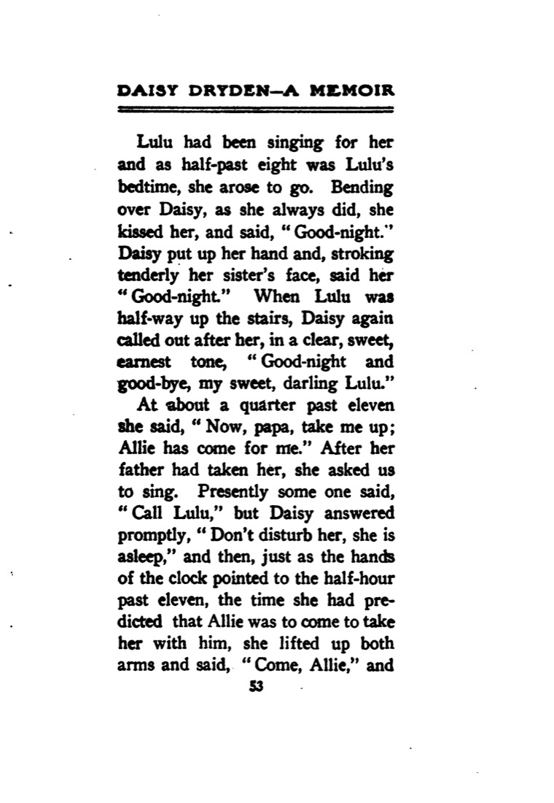
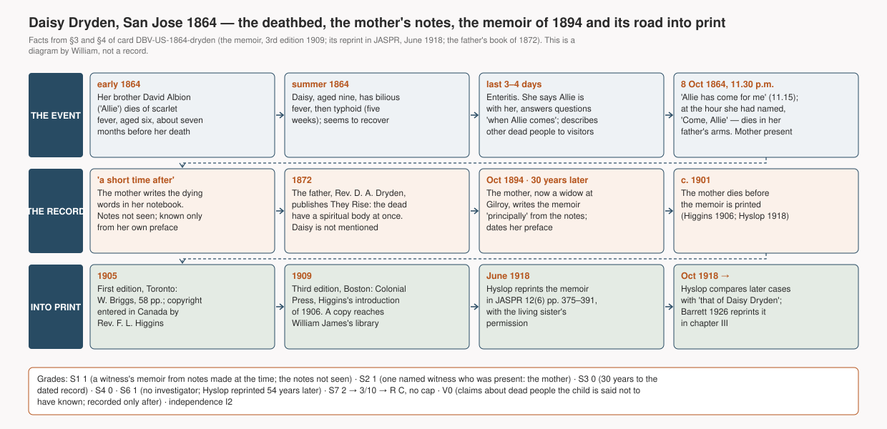

# Daisy Dryden: "Allie has come for me". A ten-year-old girl, dying of a fever, says for three days that her dead brother is with her, names the hour he will come for her, and dies at that hour; her mother writes it down from her notes thirty years later (San Jose, California, 1864)

> At a quarter past eleven on the night of 8 October 1864, in San Jose, California, a ten-year-old girl in her father's arms said "Now, papa, take me up; Allie has come for me." Three hours earlier she had said that Allie would come at half past eleven. At half past eleven she lifted both arms, said "Come, Allie," and died. Allie was her brother, who had died of scarlet fever, aged six, about seven months before. Her mother was in the room. She wrote the last days into a notebook soon after, and in 1894, by then a widow, she turned the notes into a memoir.

## What happened

Daisy Irene Dryden was born in Marysville, California, on 9 September 1854, the daughter of the Rev. David Anderson Dryden, a Methodist Episcopal minister who had come out to California in 1851, and his wife, who signs herself S. H. Dryden. In the summer of 1864, at San Jose, she had a bilious fever and then typhoid, which held her for five weeks. She seemed to recover; the doctor told her they were "out of the woods". Some two weeks later, one afternoon, her father saw her looking at a place above the door with "pleasure and amazement"; she said it was Jesus. That night she was taken with enteritis and lived four more days.

For the last three of them she spoke, as her mother puts it, of being in "both worlds". Her brother David Albion, called Allie, had died of scarlet fever at six, seven months before. Daisy said he was with her much of the time. When she was asked something she could not answer she said "Wait until Allie comes, and I will ask him." She told her mother that Allie was "standing beside you", and that they talked "with our think". To neighbours who came to the bed she described their own dead: a Mrs. B.'s twelve-year-old son Bateman, who had just died; the two children of her Sunday-school teacher, Mrs. H., dead some years, whom she described as grown up; another woman's dead daughter, whom the mother could not recognise from the description until Daisy said that "she used to have a mark of a mole on the left side of her neck, but she does not have it now." She also asked the doctor whether he prayed, said goodbye to the sky and the trees through the opened shutters, and talked of a "new spiritual body".

On the evening of 8 October, at half past eight, resting against her father, she said: "It is half-past eight now; when it is half-past eleven, Allie will come for me." She called goodbye to her sister Lulu, who went up to bed. At about a quarter past eleven she said, "Now, papa, take me up; Allie has come for me." She asked those in the room to sing. When someone suggested calling Lulu, she said, "Don't disturb her, she is asleep." Then, "just as the hands of the clock pointed to the half-hour past eleven", she lifted up both arms, said "Come, Allie," and breathed no more. She was buried beside Allie and a sister, Helen, in the cemetery at Stockton.

*Page 53 of S. H. Dryden, "Daisy Dryden: A Memoir", third edition, Boston: Colonial Press, 1909. The copy scanned came to Harvard from William James's library · archive.org `daisydrydenamem00higggoog` (Google scan, Harvard University) · published 1909 (first edition 1905), public domain*

The mother says in her preface that she "recorded her dying experience in my note-book" "a short time after her death", and that the memoir's account of the last days is written "principally" from those notes. She dated the preface "Gilroy, Cal., October, 1894", three months after her husband's death, and in the text she says that "a score and a half of years" had passed. The memoir was first printed in Toronto in 1905, after her own death, by a Canadian minister, the Rev. F. L. Higgins, who entered its copyright and wrote an introduction vouching for her and for "others still living who knew the child". A third edition appeared in Boston in 1909. In June 1918 James H. Hyslop reprinted the whole memoir in the *Journal of the American Society for Psychical Research*, with the permission of Daisy's surviving sister.

*The event, the record and the road into print, drawn from §3 and §4 of this card. A diagram by William, **it is not a record** · generating code `tools/diagrams/DBV-US-1864-dryden.py`*

## How far can this record be trusted

The witness is good and the timing is bad. The person who wrote the account was in the room for the whole of the last days, and she says she wrote notes soon after the death. But the notes have not survived, or at least have not been seen; what exists is a memoir she dated thirty years later. That is a long time for a mother's grief and faith to work on what a dying child said. The memoir was written to console ("To sorrowing hearts whose loved ones have passed away"), and it was printed after her death by a minister who used it to argue a point of doctrine.

One check cuts against the memoir. In 1872 her husband published a book on the resurrection, *They Rise*. Its doctrine is the one Daisy is made to state in the memoir: the dead have a spiritual body at once, and the soul of a child goes on developing. Higgins says that the father learned this from his dying daughter. But the 1872 book does not mention her. The text was searched for her name, for "daughter" and for "child", and none of the passages is about her. So either the father kept his source to himself, or, over thirty years, the mother's memory gave the child the father's theology. The record cannot tell which. This is why the item "later embellishment" stays open below.

What the memoir is good for is the plain structure, which a mother is unlikely to have invented and which does not depend on the theology: a dying child says her dead brother is with her, names the hour he will come for her, and at that hour reaches up, says his name and dies. The family, the father's ministry and his book are real and are found in print outside the memoir. The child's death date has not been checked in any other record.

There is also a claim of information the child should not have had: the dead children of neighbours whom, the mother says, Daisy had never heard of, and the mole on the neck of another woman's dead daughter. These were written down only after the event and may have come from ordinary talk in a small town. The mother herself explains one of them that way: she remembered afterwards that Daisy had been in the room when the dead Mrs. E. was discussed. The claim is recorded (V0) but is not evidence of anything.

As to independence, the record is a private memoir from a Methodist family in California, written in 1894 from notes of 1864. No investigator touched it until fifty-four years after the event. Its idiom is the family's own Christianity, and no deathbed record of a dead relative coming for the dying, from any other culture, was available in English then. It is graded **I2**. This makes it the second C card of the same kind as card [[DBV-GB-1883-browning]] (London, 1883), from a different recorder in a different country, and under the pairing rule of METHOD §8 the two together fill the Western cluster of the structural layer for deathbed visions. It is the first cluster filled in this study.

## Other ways to explain it

- **A child dying of fever.** Typhoid, then enteritis, after weeks of illness; "emaciated to the last degree". Fever and exhaustion produce visions. The mother insists that Daisy was clear-headed: she recognised everyone, gave the page numbers of hymns and knew that her sister was asleep. But that is the mother's judgement thirty years on, and nothing is known of the treatment.
- **What the family expected.** A minister's family that had just lost a child, reading the Bible at the bedside ("In my Father's house are many mansions") and singing "Oh! come, angel band… bear me away". A dying child who has heard all this, and whose dead brother is the person she most wants to see, needs nothing more to see him.
- **Thirty years of memory.** The account was written from notes that cannot be checked. The theology in the child's mouth matches the father's later book. Some of the sayings may have been sharpened, moved or added. The core (Allie, the hour, "Come, Allie") is the kind of detail a family remembers, but that is a guess.
- **The hour.** A child who says "Allie will come at half past eleven" and dies at half past eleven is striking. But the dying can sometimes sense when death is near, and the time of death was noted by the people who were waiting for that hour.
- **Invention.** There is a motive to console and to teach, but no sign of fraud and no gain. The book appeared after the writer's death. Nobody checked it at the time, so fraud is only partly ruled out.

The record fits the survival of consciousness and fits every ordinary explanation equally well; nothing in it separates them. Its value to the study is as a pre-1900 record of the structure, made by a witness and outside any psychical-research collection.

---

## Investigation ledger

Everything above rests on the sources numbered below. Rules in `docs/METHOD.md`.

## 1. One-line summary

Daisy Irene Dryden (10), dying of enteritis after typhoid, said for her last three days that her brother Allie (died of scarlet fever about seven months earlier) was with her, said at 8.30 p.m. that he would come for her at 11.30, said at about 11.15 "Allie has come for me", and at 11.30 lifted her arms, said "Come, Allie" and died; San Jose, California, 8 October 1864. Recorded by her mother, who was present, from notes made soon after; memoir dated October 1894, printed 1905 and 1909, reprinted in JASPR June 1918.

## 2. Structure checklist

- [x] Actual death after the vision: died at 11.30 p.m., 8 October 1864, minutes after "Allie has come for me" [#1 pp. 52–53, #2].
- [x] The patient sees or converses with a "visitor" (mostly a dead relative): her dead brother, by name, over three days and at the moment of death; she also says when he will come [#1, #2].
- [x] An observer present recorded or testified: the mother, present throughout, wrote the account (notes soon after, memoir 1894) [#1 preface].
- [x] A record of lucidity: the mother reports that Daisy recognised every visitor, gave hymn pages, and knew her sister was asleep fifteen minutes before death [#1, #2]; no medical record.
- V element: claimed (variant V) — dead persons the child is said not to have known of (§6). The core visitor (Allie) was known dead → S layer.

## 3. Account

Daisy Irene Dryden was born in Marysville, Yuba County, California, on 9 September 1854 and died in San Jose on 8 October 1864, "aged ten years and twenty-nine days" [#1 introduction p. 9]. Her father was "the Rev. David Anderson Dryden, one of the ablest of the early missionaries sent by the Methodist Episcopal Church to the Pacific Coast", who came from Ohio to California in 1851 with his wife "(the writer of the following sketch)" and died at Gilroy on 4 July 1894 aged seventy [#1 introduction pp. 12–15]. D. A. Dryden, "of the California Annual Conference", published *They Rise: Suggestive Inquiries Concerning the Resurrection of the Dead* (Cincinnati: Hitchcock and Walden, 1872) [#3].

In summer 1864 Daisy had "bilious fever", then typhoid for five weeks; she seemed to recover; about two weeks later she said she saw "a spirit, it is Jesus"; "that night she was taken with enteritis and only lived four days" [#2 pp. 383–384]. Allie "was her brother who had passed to the other life at the age of six, of scarlet fever, seven months before. He seemed to be with her a great deal of the time during those last three days" [#2 p. 384]. "Dear mamma, I do wish you could see Allie; he is standing beside you"; "We just talk with our think" [#2 p. 388]. At 8.30 p.m. on the last day: "when it is half-past eleven, Allie will come for me" [#2 p. 389; #1 p. 52]. "At about a quarter past eleven she said, 'Now, papa, take me up; Allie has come for me.' … just as the hands of the clock pointed to the half-hour past eleven, the time she had predicted that Allie was to come to take her with him, she lifted up both arms and said, 'Come, Allie,' and breathed no more" [#1 p. 53; #2 p. 390]. She was buried at Stockton beside "her brother David Albion, whom we called 'Allie,' and her sister Helen" [#2 p. 391; #1 p. 58].

Persons named or designated at the bedside: the father; the mother; the sister Lulu; "Rev. C. Lawton (the minister who was to succeed us)"; the Sunday-school superintendent; the doctor; neighbours Mrs. W., Mrs. B., Mrs. H. and another unnamed friend [#2 pp. 385–388]. Statements about other dead persons: §6.

The mother's preface: "A short time after her death, I recorded her dying experience in my note-book, and it is from those notes principally that I have written the part of the following account which treats of her last days on earth"; signed "S. H. Dryden. Gilroy, Cal., October, 1894" [#1 pp. 5–7; #2 p. 376]. In the text: "A score and a half of years have come and gone since that far night" [#2 p. 390]. Introduction by F. L. Higgins, "Toronto, Ont., September, 1906": the memoir was "written at the suggestion and request of friends, by her mother (who at this date has for five years been herself in the other life)"; he vouches "from the testimony of others still living who knew the child" [#1 pp. 9–15]. Copyright: "Entered according to Act of the Parliament of Canada, in the year one thousand nine hundred and five, by Frank Levi Higgins, at the Department of Agriculture" [#1, verso of title, page scan]. First edition: Toronto, W. Briggs, 1905, 58 pp. [#4]. Third edition: Boston, Colonial Press, 1909 [#1]. Hyslop's note: "It was an accident that brought the little pamphlet to my attention and I was fortunate enough to get into communication with the living sister of Daisy Dryden… The mother had died before the book was published and there was only the surviving sister to vouch for the genuineness of the phenomena"; and: "They made no attempt to investigate them… the recorder did not know what place the subconscious of the child had in coloring the facts" [#2 pp. 375–376].

## 4. Sources

| # | Type (primary/secondary/tertiary) | Reference | Opened | Link | Notes |
|---|---|---|---|---|---|
| 1 | primary-witness, late (memoir by a person present, from her notes) | Dryden SH. *Daisy Dryden: A Memoir*, with an introduction by Rev. F. L. Higgins. 3rd ed. Boston: Colonial Press, 1909 | **Confirmed** (full OCR text; page images of p. 53 and the copyright page, 2026-11-07) | https://archive.org/details/daisydrydenamem00higggoog | Harvard copy, stamped "From the philosophical library of William James, 1923". Public domain. Page scan in `assets/` |
| 2 | secondary (official reprint of #1 with editor's note) | Hyslop JH. "Death Visions". *Journal of the American Society for Psychical Research* 1918;12(6):375–391 | **Confirmed** (full text, 2026-11-07) | https://archive.org/details/sim_journal-of-the-american-society-for-psychical-research_1918-06_12_6 | Reprints #1 (3rd ed.) in full; editor's critique p. 375–376 |
| 3 | primary (the father's own book) | Dryden DA. *They Rise: Suggestive Inquiries Concerning the Resurrection of the Dead, as Taught in the New Testament*. Cincinnati: Hitchcock and Walden, 1872 | **Confirmed** (full OCR text searched, 2026-11-07) | https://archive.org/details/theyrisesuggesti00drydrich | Confirms the father and his doctrine. No mention of Daisy, a daughter or a dying child (searches "Daisy", "Allie", "daughter", "child", "dying") |
| 4 | tertiary (catalogue) | Canadiana record: Dryden SH. *Daisy Dryden: a memoir*. Toronto: W. Briggs, 1905. 58 pp. Subject "Dryden, Daisy, 1854-1864" | Confirmed (record page, 2026-11-07); the scanned 1905 text not read | https://www.canadiana.ca/view/oocihm.80760 | First edition. Whether its text differs from 1909 not checked |
| 5 | secondary (later use) | Hyslop JH. "Visions of the Dying". *JASPR* 1918;12(10):585–645, p. 619: a later case "resembles that of Daisy Dryden" | Confirmed (full text) | https://archive.org/details/sim_journal-of-the-american-society-for-psychical-research_1918-10_12_10 | Connection only |
| 6 | secondary (reprint) | Barrett WF. *Death-bed Visions*. London: Methuen, 1926, ch. III | Seen in session 7 reading of ch. III (see [[M-dbv-visitor-known-dead]]); page not re-checked | https://iiif.wellcomecollection.org/presentation/v2/b29813992 | Post-record |
| 7 | tertiary (catalogue records) | *Buddhist Mahâyâna Texts* (Sacred Books of the East XLIX), Oxford 1894 — the earliest English translation of a non-Western deathbed text found (card [[DBV-GB-1883-browning]] #10) | Confirmed (catalogue) | https://archive.org/details/buddhistmahy01cowe | §11 route ② only |
| 8 | — | California Digital Newspaper Collection, for a death notice of October 1864 | **Not reached** (bot check, 2026-11-07) | https://cdnc.ucr.edu/ | Unverified |

## 5. Scores and grades

| Axis | Score | Reason in one line |
|---|---|---|
| S1 Source | 1 | A memoir by a witness who was present, written "principally" from notes she says she made soon after; the notes not seen; not itself a document of the time |
| S2 Witnesses | 1 | One identified witness who was present and wrote it herself (the mother). The others (father, sister, neighbours) never testified separately; Higgins's "testimony of others" is unspecified |
| S3 Timing | 0 | First dated record October 1894, thirty years after; the notes are undated and unseen |
| S4 Ordinary explanations examined | 0 | F partly ruled out; M partly; D, E, X not ruled out (§7) |
| S5 Prior record (V axis) | 0 | The V claims (§6) were recorded only after the event, by the mother; nothing was written down before it was checked |
| S6 Investigator independence | 1 | No investigator at the time; Hyslop (ASPR) reprinted it in 1918 after contacting the surviving sister by letter, without inquiry into the facts |
| S7 Original text opened | 2 | The 1909 edition opened (text and page scans) and the 1918 reprint read in full; the 1905 first edition and the notes not seen |

Total (S1+S2+S3+S4+S6) = 3/10 → **R grade C** (no cap applies) / V grade **V0** (a V claim exists; S5 = 0).

## 6. Verified information (V claim)

| Claim | Who knew it | When recorded | Status |
|---|---|---|---|
| The two children of Mrs. H., dead "several years", are described as grown; "Daisy had never heard anyone speak of them" [#2 p. 386] | Mrs. H.; probably neighbours | 1894 (memoir) | Not checked; the child's ignorance is the mother's assertion |
| A friend's dead daughter "used to have a mark of a mole on the left side of her neck" [#2 pp. 386–387] | the friend; possibly others | 1894 | Not checked; whether Daisy had seen the girl is unknown |
| The dead Mrs. E. says "you were right, she is with the saved", referring to a conversation about a church letter [#2 p. 387] | the mother, the visitor, and (the mother realises) Daisy, who was present | 1894 | Explained by normal channels in the record itself |
| Bateman, Mrs. B.'s son, "says he is alive and well"; his father "is not here" [#2 p. 386] | known to all | 1894 | No information beyond what was known |

→ V0: claims exist, recorded only afterwards, leakage (L) not ruled out. Not usable in the V layer.

## 7. Other ways to explain it

| Item | Status | Reason |
|---|---|---|
| F Fraud | partly ruled out | No material gain; the writer died before publication (#1). But the purpose is declared consolation and instruction, and nobody checked the account (#2 p. 375) |
| M Misperception | partly ruled out | The core is the child's own words, repeated over days to several people (#2); what she "saw" is known only from what she said |
| D Memory distortion, later embellishment | **not ruled out** | Thirty years to the dated record; notes unseen; the child's theology matches the father's 1872 book, which does not mention her (#3) |
| L Leakage, normal channels | not ruled out | Small-town knowledge of neighbours' dead; the mother herself identifies one normal channel (Mrs. E., §6) |
| E Cultural expectation, suggestion | not ruled out | Minister's household, Bible readings and the hymn "Oh! come, angel band" at the bedside; a brother recently dead (#2 pp. 385, 387–388) |
| N Neurophysiology, drugs, psychology | recorded only | Typhoid then enteritis, emaciation; no record of treatment. The mother's evidence of lucidity is noted (§2). No deduction (METHOD §3) |
| C Coincidence, base rate | not ruled out | The predicted hour: the time was noted by people waiting for it; one case, no base rate |
| X Selective reporting, recorder bias | not ruled out | A consolatory memoir; published by a minister who used it doctrinally (#1 introduction); found "by accident" and printed by Hyslop because it fitted his collection (#2) |

## 8. Compatible hypotheses

| Hypothesis | Status | Reason |
|---|---|---|
| H1 Survival after death | compatible | Nothing in the record favours it over H4; the V claims are V0 |
| H2 Psi without survival | compatible | Nothing verified to explain |
| H3 Cultural transmission | compatible | Within the cluster: the family's Christian expectation fits the content. No other-cluster source (§11) |
| H4 Neurophysiology, psychology | compatible | Febrile illness and exhaustion |
| H5 Memory distortion, embellishment | compatible | Thirty-year gap; doctrinal fit with #3 |
| H6 Fraud | compatible | No cross-check |
| H7 Chance, base rate | compatible | The hour |
| H8 Investigator effect | **unfavourable** | No investigator existed when the notes or the memoir were written; Hyslop reprinted without changes and said so (#2) |

## 9. Counter-evidence

Search: 2026-11-07 / web search "Daisy Dryden" 1864 deathbed vision Allie critique, skeptic, fabricated; JASPR 1918 vols. 12(6) and 12(10) full text; the father's book (#3) / result: no case-specific rebuttal found. Hyslop's own editorial critique (#2 pp. 375–376: the family "made no attempt to investigate", the child's "subconscious" coloured the content) is a caveat by the publisher, scored under §7 E and X, not a rebuttal card. The check against #3 (§7 D) is this card's own finding.

| Source | R grade | Gist | Effect on this card |
|---|---|---|---|
| — | — | No case-specific counter-evidence found | `counter: none` |

## 10. Connections

| Target `[[id]]` | Relation (R-*) | Verdict | Grade | Reason |
|---|---|---|---|---|
| [[DBV-GB-1883-browning]] | R-MOT | recurrence | confirmed | Same cluster (EU-W), C, I2, S7 = 2, a different recorder (Ellen Chute vs S. H. Dryden), a different country; together they make the first C pair (METHOD §8). Both reached print through Hyslop (1909, 1918): one publishing body, two independent records |
| [[M-dbv-visitor-known-dead]] | R-MOT | recurrence | confirmed | Dead brother named, an hour named, arms lifted, "Come, Allie" |
| [[M-dbv-visitor-unknown-dead]] | R-MOT | neutral | confirmed | The neighbours' dead children (§6): V0, not this motif's V2 form |
| [[P-Hyslop-JH]] | R-INV | neutral | confirmed | Reprinted the memoir in 1918 after contacting the sister (#2). Post-record |
| [[O-ASPR]] | R-INV | neutral | confirmed | Publishing body, 1918 |
| [[P-Barrett-WF]] | R-TXT | neutral | confirmed | Reprinted in 1926 (#6). Post-record |
| D. A. Dryden, *They Rise* 1872 (no entity) | R-TXT | undecided | confirmed | The father's doctrine matches what the memoir attributes to Daisy; the book does not mention her (§7 D) |
| F. L. Higgins (no entity) | R-PER | neutral | confirmed | First publisher, 1905; introduction 1906 |

## 11. Cultural independence

Cluster: EU-W / record year 1894 (memoir dated by its author; notes of 1864) vs baseline year 1900 (DBV, provisional) / investigating body: none at the time of the record; ASPR reprinted in 1918.

| Path | Ruled out / unknown / confirmed | Reason |
|---|---|---|
| ① Direct contact | ruled out | A Methodist minister's household in San Jose and Gilroy, California (#1, #3); no connection to a record of another cluster |
| ② Translation, publication | ruled out | No deathbed record of a dead relative coming for the dying, from another cluster, was accessible in English by 1894. The one non-Western deathbed text translated by then (#7, Oxford 1894) teaches a different visitor, Amitābha, and cannot be the source of the element compared (METHOD §5, note of 2026-11-06, applied here to route ②). The content goes back to the notes of 1864 |
| ③ Missionary, religious transmission | ruled out | The idiom is the family's own Christianity |
| ④ Mass media | ruled out | Record year 1894, before 1900: automatically. Caveat: the text was printed only in 1905, after the author's death; editorial change by the first publisher cannot be ruled out (§7 X) |
| ⑤ Same investigating body | ruled out | No investigating body produced the record |

→ Independence grade **I2**. With [[DBV-GB-1883-browning]] (C, I2, S7 = 2, another recorder) this card completes the first C pair: **the EU-W cluster of the DBV structural layer is filled (METHOD §8)**. Card 4's C comes from cap ③ (S2 = 0); using a cap-③ C as half of a pair was decided on 2026-10-31 (card 4 §11) and is applied here as written. Limit: both records came into print through one publisher (Hyslop, ASPR), so the investigating-body condition of §8 ("2 or more investigating bodies") is not helped by this pair.

## 12. Notes

- **Why this case and not the others in Hyslop 1918.** Hyslop's "Visions of the Dying" (#5) prints dozens of cases, almost all written in 1906–1918 at his invitation, which makes them post-1900 records collected by an investigating body (I0 by the precedent of card [[DBV-GB-1924-doris]]). Two were looked at and not carded: R. C. Gittermann (Odessa, 1893, "Papa! Papa!", written 1907 by an associate of the SPR, pp. 603–604) and Cyrus Emery (Illinois, 1857, "I see my father", written 1906 by a Spiritualist widower, pp. 604–605). The Dryden memoir is the one record in the volume written before 1900 by a private person for her own purposes.
- **What would raise the grade.** The notebook; a statement by Lulu or by the father written before 1894; a death notice of October 1864 in a California paper or in the *California Christian Advocate* (S3, S2). The California Digital Newspaper Collection was not reachable (#8).
- **The 1905 text.** The first edition (#4) is scanned at Canadiana; it was not compared with 1909. Higgins's introduction is dated 1906, after the first edition, so the 1905 printing may have had none.
- **Names.** All persons named died long ago (Daisy 1864, father 1894, mother c. 1901). The neighbours appear only as initials in the source.

## 13. Materials

| File | Kind | What | Source · licence |
|---|---|---|---|
| `DBV-US-1864-dryden--memoir-1909-p53.jpg` | ① record copy | Memoir p. 53: "Allie has come for me" … "Come, Allie" | archive.org `daisydrydenamem00higggoog`, leaf 58 · public domain (1909) |
| `DBV-US-1864-dryden--chain.svg` · `--chain-ko.svg` | ④ diagram | Event, record and road into print, 1864–1918, with the grades. Not a record | William · code `tools/diagrams/DBV-US-1864-dryden.py` |

- Not included: no photograph of Daisy or her family was found in the sources opened; the JASPR 1918 pages (text only used); the Stockton grave (not searched; community grave sites would be leads only).
