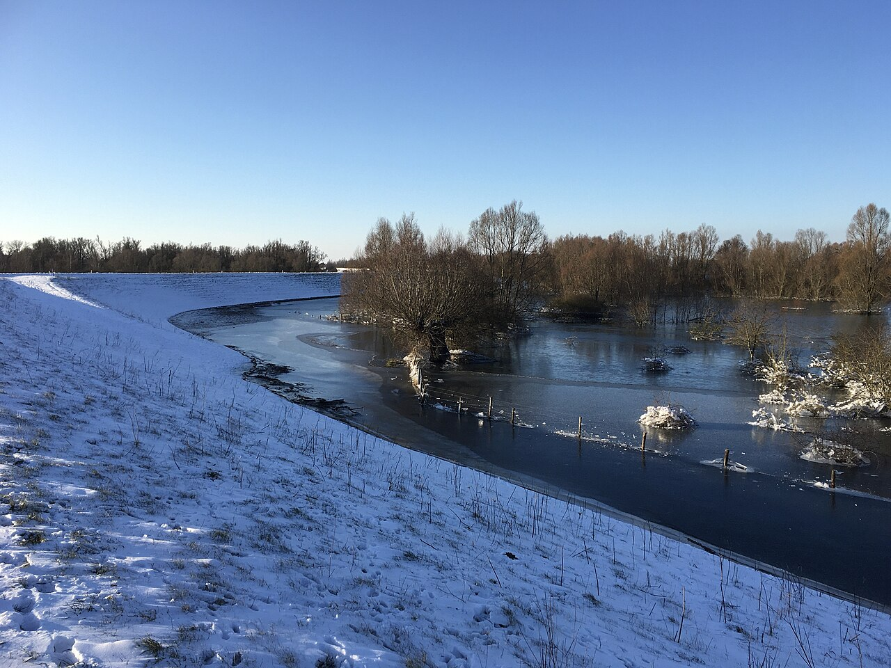
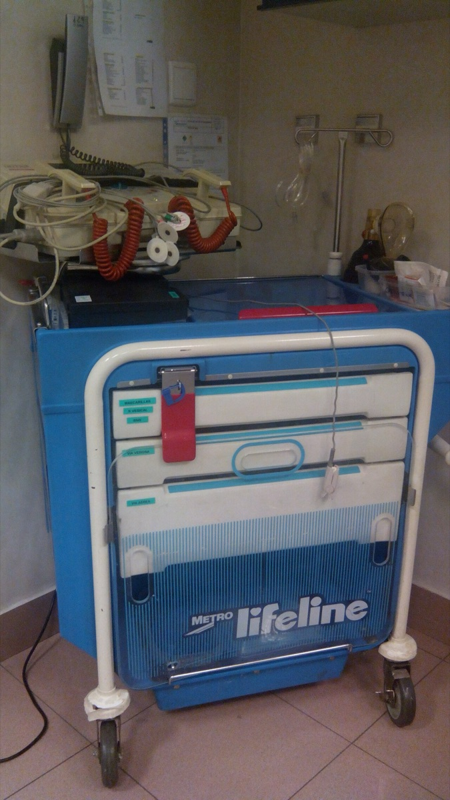
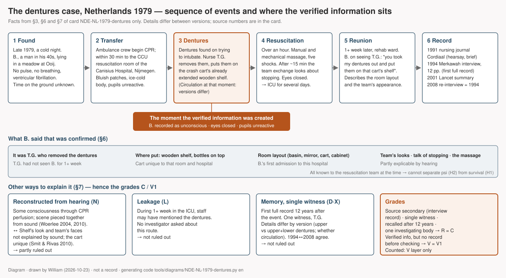

# The man with the dentures — a patient resuscitated from cardiac arrest describes, from above, the nurse who removed his dentures and the cart they were put on (Nijmegen, 1979)

> Late 1979, a cold night near Nijmegen in the Netherlands. A man was found lying in a meadow. His heart had stopped. In hospital, during more than an hour of resuscitation, a nurse took the dentures out of his mouth and put them on a wooden shelf of a cart. More than a week later, when that nurse walked into another ward, the man spoke first: "Hey, yes you, you know where my dentures are!"

## What happened

The man is recorded only as B. He was a steel bender from the village of Ooij, east of Nijmegen, and in his early forties. On a cold night late in 1979 a passer-by found him lying in a meadow and called an ambulance. Nobody knows how long he had been there. When the ambulance crew arrived he had no pulse and was not breathing; his heart was only fibrillating. The crew began resuscitation and brought him within half an hour to the resuscitation room of the coronary care unit at the Canisius Hospital.

*Reference · Winter on the floodplain of the river Waal near Ooij, February 2021. The records do not say where the meadow in which B. was found lies · Lendskaip, Wikimedia Commons · CC0*

When B. arrived, his skin showed bluish patches like post-mortem lividity. His body was ice cold, his pupils were dilated and did not react to light, and his eyes were closed. The resuscitation team was the nurse T.G., two female student nurses, and a junior doctor who would not take the decision to stop. When they tried to intubate him, they found dentures. T.G. took them out and put them on the wooden sliding shelf of the crash cart in the room, a shelf already pulled out for preparing syringes. The cart had been built for that room by the hospital's technicians, and there was no other like it anywhere in the hospital. The resuscitation went on for more than an hour. The heart was compressed by hand and by machine, and shocks were given five times. After about fifteen minutes the team felt they were working on a dead man and exchanged looks about stopping. But the patient was young and the doctor would not decide, so they went on. At last the heart began to beat again. B. was moved to intensive care and ventilated for several days.

*Main building and entrance of the St Canisius Hospital in Nijmegen, 1960. The building stood on St. Annastraat from 1926 to 1992 and is the hospital where the resuscitation of 1979 took place. The records do not say in which wing the resuscitation room lay · Regionaal Archief Nijmegen F12159, Fotopersbureau Gelderland, Wikimedia Commons · CC BY-SA 4.0*

T.G. finished the shift that night, had five days off, and was then assigned to another department. So for more than a week T.G. did not see B. Meanwhile B. woke up in intensive care and asked where his dentures were. Nobody knew. They had been lost during the clearing up. One night T.G. walked into the rehabilitation ward to hand out medication. B. recognised the nurse at once and spoke first: "Yes, you were there when I was brought into hospital and you took my dentures out of my mouth and put them onto that cart, it had all these bottles on it and there was this sliding drawer underneath and there you put my teeth." He described the resuscitation room: a very small room, a niche with a wash basin and disinfectants to the right of the bed, where the mirror was, the equipment cart on the left, a narrow metal cabinet holding infusion pumps. He said he had watched from above, from the top left corner of the room, over that cabinet. He described what the team members looked like, and he knew it was T.G. who had compressed his chest. He had kept trying to say, "Ouch, stop doing this because it hurts so much! I am still here; my heart does not stand still! I am alive!" But nobody heard him. There was no tunnel, no light, no review of his life. B. left hospital four weeks later.

*Reference · A present-day crash cart (Spain, 2014). The cart in the Canisius resuscitation room in 1979 was a one-off built for that room, and no photograph of it survives · Manuel Ramallo, Wikimedia Commons · CC0*

For a long time the story went unrecorded. As was usual then, nothing was written in the medical notes, and the notes themselves were later destroyed. T.G. only told colleagues. Twelve years later, in 1991, one of those colleagues passed it on to the Dutch near-death research foundation Merkawah, and a short version appeared in a nursing journal. In February 1994 a member of the foundation interviewed T.G. at length and left a typed record of twelve pages. T.G. was asked to repeat the same passages several times; the account hardly changed. In 2001 the cardiologist Pim van Lommel published a Dutch study of near-death experiences in the medical journal *The Lancet* and included this case as a first-person summary from the nurse, without a year or a place. After that "the man with the dentures" became the most frequently cited near-death anecdote in the world. In 2008 Rudolf Smit of the foundation traced T.G. and asked again; the account matched the 1994 record almost exactly. The patient B. was never interviewed. The foundation tried to find him and failed, and some years later T.G. saw his death notice in a newspaper. In 2010 the anaesthesiologist G. M. Woerlee published a rebuttal of the case, and Smit and Titus Rivas replied.

*Diagram · The sequence from the finding in the meadow to the reunion on the ward, and which of B.'s statements were confirmed by whom. Drawn by William from sections 3, 6 and 7 of the ledger below; **it is not a record** · generating code `tools/diagrams/NDE-NL-1979-dentures.py`*

## How far can this record be trusted

The most famous anecdote is not the best record. This case shows it. There is one witness, T.G. The two student nurses and the doctor who were in the room were never interviewed. Nor was the patient. The first record came twelve years after the event, and then at second hand, from a colleague who had not been present. The only body that investigated is one that takes near-death experiences to be real. The versions differ. In the 1991 article B. was afraid the team would stop; in the 1994 interview he wanted them to stop because it hurt. Whether the dentures were upper and lower or only upper, and whether the heart was being compressed when they were removed or there was no circulation at all, also differ between versions. On this study's scale for the quality of a record, A to D, it is a **C**. Not because the event is weak but because the record is.

There is still a reason to count this case. B. was brought into the resuscitation room with his eyes closed and his heart stopped. He later stated things such a man could hardly know, and the person who had been there said they were right: who took the dentures out, where they were put, what that shelf looked like, what the room looked like. So the case counts as one with "verified information". But not at the top grade. B.'s words were not written down in a dated document and then checked; the memory of the person who checked them was recorded twelve years later. And everything B. said was known to the resuscitation team. So the verification grade is **V1**, the middle of three.

In structure this experience is unlike a typical near-death experience. No tunnel, no light, only "I watched from above". So it does not go into the count of whether the same structure arose separately in several cultures. It goes only into the count of verified information.

## Other ways to explain it

- **Memory may have changed.** Twelve years. The difference between 1991 and 1994 is on record. That 1994 and 2008 agree is the same person repeating the same story, and is no evidence that memory did not change.
- **Someone may have told him.** In 2008 T.G. was asked about ways B. could have seen the cart beforehand, a guided tour or a brochure, and said there were none. But no investigator asked whether a member of the intensive-care staff might have told B. "that nurse took your dentures out".
- **He may have been conscious during the resuscitation.** This is Woerlee's argument. Hypothermia makes the outward signs of death unreliable. There are cases in the medical literature of consciousness returning during chest compressions. The scene could have been pieced together from what he heard. Visual details such as the look of the shelf and the viewpoint in the "top left corner" are hard to explain by sound alone. But the only evidence that those details were given is T.G.'s memory.
- **It may be chance.** More than three details matching is hard to call chance. But no record was made before the match was confirmed.
- **It may be a chosen story.** It was collected by a body that collects near-death experiences. How many stories did not match is unknown.

So this record is **compatible** with the hypothesis that consciousness continues after death. It cannot separate that hypothesis from the others. What this case shows is rather why prospective studies, with hidden targets set up in advance, are needed.

---

## Investigation ledger

Everything above rests on the sources numbered below. The ledger is this study's working record: the facts with their source numbers (§3–§4), the scores behind the grades (§5), the verified information (§6), the ordinary explanations (§7), the hypotheses the record can and cannot separate (§8), counter-evidence (§9), connections to people, organisations and motifs (§10), cultural independence (§11), notes (§12) and the list of materials (§13). The scoring rules are in `docs/METHOD.md` (Korean; English translation in progress).

## 1. One-line summary

On a night late in 1979, B., a man in his forties found hypothermic and in cardiac arrest in a meadow, was revived after more than an hour of resuscitation. More than a week later he recognised the nurse T.G., whom he was apparently seeing for the first time, and said that T.G. had taken his dentures out of his mouth and put them on the sliding shelf of "that cart". T.G.'s testimony was recorded in 1991 (through a colleague), 1994 (direct interview) and 2008 (re-interview); the patient died without ever being interviewed.

## 2. Structure checklist

- [x] Required 1: medical crisis — ventricular fibrillation, no pulse, no breathing, CPR for over an hour, five defibrillations. Medical records destroyed; confirmed by the testimony of the resuscitation nurse [#2 #4]
- [ ] Required 2: experience reported during the crisis with two or more elements — **only one element**, an out-of-body viewpoint (saw the resuscitation from above). No tunnel, light, life review or meeting with the dead [#2 p.59]. No peace (pain, "stop") [#2]. No border or decision to return
- [x] Optional: change of attitude afterwards — "he is no longer afraid of death" (Lancet version only) [#1]
- V element: **present** — described events around him during the resuscitation (removal of the dentures, the cart, the room, the people, the discussion about stopping), confirmed by the resuscitation nurse [#1 #2]

→ **Not eligible for the S-layer count** (fewer than two elements); **eligible for the V layer** (METHOD §1 v0.2: confirmed crisis + out-of-body viewpoint + V element). This card is the occasion for v0.2.

## 3. Account

B. was a steel bender in his early forties (44 in the Lancet version) from the village of Ooy/Ooij near Nijmegen [#1 #2]. On a cold night late in 1979 a passer-by found him lying in a meadow and called an ambulance; nobody knows how long he had lain there [#2 #3]. The year 1979 is given explicitly only by Woerlee (2010); Smit & Rivas (2010) write only "30 years ago" [#3 #4]. On the ambulance crew's arrival he had no pulse, no breathing and ventricular fibrillation; the crew began resuscitation and took him within 30 minutes to the resuscitation room of the coronary care unit (CCU) of the Canisius Hospital [#2 #3]. On arrival, bluish patches resembling post-mortem lividity, an ice-cold body, dilated pupils unreactive to light and closed eyes were noted [#2 #4].

The team was the nurse T.G. (acting as first team leader), two female student nurses, and a junior doctor who did not take the decision to stop [#2 #3]. On attempting intubation the dentures were found, and T.G. removed them and placed them on the crash cart's **already extended wooden sliding shelf** (used for preparing syringes) [#2]. The 1994 interview speaks of upper and lower dentures, the Lancet version of an upper denture [#1 #2]. The circulatory state at the moment of removal differs between versions: in the Lancet version the dentures were found when intubation was attempted while the patient was being ventilated without intubation and given cardiac massage and defibrillation [#1]; in T.G.'s 2008 version the dentures were removed before the mask was fitted, the mechanical heart massage machine (Thumper) was switched on only after the mask was fitted, and there was no circulation at all for more than a minute while the patient was moved from stretcher to bed and the machine was set up [#4]. During the lift transfer of five minutes or more from the emergency department to the third-floor CCU, the ambulance nurse running beside the stretcher could give only some ventilation [#4].

Resuscitation, including manual and mechanical heart massage and five defibrillations, took more than an hour ("more than an hour" in 1994; about an hour and a half in the Lancet; about 90 minutes in Woerlee) [#1 #2 #3]. After about 15 minutes the team "were convinced that we were working on a dead man" and discussed stopping by exchanged glances, but continued "because it was such a young man" and because the junior doctor would not decide [#2]. Except during pupil checks the eyes were closed, and the pupils never reacted [#2 #4]. After some return of heartbeat, blood pressure and spontaneous breathing he was transferred to the ICU and ventilated for several days [#1 #2 #3].

T.G. had five days off after that night shift, was then assigned to another department, and "lost sight of the patient for more than a week" [#2]. Meanwhile B. asked in the ICU where his dentures were, but nobody knew (they were lost during clearing up) [#2]. When T.G. entered the rehabilitation ward to hand out night medication, B. spoke first: "Hey, yes you, you know where my dentures are!" [#2]. B. said: "Yes, you were there when I was brought into hospital and you took my dentures out of my mouth and put them onto that cart, it had all these bottles on it and there was this sliding drawer underneath and there you put my teeth." [#2]. B. described the resuscitation room: a very small room, a niche with a wash basin and disinfectants to the right of the bed, where a mirror was, the cart on the left, a narrow metal cabinet in which infusers and infusion pumps were stored [#2]. His viewpoint was the top left corner of the room, above the metal cabinet [#4]. B. described the team members' appearance and told T.G. that T.G. had done the heart massage; he had kept trying to say "Ouch, stop doing this because it hurts so much! I am still here; my heart does not stand still! I am alive!" — "But you did not hear me." [#2]. B.'s experience "did not include a tunnel, light, a life review" [#2 p.59]. The Lancet version adds that B. was very afraid the team would stop CPR, and that "he is no longer afraid of death" [#1].

The crash cart had been built by the hospital's technicians for that room and there was no other like it in the hospital; B. had never been admitted to that hospital before; there were no guided tours or brochures of the resuscitation room [#2 #4]. According to T.G., outside the CCU at that time defibrillators and monitors were carried by hand and carts were not wheeled about [#4]. B. left hospital after four weeks [#1 #2]. T.G. later saw him once from a distance at an outpatient check-up, looking like a man whose heart was badly damaged, and some years later saw a death notice in a newspaper for a B. of Ooij [#2]. The Merkawah foundation also tried to find B. and failed [#2].

Record history: the experience was not entered in the medical notes (the practice of the time) and the notes themselves were routinely destroyed [#2 #4]. T.G. told colleagues; one of them, K.B., passed it to Meijers, and it appeared briefly in the nursing journal *Cordiaal* in August 1991 (K.B. confirmed in 2008 to having been absent from the scene and only a conduit) [#2 #5]. On 2 February 1994 Addink of Merkawah interviewed T.G. at length and produced a "densely typed document of 12 pages" (dated 3 February); the interviewer "asked him several times to repeat his account" and "there were virtually no differences" [#2 #6]. On the basis of these two documents van Lommel et al. published a first-person summary in the Lancet in 2001, without year or place [#1 #3]. In 2007 the Merkawah archive kept by van Wees passed to Smit, who traced T.G. in 2008 and interviewed by telephone; Rivas conducted a long interview (*Terugkeer* 2008) [#2 #7 #8]. The details of 1994 and 2008 matched almost exactly [#4]. The original 1991 interview recording is lost [#2].

Version discrepancies: Meijers 1991 and the Lancet 2001 have B. afraid the team would stop; Addink 1994 has B. alive and well and wanting them to stop because the massage hurt [#2]. In 2008 T.G. explained this as two phases (at first wanting them to continue, later wanting them to stop) [#2]. T.G. had heard patients' NDE accounts during night rounds before this event and knew of the phenomenon [#2]. B. was, in T.G.'s view, "a very down-to-earth steel bender who most probably did not even understand that he had had an NDE", and the Dutch public at the time hardly knew the concept (the assessment of T.G. and Smit) [#2 p.59].

## 4. Sources

| # | Type (primary/secondary/tertiary) | Reference | Opened | Link | Notes |
|---|---|---|---|---|---|
| 1 | Secondary (academic; first-person summary of the nurse's report) | van Lommel P, van Wees R, Meyers V, Elfferich I. Near-death experience in survivors of cardiac arrest: a prospective study in the Netherlands. *Lancet* 2001;358:2039-45, p.2041 | Partly confirmed — the p.2041 paragraph read as reprinted in #2 and #10. Full text paywalled | PubMed PMID 11755611 | No year or place. Based on the 1991 and 1994 documents |
| 2 | Secondary (investigator's collection of witness interviews; excerpts of the 1994 record reprinted) | Smit RH. Corroboration of the dentures anecdote involving veridical perception in a near-death experience. *J Near-Death Stud* 2008;27(1):47-61 | Confirmed (full PDF) | https://digital.library.unt.edu/ark:/67531/metadc798921/ | Key source. The author is a Merkawah board member |
| 3 | Rebuttal (academic) | Woerlee GM. Response to "Corroboration of the dentures anecdote…". *J Near-Death Stud* 2010;28(4):181-191 | Confirmed (UNT IIIF OCR full text) | https://digital.library.unt.edu/ark:/67531/metadc461689/ | Gives the year 1979 |
| 4 | Reply to rebuttal (academic; English translation of the witness's 2008 statements) | Smit RH, Rivas T. Rejoinder to "Response to …". *J Near-Death Stud* 2010;28(4):193-205 | Confirmed (UNT IIIF OCR full text) | https://digital.library.unt.edu/ark:/67531/metadc461736/ | Two cardiologists consulted (van Lommel, Louridtz) |
| 5 | Secondary (earliest record; nursing journal; hearsay from K.B., who was not present) | Meijers V. Bijna-dood-ervaringen na geslaagde reanimaties. *Cordiaal* 1991;3:53-56 | Unverified (via #2) | — | Original recording lost |
| 6 | Primary (typed investigation interview record, unpublished) | Addink A. Interview record of T.G., interviewed 1994-02-02, typed 02-03, 12 pages, Merkawah archive | Unverified (excerpts in English in #2) | — | Not publicly available |
| 7 | Secondary (investigator's interview, Dutch) | Rivas T. Een gesprek met TG over de man met het Gebit. *Terugkeer* 2008;19(3):12-20 | Unverified (excerpts in English in #4) | — | Merkawah newsletter |
| 8 | Primary (witness's own written comment, Dutch) | T.G. Commentaar op Woerlee door verpleegkundige TG. *Terugkeer* 2008;19(4):8 | Unverified (excerpts in English in #4) | — | Original source of the statement on the timing of the denture removal |
| 9 | Rebuttal (commentary) | French CC. Dying to know the truth: visions of a dying brain, or false memories? *Lancet* 2001;358:2010-11 | Reference confirmed (PMID 11755600; Goldsmiths eprint 5137 has no full text). Text partly via quotations in #2 and #3 | https://research.gold.ac.uk/id/eprint/5137/ | Points out the absence of cross-checking |
| 10 | Rebuttal (academic) | Woerlee GM. Cardiac arrest and near-death experiences. *J Near-Death Stud* 2004;22(4):235-249 | Confirmed (UNT IIIF OCR full text) | https://digital.library.unt.edu/ark:/67531/metadc799067/ | Conjecture based on the Lancet summary alone |

## 5. Scores and grades

| Axis | Score | Reason in one line |
|---|---|---|
| S1 Source | 1 | No contemporary document (the medical notes were destroyed). Academic collection by investigators who interviewed the witness directly (#2; #6 reprinted) |
| S2 Witnesses | 1 | A single witness, T.G., identified (to the investigators). The patient, the two student nurses and the doctor were not interviewed. K.B. is hearsay from someone not present |
| S3 Timing | 0 | First record August 1991 = about 12 years after the event. Direct interview record 1994 |
| S4 Ordinary explanations examined | 0 | §7: F partly ruled out, but D and X "not ruled out" (2 items) |
| S5 Prior record (V axis) | 1 | Told orally to a third party (T.G.) before verification, who later testified. Dated document 12 years later |
| S6 Investigator independence | 1 | All investigators (Meijers, Addink, Smit, Rivas) belonged to or were associated with Merkawah (the Dutch IANDS affiliate, an organisation that presupposes the reality of the phenomenon). Face-to-face interviews were conducted |
| S7 Original text opened | 2 | #2, #3, #4, #10 read in full |

Total (S1+S2+S3+S4+S6) = 3/10 → R grade **C** / cap applied: none (③ not applicable: S1=1, S2=1; ④ F partly ruled out) / V grade **V1** (S5=1; F, L, C at least partly ruled out; R≥C)

## 6. Verified information (V claim)

| Information | Who said it | When and where recorded | When and by whom verified | Normal channels investigated | Who alive at the time knew it |
|---|---|---|---|---|---|
| It was T.G. who removed the dentures | B. → T.G. | 1991 *Cordiaal* (hearsay), 1994 interview record | Confirmed by T.G. at the moment it was said | T.G.: had not seen B. for more than a week, and B. had never seen T.G. Whether ICU staff told him was not investigated | T.G., the two student nurses, the doctor |
| Where the dentures were put — the cart's already extended wooden sliding shelf, bottles on top | B. → T.G. | Same | Same | The cart was unique in the hospital and specific to that room; B.'s first admission; no tours or brochures (T.G. 2008) | The whole resuscitation team |
| Layout of the resuscitation room (basin niche, mirror, cart, metal cabinet) | B. → T.G. | 1994 interview record | T.G. | B. was in that room only on that occasion (T.G.) | CCU staff |
| Appearance of team members, the discussion about stopping, that T.G. did the massage | B. → T.G. | 1994 | T.G. | Mixed: parts explicable by hearing (the discussion) and parts hard to explain that way (appearance) | The resuscitation team |

Every item was known to people alive at the time (the resuscitation team) → it cannot separate H2 (psi) from H1.

## 7. Other ways to explain it

| Item | Status | Reason |
|---|---|---|
| F Fraud | Partly ruled out | No motive of money or fame (T.G. asked for anonymity; the patient is unidentified; no publicity sought in 30 years). But no cross-check with a second witness by an independent investigator (student nurses and doctor not interviewed; 1994 and 2008 are the same witness) |
| M Misperception | Partly ruled out | Detailed environmental record (night, hypothermia, unreactive pupils, closed eyes, mechanical massage). But the circulatory state at the moment of denture removal differs between versions (#1 vs #4). Woerlee's "consciousness during CPR, scene reconstructed from hearing" has difficulty with the visual details of the dentures and shelf and with the top-left viewpoint (#4), but the only ground for ruling it out is T.G.'s 2008 memory |
| D Memory distortion, later embellishment | Not ruled out | No prior record (first 12 years later). The 1991↔1994 discrepancy ("afraid they would stop" vs "wanted them to stop") is actually on record. 1994↔2008 agreement is the same witness repeating, not evidence against distortion |
| L Leakage, normal channels | Partly ruled out | In 2008 the routes by which the cart might have been seen (tour, brochure, ICU) were asked about and T.G. denied them. But the possibility that ICU staff said "that nurse took your dentures out" was not investigated, and no prior record blocks it |
| E Cultural expectation, suggestion | Partly ruled out | The content departs from the NDE stereotype (tunnel, light). That the patient did not know the concept is only T.G.'s impression |
| N Neurophysiology, drugs, psychology | (recorded only) | Hypothermia (reduced oxygen demand makes prolonged resuscitation survivable — noted by both T.G. and Woerlee); literature on consciousness returning during CPR (Lewinter 1989, Bihari & Rajajee 2008, cited by Woerlee 2010, not opened); literature on hypoxia inducing out-of-body sensations (cited by Woerlee 2010, not opened). No S-layer deduction |
| C Coincidence, base rate | Partly ruled out | Three or more specific items match (person, shelf, bottles, room layout) but there is no prior record |
| X Selective reporting, recorder bias | Not ruled out | An anecdote from outside the prospective study's population (a nurse's story heard during the pilot). No collection criteria. Merkawah is an NDE-collecting organisation |

## 8. Compatible hypotheses

| Hypothesis | Status | Reason |
|---|---|---|
| H1 Survival after death | Compatible | V1. All the information was known to living people, so neither support nor refutation |
| H2 Psi without survival | Compatible | All verified information was known to the resuscitation team (§6, last column) |
| H3 Cultural transmission | Undetermined | Not counted in the S layer. Record 1991 > baseline 1975. Availability of Dutch-language popular NDE books in 1979 not investigated (§12) |
| H4 Neurophysiology, psychology | Compatible | Woerlee 2010's hypothermia, CPR-perfusion and locked-in hypotheses are compatible with the experience itself. The visual details are not explained by H4 alone; M and L decide |
| H5 Memory distortion, embellishment | Compatible | 12-year gap; version discrepancies on record. The most live hypothesis |
| H6 Fraud | Compatible | No motive or exposure, but no cross-check → "unfavourable" condition not met |
| H7 Chance, base rate | Compatible | No prior record |
| H8 Investigator effect | Compatible | One investigating body (Merkawah). That the 1994 interviewer tested consistency by repeated questioning is a positive factor, but the original-language record was not opened |

## 9. Counter-evidence

Search: 2026-10-21 / "dentures anecdote Woerlee", "van Lommel dentures French 2001"; the full UNT JNDS OAI index (1,081 records) searched for Woerlee / Result: the 3 items below + Woerlee's 2005 replies to letters (JNDS 23(3), metadc799324, metadc938056, not opened)

| Source | R grade | Gist | Effect on this card |
|---|---|---|---|
| French 2001 (#9) | C (S7=1) | No attempt at cross-checking was reported; in the past, cross-checks have often weakened the impression | A valid point. Smit 2008 in effect carried out that cross-check. Ground for "partly ruled out" on F and L (the cross-check took place only within the same investigating body) |
| Woerlee 2004 (#10) | C (S2=0 cap) | From the Lancet summary alone: the patient was conscious because of efficient CPR, felt no pain, heard the sound of a metal drawer, and saw a "brother" with half-open eyes | Many factual errors (not a drawer; eyes closed; not a brother; there was pain). Recorded only. No effect |
| Woerlee 2010 (#3) | C (S2=0 cap) | Given 1979 Dutch ambulance times, circulation must have been present before he was found; hypothermia makes clinical signs of death meaningless; CPR perfusion restores consciousness in about 20% (citing own book); hypoxic paralysis allows consciousness without response; the scene reconstructed from hearing; the OBE a product of hypoxia | No "confirmed" fraud or leakage → no downgrade. Ground for lowering M from "ruled out" to "partly ruled out". Smit & Rivas concede they have "no explanation" for the simultaneous pain |
| Smit & Rivas 2010 (#4) | — (reply) | T.G. 2008: dentures removed before the Thumper was switched on, during more than a minute of zero circulation; viewpoint the top left corner; the cart unique; reconstruction from hearing hard even for the blind; the pain conjectured psychogenic or ESP | The authors concede that however reliable, a single witness is "no guarantee" (p.195) — ground for keeping S2=1 |

## 10. Connections

Search: 2026-10-21 / references of #2, #3, #4; UNT JNDS index / Result: below

| Target `[[id]]` | Relation (R-*) | Verdict | Grade | Reason |
|---|---|---|---|---|
| [[O-Merkawah]] | R-INV | Neutral | Confirmed | All recorders belonged to it (Meijers, van Wees, Addink, Smit, Rivas); van Lommel connected with its founding [#2 #4] |
| [[P-TG-witness-1979]] | R-PER | Neutral | Confirmed | Sole witness. Interviews 1994 and 2008; written comment 2008 |
| [[P-Woerlee-GM]] | R-REB | Neutral | Confirmed | Rebuttals 2004 and 2010. The same author also rebutted the Pam Reynolds case (JNDS 30(1), 2011) — shares R-REB with candidate card NDE-US-1991-reynolds |
| [[M-obe-veridical-resuscitation]] | R-MOT | Undecided | Confirmed | First entry in the motif ledger. Not eligible for the S-layer count but recorded in the motif timeline |
| [[NDE-INTL-2014-aware]] | R-TXT | Transmission (research design) | Unverified | Assumption that van Lommel 2001 is a precursor of the AWARE design. To check in the AWARE card's references |

## 11. Cultural independence

Cluster: EU-W / record year 1991 vs baseline year for NDE 1975 → after / investigating body: O-Merkawah

| Path | Ruled out / unknown / confirmed | Reason (including transmission links from §10) |
|---|---|---|
| ① Direct contact | Ruled out | No overlap of family, village or informant with any other card |
| ② Translation, publication | Unknown | Whether a Dutch edition of Moody's *Life After Life* circulated by 1979 not investigated |
| ③ Missionary, religious transmission | Ruled out | Not applicable (within Christendom; no outside doctrine introduced) |
| ④ Mass media | Unknown | Both the record (1991) and the event (1979) fall after the baseline year. T.G. believes B. did not know the concept, but that is an impression |
| ⑤ Same investigating body | Ruled out | No other card at present with a Merkawah-investigated case (AWARE is a different body) |

→ Independence grade **I1** (no effect on the verdict since the S layer is not counted; the V layer does not condition on independence)

## 12. Notes

- This card gave rise to METHOD v0.2 (NDE V-layer entry conditions). If the owner rejects it, the card reverts to "similar case".
- What the result means: the most famous verified-NDE anecdote grades **C/V1** on this scale. The record is weak, not the event: a single witness, first record 12 years later, one investigating body, version discrepancies. It is a specimen of "a famous anecdote is not evidence", and shows why AWARE (prospective, with records made in advance) is needed as a control.
- Unresolved: ① circulation of Dutch-language popular NDE books (the Moody translation) around 1977 — if confirmed, ② and ④ in §11 could change to "confirmed", with little effect since the S layer is not counted. ② "upper and lower dentures" (1994) vs "upper" (Lancet). ③ The circulatory state at denture removal — whether the difference between the Lancet version (during massage) and T.G.'s 2008 version (before the machine was switched on) comes from the Lancet authors' reconstruction or from a change in T.G.'s memory is unknown. ④ The year 1979 rests on Woerlee 2010 alone (presumably from the Rivas 2008 interview). ⑤ The possibility of information passing via ICU staff (L) was asked by no investigator.
- To open next: the entry on this case in the English edition of Rivas, Dirven & Smit, *The Self Does Not Die* (2016), which may contain the result of Anny Dirven's search for B. — remains unverified if no free copy exists. Woerlee's 2005 letters (metadc799324, metadc938056). Lancet 2001 full text (paywalled; no copy found on the authors' sites).
- Tools: UNT PDFs block automated access, but the IIIF `manifest/` and `m1/
/annotations/ocr/` open → `tools/unt_ocr.py`. Full JNDS index in `sources/unt-jnds-index.tsv`.

## 13. Materials

Rules in METHOD §9. Photographs aid understanding; they are not evidence and do not affect grades. The images themselves appear above in "What happened"; this is the list. Full licence records in `assets/index.md`.

| File | Kind | What | Source · licence |
|---|---|---|---|
| `NDE-NL-1979-dentures--ooij-waal-winter.jpg` | ② Place (reference) | Winter on the Waal floodplain near Ooij, 2021. The place where B. was found is not recorded | Lendskaip, Wikimedia Commons · CC0 |
| `NDE-NL-1979-dentures--canisius-hospital-1960.jpg` | ② Place | Main building and entrance of the St Canisius Hospital, 1960. The St. Annastraat building, 1926–1992 | Regionaal Archief Nijmegen F12159, Fotopersbureau Gelderland, Wikimedia Commons · CC BY-SA 4.0 |
| `NDE-NL-1979-dentures--crash-cart-example.jpg` | ② Object (reference) | A present-day crash cart (Spain, 2014). No photograph of the cart in the case exists | Manuel Ramallo, Wikimedia Commons · CC0 |
| `NDE-NL-1979-dentures--sequence.svg` | ④ Diagram | The sequence of events and where the verified information sits. **Not a record** | Drawn by William, `tools/diagrams/NDE-NL-1979-dentures.py` |

- Not included for copyright reasons: pages of the four JNDS papers (© IANDS, per UNT metadata) and of the Lancet 2001 paper. See the links in §4.
- Newspaper and archive search (2026-10-22): Delpher (the Dutch Royal Library's newspaper archive, DDD), 1979-09-01 to 1980-03-31, for `Ooij AND weiland AND reanimatie`, `Ooij AND onderkoeld`, `Ooij AND Canisius AND reanimatie`, `(Ooij OR Ooy) AND (weiland OR wei OR polder) AND (gevonden OR bewusteloos OR onderkoeling)` → **0 hits**. National papers for the same period return 1,345 hits for 'Nijmegen', but the regional paper De Gelderlander has no 1979 issues in Delpher (`papertitle="De Gelderlander"` → 0). So whether the local press reported the event is **unverified**, not "no". The 1991 *Cordiaal* article has no digital archive.
- To look for next: a digital edition of De Gelderlander at the Regionaal Archief Nijmegen (if it exists, search "Ooij" for November–December 1979); photographs of the Canisius Hospital CCU or resuscitation room in 1979 (same archive).
