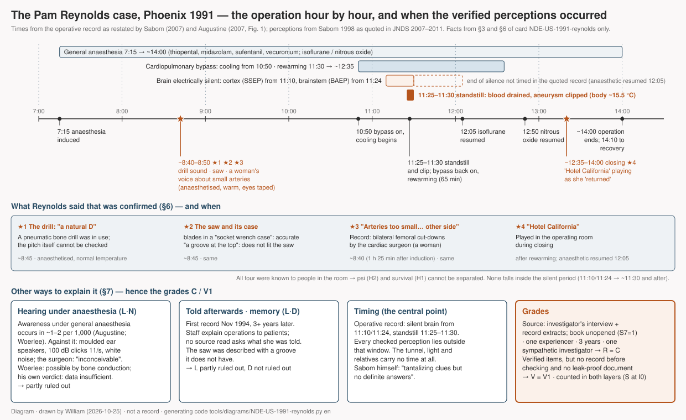

# Pam Reynolds and the bone saw — a woman under general anaesthesia for brain surgery with induced cardiac standstill describes the saw, a conversation about her arteries and the music in the room (Phoenix, 1991)

> August 1991, Phoenix, Arizona. A thirty-five-year-old singer-songwriter lay on an operating table with her eyes taped shut and moulded speakers in both ears clicking at a hundred decibels. To reach a giant aneurysm at the base of her brain, the surgeons would cool her body to about 60 °F, stop her heart and drain the blood from her head. Three years later she told a cardiologist what she had heard and seen while her skull was being opened: a saw that looked like an electric toothbrush, a woman's voice saying her arteries were too small, and, as she came back, the Eagles' "Hotel California".

## What happened

Pam Reynolds is the name under which the Atlanta cardiologist Michael Sabom introduced her in 1998; he chose it as a pseudonym. Her real name became public later, and she died in 2010, so this card keeps the name the literature uses. In 1991 she was thirty-five, a musician and singer-songwriter, and she had a giant aneurysm of the basilar artery: a swelling of the great artery at the base of the brain, which the surgeon noted in his records as "extremely large" and extending up into the brain. It could not be clipped while blood was flowing through it. Robert Spetzler at the Barrow Neurological Institute in Phoenix offered a procedure his team had described in a 1988 paper and that few centres then performed: hypothermic cardiac arrest, "standstill". The body is cooled to about 60 °F (15.5 °C) on a heart–lung machine, the heart is stopped, the blood is drained from the head so that the aneurysm collapses "like a deflated balloon" and can be clipped, and then the blood is returned and the body rewarmed.

*Reference · The Barrow Neurological Institute, Phoenix, in 2019: the Robert F. Spetzler Neuroscience Tower, a later building named after the surgeon. The 1991 operating theatre is not shown, and no photograph of the institute as it was in 1991 was found with a usable licence · BarrowWebmaster, Wikimedia Commons · CC BY-SA 4.0*

The operation took place in August 1991. Shortly after 7:15 that morning she was given a general anaesthetic: thiopental, then midazolam, the opioid sufentanil and the muscle relaxant vecuronium, with nitrous oxide and isoflurane. Her arms and legs were tied down, her eyes were lubricated and taped shut, and small moulded speakers were fitted into both ears and covered with "mounds of tape and gauze". Through them, to monitor her brainstem, clicks of about 100 decibels sounded eleven times a second, alternating between the ears every three minutes, with white noise played into the other ear. Part of her head was shaved. About an hour and twenty-five minutes after induction, Spetzler opened her skull with a pneumatic Midas Rex instrument, a burr first and then a reciprocating saw, while a cardiac surgeon, a woman the card calls Dr M., prepared the vessels in her groin for the bypass machine. The vessels on the right were too small, so the left side was opened as well; the operative record calls these "bilateral femoral cut-downs". At 10:50 the machine began to cool her blood. At 11:10 the responses of her cortex to a stimulus at the wrist were flat; at 11:24 the responses of her brainstem to the clicks were flat. At 11:25 the head of the table was tilted up, the machine was turned off, and the blood was drained from her head "like oil from a car". Spetzler clipped the collapsed aneurysm. At 11:30 the machine was restarted and warmed her over the next sixty-five minutes. The anaesthetic gases, stopped during the deep cooling, were resumed at 12:05 (isoflurane) and 12:50 (nitrous oxide). About 12:32 she came off bypass at 89.6 °F, still cool; the wounds were closed; the operation ended around 2:00 PM, and at 2:10 she was taken to the recovery room, intubated and stable.

Sabom first interviewed her on 11 November 1994, more than three years after the operation, and printed her account in *Light & Death* (1998). She said the first thing she remembered was a sound: "It was a natural D. As I listened to the sound, I felt it was pulling me out of the top of my head. The further out of my body I got, the more clear the tone became." She felt she was watching from above, "metaphorically sitting on Dr. Spetzler's shoulder", with a vision "brighter and more focused and clearer than normal". "I thought the way they had my head shaved was very peculiar. I expected them to take all of the hair, but they did not." The instrument whose sound she hated "looked like an electric toothbrush and it had a dent in it, a groove at the top where the saw appeared to go into the handle, but it didn't. And the saw had interchangeable blades, too, but these blades were in what looked like a socket wrench case." She heard it "crank up", humming "at a relatively high pitch and then all of a sudden it went Brrrrrrrrrr! like that." She heard a woman's voice say something about her veins and arteries being very small, and wondered what they were doing down there, "because this is brain surgery". Then she was drawn into something "like a tunnel but it wasn't a tunnel", towards a pinpoint of light that grew. She heard her grandmother calling her, "but I didn't hear her call me with my ears". In the light she made out figures: her grandmother, an uncle, a great-great-aunt, her grandfather. She understood that if she went all the way into the light she could not be put back. Her uncle took her back and pushed her into her body, which felt "like diving into a pool of ice water". "When I came back, they were playing 'Hotel California' and the line was 'You can check out anytime you like, but you can never leave.'" She later told one of her physicians (Dr B.) that this was "incredibly insensitive". When she regained consciousness she was still on the respirator. She first mentioned the experience to Spetzler several days later, on his rounds.

*Diagram · The operation hour by hour, from the operative record as restated by Sabom and Augustine, with the four perceptions that were checked placed at the times the record gives them, the period of absent brain function, the other explanations and the grades. Drawn by William from sections 3, 6 and 7 of the ledger below; **it is not a record** · generating code `tools/diagrams/NDE-US-1991-reynolds.py`*

Sabom checked what he could. He obtained the operative record and used its times, which are the ones given above. He wrote that he had been "very skeptical" about the saw until the manufacturer, Midas Rex of Fort Worth, Texas, sent him photographs from its user manual: the instrument did resemble an electric toothbrush, and its interchangeable blades were kept in a case like a socket-wrench case. The record also documented the cut-downs on both sides of the groin by the cardiac surgeon, about an hour and twenty-five minutes after induction. The partly shaved head was accurate. In 2002 the BBC film *The Day I Died* brought the case to a wide public. In it Spetzler said that at that stage of the operation nobody could observe or hear, that the instruments had been "inside their packages", and that with "clicking modules in each ear" he found it "inconceivable" that she heard through the normal auditory pathways: "I don't have an explanation for it." Reynolds gave the film a sharper version of the voice than the book had: "We have a problem. Her arteries are too small", and then a man's voice, "Try the other side." From 2007 to 2012 the case was argued through in the *Journal of Near-Death Studies*. Keith Augustine drew the operation as a timeline and showed that the perceptions Sabom had verified began about two hours before the cooling, under ordinary anaesthesia. Sabom restated the times from the record and accepted them, disagreeing about what they implied. The anaesthesiologist Gerald Woerlee argued that she could have heard between and around the clicks, through bone conduction; Chris Carter, Stuart Hameroff and Rudolf Smit replied, and Smit tried Woerlee's proposed sound test on himself and found it intolerable within seconds.

## How far can this record be trusted

This is the case usually described as a near-death experience during a flat EEG. The record does not say that. Each of the four things Reynolds reported that could be checked, the sound of the drill, the shape of the saw and its case, the woman's voice about her arteries and the song, happened while she was under general anaesthesia at normal body temperature. The first three are placed by the operative record around 8:40 to 8:50, about two hours before her heart was stopped; the song was played during closing, after the anaesthetic gases had been resumed. Her brain was electrically silent from 11:10 and 11:24, and her circulation stopped from 11:25 to 11:30. Nothing she said that could be checked falls inside that window, and she gave no times for the tunnel, the light or the relatives. Augustine drew this in 2007; Sabom, who had the record, did not dispute the times. The disagreement between them is about what they mean.

The record is thin in the ways that matter on this study's scale. There is one experiencer. The first record of her words is an interview three years and three months after the event, by a single investigator who was both a cardiologist and a believer: Sabom writes that his certainty about life after death rests not on research into near-death experiences but on his Christian faith. Nobody interviewed the operating-room staff about her account until a television crew did eleven years later and debaters did twenty years later. The book in which Sabom printed her account and his checks is in copyright and could not be opened; this card relies on the long passages reprinted verbatim in the journal debate. On the scale of A to D the record grades **C**.

What holds it up is that Sabom checked against documents he did not control, the operative record and the manufacturer's manual, and said in print that the accuracy of the saw had shocked him. The conditions were documented unusually well for a case of this kind: taped eyes, sealed ear speakers with loud clicks, and a surgeon who says in public that normal hearing was inconceivable. So the case counts as one with verified information. But every item she got right was known to everyone in the room, she told Sabom before he checked, and there is no document dated before the checking. That is the middle grade, **V1**.

Unlike the man with the dentures, this is a full narrative: an out-of-body viewpoint, a tunnel, a light, dead relatives, a return. So it is eligible for the count of structure as well as for the count of verified information. But it comes from the United States in 1991, sixteen years after Moody's *Life After Life* and nine after Sabom's own first book; the pattern was everywhere she could have looked. It adds nothing to the question of independent origin (**I0**).

## Other ways to explain it

- **She may have heard it.** Awareness under general anaesthesia occurs in about one or two patients per thousand, and most of it is hearing. The perceptions fall in exactly the phase where it occurs: anaesthetised, warm, before cooling. Against it stand the moulded speakers sealed with tape and gauze, clicking at 100 decibels, the white noise in the other ear, and Spetzler's "inconceivable". Woerlee answers that the clicks occupy about one hundredth of each second, that the masking ear hears noise at only 40 decibels, that bone conducts sound around a sealed ear, and that Reynolds never mentioned the clicks. Smit replies that a musician would have been tormented by them and that he could not stand the test for seconds. Woerlee's own closing verdict is narrower than his title: a physical explanation is "provably possible", the alternative "unproven", and the available data "insufficient" to decide. This study agrees with that last sentence.
- **She may have been told.** She spoke to Spetzler a few days after the operation, and surgeons explain operations to their patients. Three years passed before anyone wrote down what she said. No text read here asks what she was told in those years.
- **Memory may have reshaped it.** The saw has no groove where she put one. Her account of the voice changed between 1998 ("something about my veins and arteries being very small… I'm not sure") and 2002 ("We have a problem. Her arteries are too small", "Try the other side").
- **It may be a chosen case.** Spetzler's team performed many standstill operations; this is the one that was told. Whether the other patients were asked is not stated in anything read here.
- **Coincidence** explains the socket-wrench case poorly, but the "natural D" cannot be checked, and small vessels and rock music are ordinary events in an operating room.

So this record is **compatible** with the hypothesis that consciousness continues when the brain is silent, but it does not test it: nothing it verifies happened while the brain was silent. What it shows is how a record can be better than its legend in one way, the documentation of the conditions, and worse in another, the timing, and why the legend outran the record.

---

## Investigation ledger

Everything above rests on the sources numbered below. The ledger is this study's working record: the facts with their source numbers (§3–§4), the scores behind the grades (§5), the verified information (§6), the ordinary explanations (§7), the hypotheses the record can and cannot separate (§8), counter-evidence (§9), connections to people, organisations and motifs (§10), cultural independence (§11), notes (§12) and the list of materials (§13). The scoring rules are in `docs/METHOD.md`.

## 1. One-line summary

A woman under general anaesthesia for a standstill operation (Phoenix, August 1991) reported, three years later, hearing the bone saw, seeing its shape and case, hearing a woman's voice about her small arteries, and hearing "Hotel California" on her return; the first three are placed by the operative record about two hours before cardiac arrest and the fourth after the anaesthetics were resumed, so the case is C/V1 and says nothing about perception during absent brain function.

## 2. Structure checklist

- [x] Required 1: a confirmed life-threatening crisis — giant basilar aneurysm operated under hypothermic cardiac arrest with circulation stopped 11:25–11:30 [#2, #3, #7]
- [x] Required 2: two or more NDE elements — out-of-body viewpoint, tunnel ("like a tunnel but it wasn't a tunnel"), light, deceased relatives, return [#1 pp. 41–46 via #5, #7]
- [x] Optional: a boundary ("if I went all the way into the light… they would be unable to put this back into the body") and a return pushed by a relative [#1 pp. 45–46 via #7]
- V element: **present** — four auditory/visual items checked by the investigator against the operative record and the manufacturer's manual (§6)
- → **Eligible for the S-layer count** (structure complete; independence I0, so no new independent cluster) **and for the V layer** (METHOD §1 v0.2: confirmed crisis, out-of-body viewpoint, V element).

## 3. Account

**Person and condition.** Pam Reynolds (pseudonym chosen by Sabom [#3]; real name public later; 1956–2010 [#13]), aged 35 in August 1991 [#3], a musician and singer-songwriter [#10]. Giant aneurysm of the basilar artery, "extremely large" and extending up into the brain according to the surgeon's record [#1 via #7]. Operation at the Barrow Neurological Institute, Phoenix, by Robert Spetzler, using hypothermic cardiac arrest, a technique his team had published in 1988 [#11 as cited in #5]: body temperature lowered to 60 °F, heart stopped, blood drained from the head [#3].

**Conditions during the operation.** Induction with thiopental shortly after 7:15 AM; midazolam, sufentanil, vecuronium; nitrous oxide and isoflurane [#3, #5]. Arms and legs tied down, eyes lubricated and taped shut [#3]. Moulded speakers in both ears, covered with "mounds of tape and gauze… cover the whole ear pinnae" (S.C., the institute's intraoperative monitoring practitioner, pers. comm. to Sabom 2006-10-10) [#2]; clicks at about 100 dB, 11.3 per second, 100 µs, 40 dB white noise in the other ear [#5, citing #11 and #1 p. 41]; clicks alternating between the ears at three-minute intervals (S.C., pers. comm. to Carter 2011-11-11) [#7]. Head partly shaved [#1 via #7]. Craniotomy with a Midas Rex pneumatic instrument, a burr first and then a reciprocating saw [#6]; at the same time the cardiac surgeon (a woman; Dr M.) performed femoral cut-downs: the right femoral vessels were too small for the bypass cannulae, so the left side was prepared as well, "bilateral femoral cut-downs" in the record, about 1 h 25 min after induction [#1 p. 185 via #3; #2; #7].

**Operative record (times).** Bypass and cooling 10:50; cortical somatosensory evoked responses (left median nerve) "flat line" 11:10; brainstem auditory evoked responses "flat line" 11:24; bypass off, blood drained, aneurysm clipped 11:25; bypass on, rewarming over 65 minutes 11:30; isoflurane resumed 12:05 and nitrous oxide 12:50, then continued without interruption; surgery ended about 2:00 PM [#2]. Off bypass about 12:32 at 89.6 °F [#7]. "At 2:10 P.M. the patient was taken to the recovery room still intubated but in stable condition" (Spetzler's report, quoted by Sabom p. 47) [#5]. Augustine's Figure 1 places the start of the out-of-body experience about 2 h 5 min before cooling [#3].

**Her account (first recorded 1994-11-11 [#3]; printed 1998 [#1]).** The "natural D" pulling her out of the top of her head; viewpoint "metaphorically sitting on Dr. Spetzler's shoulder"; vision "brighter and more focused and clearer than normal"; the partly shaved head "very peculiar"; the saw "like an electric toothbrush… a groove at the top… interchangeable blades… in what looked like a socket wrench case"; "I heard the saw crank up… humming at a relatively high pitch and then all of a sudden it went Brrrrrrrrrr!"; "Someone said something about my veins and arteries being very small. I believe it was a female voice and that it was Dr. M., but I'm not sure"; "What are they doing there, because this is brain surgery?" [#1 pp. 41–42 via #5, #7]. Tunnel "like a tunnel but it wasn't a tunnel"; grandmother calling, "I didn't hear her call me with my ears"; pinpoint of light growing; figures of her grandmother, an uncle, a great-great-aunt and her grandfather; told that if she went all the way into the light they could not put her back; uncle pushed her back, "like diving into a pool of ice water" [#1 pp. 44–46 via #7]. "When I came back, they were playing 'Hotel California'…"; remark to Dr B.; still on the respirator when she regained consciousness [#1 p. 47 via #5]. First mentioned the experience to Spetzler several days later on his rounds [#7]. In the 2002 film: "I distinctly remember a female voice saying, 'We have a problem. Her arteries are too small.' And then a male voice: 'Try the other side.' It seemed to come from further down the table" [#12 via #7].

**Checks by the investigator.** Operative record obtained and quoted [#2]. Saw: Sabom "very skeptical" until the Midas Rex Company (Fort Worth, Texas) supplied user-manual photographs showing an instrument resembling an electric toothbrush with interchangeable blades in what looked like a socket-wrench case; "shocked at the accuracy" [#1 pp. 187–189 via #3, #5]. The groove she described does not fit the instrument [#3]. Cut-downs confirmed in the record [#1 p. 185 via #3]. Shaved head accurate but learnable afterwards [#3]. Music during closing reported as fact in Sabom's narrative [#1 via #5]; how he confirmed it is not stated in the texts read.

**Later statements by the surgeon.** BBC 2002: at that stage nobody can observe or hear; the drill "and so on were covered up and invisible. They were inside their packages"; hearing through the normal auditory pathways with "clicking modules in each ear" is "inconceivable"; "I don't have an explanation for it" [#12 via #9]. Pers. comm. to Carter 2011-03-17: the speakers were still clicking during closing [#7].

**Record history.** 1991 event → several days later, told to Spetzler (content not recorded) [#7] → 1994-11-11 first interview by Sabom [#3] → 1998 *Light & Death* ch. 3 [#1] → 2002 BBC *The Day I Died* [#12] → 2007 JNDS exchange (Augustine, Tart, Sabom, Greyson; Augustine's reply) [#2, #3, #4, #14] → 2008 letters (Smit, Sabom, Atwater) [#9, #15] → 2011 exchange (Woerlee, Hameroff, Carter, Woerlee's rejoinder) [#5–#8] → 2012 Smit's test [#10]. Reynolds died in 2010 [#13].

**Discrepancies.** ① The voice: 1998 "something about my veins and arteries being very small… I'm not sure" vs 2002 "We have a problem. Her arteries are too small" plus a male "Try the other side" [#5, #7]. ② The saw: a groove it does not have [#3]; the two-stage sound explained by Woerlee as burr then saw [#6], by Sabom's narrative as the one instrument [#1 via #5]. ③ The end of the period of absent brain activity is not timed in the record as quoted; only the resumption of anaesthetics (12:05) and the first "blips" during rewarming are mentioned [#2, #7].

## 4. Sources

| # | Type (primary/secondary/tertiary) | Reference | Opened | Link | Notes |
|---|---|---|---|---|---|
| 1 | primary (investigator's record of the interviews and of the operative record) | Sabom MB. *Light & Death: One Doctor's Fascinating Account of Near-Death Experiences*. Grand Rapids: Zondervan, 1998. Ch. 3 pp. 37–51; discussion pp. 184–190; p. 198 | **unverified** (in copyright; no free copy) | — | All content taken from verbatim quotations in #2, #3, #5, #7 with Sabom's page numbers |
| 2 | secondary (investigator's commentary) | Sabom MB. Commentary on "Does paranormal perception occur in near-death experiences?" *J Near-Death Stud* 2007;25(4):257–260 | confirmed (OCR) | https://digital.library.unt.edu/ark:/67531/metadc799458/ | Operative times; S.C. pers. comm. 2006-10-10; disclaimers; faith statement |
| 3 | rebuttal (secondary) | Augustine K. Does paranormal perception occur in near-death experiences? *J Near-Death Stud* 2007;25(4):203–236 | confirmed (OCR) | https://digital.library.unt.edu/ark:/67531/metadc799110/ | Figure 1 (p. 218) timeline; awareness 1–2/1,000; first interview date |
| 4 | rebuttal (secondary) | Augustine K. "Does paranormal perception occur in near-death experiences?" defended. *J Near-Death Stud* 2007;25(4):261–283 | confirmed (OCR) | https://digital.library.unt.edu/ark:/67531/metadc799459/ | Reynolds pp. 276–281; nothing new on the record |
| 5 | rebuttal (secondary) | Woerlee GM. Could Pam Reynolds hear? A new investigation into the possibility of hearing during this famous near-death experience. *J Near-Death Stud* 2011;30(1):3–25 | confirmed (OCR) | https://digital.library.unt.edu/ark:/67531/metadc461684/ | Quotes #1 pp. 37–47 at length; drugs; click parameters; 2:10 PM |
| 6 | rebuttal (secondary) | Woerlee GM. Rejoinder to responses to "Could Pam Reynolds hear?" *J Near-Death Stud* 2011;30(1):54–61 | confirmed (OCR) | https://digital.library.unt.edu/ark:/67531/metadc461715/ | Burr then saw; verdict p. 60 |
| 7 | reply (secondary) | Carter C. Response to "Could Pam Reynolds hear?" *J Near-Death Stud* 2011;30(1):29–53 | confirmed (OCR) | https://digital.library.unt.edu/ark:/67531/metadc461722/ | Reprints #1 pp. 37–47; BBC quotations; Spetzler pers. comm. 2011-03-17; S.C. pers. comm. 2011 |
| 8 | reply (secondary) | Hameroff S. Response to "Could Pam Reynolds hear?" *J Near-Death Stud* 2011;30(1):26–28 | confirmed (OCR) | https://digital.library.unt.edu/ark:/67531/metadc461724/ | Nothing about the record used |
| 9 | reply (letter) | Smit RH. Further commentary on Pam Reynolds's NDE. *J Near-Death Stud* 2008;26(4):308–310 | confirmed (OCR) | https://digital.library.unt.edu/ark:/67531/metadc937967/ | Spetzler's BBC statements |
| 10 | reply (letter) | Smit RH. Failed test of the possibility that Pam Reynolds heard normally during her NDE. *J Near-Death Stud* 2012;30(3):188–192 | confirmed (OCR) | https://digital.library.unt.edu/ark:/67531/metadc938051/ | Self-test; "musician, a singer-songwriter"; four video interviews |
| 11 | primary (technique paper) | Spetzler RF et al. *J Neurosurg* 1988;68:868–879 | reference confirmed (PubMed 3373282); text **unverified** | https://pubmed.ncbi.nlm.nih.gov/3373282/ | Click parameters as quoted in #5 |
| 12 | tertiary (television) | BBC, *The Day I Died* (producer Kate Broome), 2002 | **unverified** (quoted in #7, #9) | — | Spetzler's and Reynolds's on-camera statements |
| 13 | tertiary | Wikidata Q2499174 | confirmed | https://www.wikidata.org/wiki/Q2499174 | Dates 1956–2010 |
| 14 | reply (secondary) | Tart C. Commentary. *J Near-Death Stud* 2007;25(4):251–256 | not fetched | UNT JNDS index (`sources/unt-jnds-index.tsv`) | |
| 15 | replies (letters) | Sabom MB. Letter, *J Near-Death Stud* 2008 (metadc937968); Atwater PMH. Letter (metadc799054) | confirmed (OCR) | https://digital.library.unt.edu/ark:/67531/metadc937968/ | Nothing about the record used |

## 5. Scores and grades

| Axis | Score | Reason in one line |
|---|---|---|
| S1 Source | 1 | Secondary: an investigator who interviewed the experiencer in person (#1), reached through verbatim quotation; no document of her account from 1991 |
| S2 Witnesses | 1 | One identified experiencer; the corroboration is documentary (record, manual), not a second independent witness of her words |
| S3 Timing | 0 | First interview 1994-11-11, three years and three months after the event [#3] |
| S4 Ordinary explanations examined | 0 | Two items not ruled out (D, X) → the condition for 1 (at most one) is not met; F partly ruled out |
| S5 Prior record (V axis) | 1 | Told orally to Sabom before he checked the record and the manual; he later testified (#1, #2); no dated document before checking |
| S6 Investigator independence | 1 | In-person interview by a single investigator who is a believer by his own statement [#2] and was already an NDE author; no body, but not disinterested |
| S7 Original text opened | 1 | #1 not opened; reliable scholarly secondaries (#2–#10) reprint the passages verbatim with page numbers |

Total (S1+S2+S3+S4+S6) = 3/10 → R grade **C** / cap applied: none (S7=1, no cap ①; explanations filled; S1, S2 > 0; F partly ruled out; counter searched) / V grade **V1** (S5=1; F, L, C at least partly ruled out; R≥C).

## 6. Verified information (V claim)

| Information | Who said it | When and where recorded | When and by whom verified | Normal channels investigated | Who alive at the time knew it |
|---|---|---|---|---|---|
| ★1 A tone, "a natural D", then an instrument "humming at a relatively high pitch and then all of a sudden it went Brrrrrrrrrr!" used on her head | Reynolds | Interview 1994-11-11; #1 p. 41 | Sabom: a Midas Rex pneumatic instrument was used for the craniotomy [#1 pp. 187–189 via #3]; Woerlee: burr first, then a reciprocating saw, which fits the two sounds [#6]. The pitch cannot be checked | Hearing under anaesthesia examined in #3, #5, #6, #7, #9, #10 (§7 N, L) | Everyone in the operating room |
| ★2 The saw "looked like an electric toothbrush… a groove at the top where the saw appeared to go into the handle"; "interchangeable blades… in what looked like a socket wrench case" | Reynolds | same | Sabom, "very skeptical", obtained user-manual photographs from the manufacturer: resemblance to an electric toothbrush and the blade case confirmed; the groove does not fit [#1 pp. 187–189 via #3, #5] | Whether she saw such an instrument before or after the operation was asked in no text read | Surgical team; anyone who has seen the instrument |
| ★3 A woman's voice about her small vessels ("veins and arteries being very small… I believe it was a female voice", 1998; "We have a problem. Her arteries are too small", then a man's "Try the other side", 2002) | Reynolds | same; #12 (2002) | Sabom: the record documents "bilateral femoral cut-downs" by the cardiac surgeon (a woman) because the right femoral vessels were too small, about 1 h 25 min after induction [#1 p. 185 via #3; #2; #7] | Hearing under anaesthesia (§7 N); being told afterwards not asked | Surgical team |
| ★4 "When I came back, they were playing 'Hotel California'… 'You can check out anytime you like, but you can never leave'" | Reynolds | same; #1 p. 47 | Sabom's narrative: rock music was played while the younger assistants closed [#1 via #5]; how it was confirmed is not stated in the texts read. Spetzler (pers. comm. 2011-03-17): the ear speakers were still clicking during closing [#7] | Anaesthetics resumed 12:05 and 12:50 [#2]; Woerlee: awareness during closing "could very well" have occurred [#5] | Surgical team |
| (not counted) Her head was shaved only in part, which she found "very peculiar" | Reynolds | same; #1 p. 41 | Accurate [#3] | Visible to her afterwards [#3] | — |

Every counted item is a sound heard by everyone in the room, or an object seen by them, during a phase in which she was anaesthetised at normal temperature (★1–★3) or after the anaesthetics had been resumed (★4). The record cannot separate H2 (psi) from H1, and cannot separate either from hearing under anaesthesia (§7 N).

## 7. Other ways to explain it

| Item | Status | Reason |
|---|---|---|
| F Fraud | Partly ruled out | No money or fame sought at first: the pseudonym was Sabom's [#3]; she appeared in public only with the 2002 film [#12 via #9]. Sabom checked against documents he did not control [#1 via #3]. But nothing she said was recorded before 1994 by anyone but Sabom, and her first statements to Spetzler "several days later" [#7] were not recorded |
| M Misperception | Partly ruled out | The sounds she reports were real sounds in the room; the question is the channel (N, L), not misperception. The one visual item has a feature the instrument lacks (the groove) [#3] |
| D Memory distortion, later embellishment | Not ruled out | First record 3 years 3 months after the event [#3]. Versions differ: 1998 "veins and arteries… I'm not sure" vs 2002 "We have a problem. Her arteries are too small" / "Try the other side" [#5, #7]. The groove [#3] |
| L Leakage, normal channels | Partly ruled out | Two channels. (a) Hearing during the operation: see N. (b) Being told afterwards: she spoke to Spetzler several days later [#7]; surgeons explain operations; no text read asks what she was told between August 1991 and November 1994. That she never mentioned the clicks is used by both sides [#5, #10] |
| E Cultural expectation, suggestion | Partly ruled out | Tunnel, light, relatives and return follow the pattern available in the US since 1975 (§11); the four verified items do not come from that pattern. Whether she had read NDE literature before 1991 is not recorded in the texts read |
| N Neurophysiology, drugs, psychology | (recorded only) | Awareness under general anaesthesia 1–2 per 1,000, 48 % auditory [#3]; 1–9 per 1,000 [#5]. All verified items fall in phases of normal temperature with anaesthesia running [#2, #3, #5]. Against hearing: moulded speakers sealed with tape and gauze, 100 dB clicks about 11 per second alternating between the ears every three minutes, 40 dB white noise in the other ear [#2, #5, #7]; Spetzler "inconceivable" [#12 via #9]; Smit's self-test intolerable within seconds [#10]. For hearing: clicks occupy about 1 % of each second, the masking ear hears only 40 dB noise, bone conduction [#5, #6]. Woerlee's own conclusion: physical explanation "provably possible", immaterial explanation "unproven", "the available data… are insufficient" [#6 p. 60] |
| C Coincidence, base rate | Partly ruled out | The socket-wrench case and the two-stage saw sound are specific; a "natural D" from a pneumatic drill cannot be checked; small vessels and rock music are common operating-room events. No prior record |
| X Selective reporting, recorder bias | Not ruled out | One case from a surgical series; whether the other standstill patients were asked is not stated in the texts read (Sabom's book reportedly compares other patients: unverified, #1). The popular framing places the experience during standstill [#12]; the investigator's own record does not [#2, #3] |

## 8. Compatible hypotheses

| Hypothesis | Status | Reason |
|---|---|---|
| H1 Survival after death | Compatible | V1. All verified information was known to living people in the room, and none of it is placed in the period of absent brain function [#2, #3]: neither support nor refutation |
| H2 Psi without survival | Compatible | All verified information was known to the surgical team (§6, last column) |
| H3 Cultural transmission | Compatible | S layer at I0: record 1994 > baseline 1975, United States, English; routes ② and ④ confirmed (§11). The narrative elements follow the available pattern; the verified items do not depend on it |
| H4 Neurophysiology, psychology | Compatible | Awareness under anaesthesia with hearing by bone conduction (Woerlee) is not excluded by the record; the surgeon finds it inconceivable; the data are insufficient to decide [#6] |
| H5 Memory distortion, embellishment | Compatible | 3-year gap; version differences; the groove. A live hypothesis |
| H6 Fraud | Compatible | No motive known and third-party documents were checked, but no record before 1994 → "unfavourable" condition not met |
| H7 Chance, base rate | Compatible | No prior record; two of the four items are specific |
| H8 Investigator effect | Compatible | A single investigator whose certainty about life after death rests, by his own statement, on faith [#2]; he nonetheless restated the record against the popular reading of his own case and printed disclaimers [#1 pp. 49–50, 189–190, 198 via #2]. The questions asked in 1994 are not published |

## 9. Counter-evidence

Search: 2026-10-25 / `sources/unt-jnds-index.tsv` for "Reynolds"; references of #3 and #5 / Result: twelve JNDS texts opened; the full exchange is summarised in `sources/jnds-reynolds-2007-2012.md`.

| Source | R grade | Gist | Effect on this card |
|---|---|---|---|
| Augustine 2007 [#3, #4] | C (no witnesses of its own: S2=0 → cap C) | Timeline from the record: the verified perceptions began about 2 h 5 min before cooling, under anaesthesia; awareness rates; the groove; the shaved head learnable | Decides the "when" column of §6: the case cannot be used for "experience during a flat EEG". S4 and N as above |
| Woerlee 2011 and rejoinder [#5, #6] | C (same cap) | Drugs and their half-lives; click parameters from #11; bone conduction; clicks never mentioned; burr then saw; own verdict "insufficient" | N and L "partly ruled out" rather than "ruled out"; D "not ruled out" |
| Sabom 2007 [#2] | — (reply) | Restates the operative times; concedes them; disclaimers; faith statement | Supplies the times in §3; S6=1 |
| Carter 2011, Hameroff 2011 [#7, #8] | — (replies) | Evoked potentials are not conscious perception; sealed speakers exclude ordinary hearing; reprints of #1 | Supplies the verbatim wording of §3; keeps N at "partly ruled out" |
| Smit 2008, 2012 [#9, #10] | — (replies) | Spetzler's BBC statements; self-test of the click stimulus intolerable; musician | Same |

## 10. Connections

Search: 2026-10-25 / entity files; references of #3, #5, #7 / Result: below

| Target `[[id]]` | Relation (R-*) | Verdict | Grade | Reason |
|---|---|---|---|---|
| [[P-Reynolds-Pam]] | R-PER | Neutral | Confirmed | Experiencer; pseudonym in 1998; real name public later; died 2010 [#13] |
| [[P-Sabom-MB]] | R-INV | Neutral | Confirmed | Sole investigator: interviews from 1994-11-11, book 1998, commentary 2007 |
| [[P-Spetzler-RF]] | R-PER | Neutral | Confirmed | Surgeon and witness of the conditions; statements 2002 (BBC) and 2011 (pers. comm. to Carter) |
| [[L-Barrow-Neurological-Institute]] | R-LOC | Neutral | Confirmed | Site of the operation |
| [[P-Woerlee-GM]] | R-REB | Neutral | Confirmed | 2011 article and rejoinder; the same rebutter as in [[NDE-NL-1979-dentures]] |
| [[P-Augustine-K]] | R-REB | Neutral | Confirmed | 2007 survey and reply |
| [[O-Merkawah]] | R-REB (defence) | Neutral | Confirmed | Smit's letters of 2008 and 2012; not an investigating body for this case |
| [[M-obe-veridical-resuscitation]] | R-MOT | Undecided | Confirmed | Second entry in the motif ledger |
| [[NDE-NL-1979-dentures]] | R-MOT | Neutral | Confirmed | Same motif and the same two debaters (Smit, Woerlee), different investigators and countries; no transmission between the two experiencers is known (the Dutch story was first printed in 1991, Reynolds's first record is 1994). Both lie in EU-W after 1975 |

## 11. Cultural independence

Cluster: EU-W / record year 1994 vs baseline year for NDE 1975 → after / investigating body: none (single investigator [[P-Sabom-MB]])

| Path | Ruled out / unknown / confirmed | Reason (including transmission links from §10) |
|---|---|---|
| ① Direct contact | Ruled out | No contact between Reynolds and the people of the other cards (Netherlands 1979, London 1924) is recorded or plausible |
| ② Translation, publication | Confirmed | English-language NDE literature from Moody 1975 and Sabom's own 1982 book were available in the United States before 1991; the investigator was himself an author of that literature |
| ③ Missionary, religious transmission | Not applicable | Same cluster and religious background as the other EU-W cards [#2] |
| ④ Mass media | Confirmed | NDE accounts were in US mass media from 1975. Her own account entered mass media in 2002 [#12]; that affects later cards, not this one |
| ⑤ Same investigating body | Ruled out | No other card by Sabom |

→ Independence grade **I0** (routes ② and ④ confirmed). The S-layer count gains no new independent cluster from this card; the V layer does not condition on independence.

## 12. Notes

- Names. "Pam Reynolds" was a pseudonym chosen by Sabom [#3]; her real name became public with the 2002 film and later reporting, and she died in 2010 [#13]. The card keeps the name used in the literature. The cardiac surgeon (Dr M.), the physician she spoke to afterwards (Dr B.) and the institute's monitoring practitioner (S.C.) are living or of unknown status and are given initials, although the texts name them; Sabom, Spetzler and the authors of the debate are public authors and are named.
- The central result is timing. All four verified items fall in phases of normal temperature with anaesthesia running; Reynolds gave no time for the tunnel and the relatives; the record as quoted does not time the end of the period of absent brain activity. Sabom's own words: the case "gives us tantalizing clues but no definite answers" [#1 pp. 189–190 via #2], and "modern descriptions of NDEs are not accounts of life after death" [#1 p. 198 via #2]. "Since she did live then by definition she was never dead… Doctors can save people from death and rescue some who are close to death, but they cannot raise people from the dead" [#1 pp. 49–50 via #2].
- The clicks. Reynolds never mentioned them [#5, #10]. Woerlee reads this as consistent with hearing speech without consciously registering the clicks; Smit reads it as proof that she could not have heard through her ears, because a musician would have been tormented by them. The fact is the same; it decides nothing.
- Discrepancies are listed in §3. The 2002 wording is more precise than the 1998 wording; the direction of change is the one memory distortion predicts, but a sharper second telling is also what repeated interviewing produces. Four video interviews exist [#10]; none opened.
- Other standstill patients: whether Spetzler's other patients were asked about experiences is the question that would turn X from "not ruled out" into a measurable base rate. Sabom's book reportedly compares other patients (unverified, #1).
- This is the first card for which the counter-evidence could be read in full and free of charge (twelve texts); the counter axis is fully used. The 1998 book, the 2007 Tart commentary, the BBC film, the 1988 technique paper and Sabom's 1982 *Recollections of Death* remain unopened.
- Tools: quotations were extracted from the UNT OCR with Python windows over whitespace-normalised text; ugrep context patterns exceed its complexity limit. OCR of two-column pages scrambles word order within lines; every quotation above was reconstructed from two overlapping sources (#5 and #7) where possible.

## 13. Materials

Rules in METHOD §9. Photographs aid understanding; they are not evidence and do not affect grades. The images themselves appear above in "What happened"; this is the list. Full licence records in `assets/index.md`.

| File | Kind | What | Source · licence |
|---|---|---|---|
| `NDE-US-1991-reynolds--barrow-tower.jpg` | ② Place (reference) | The Robert F. Spetzler Neuroscience Tower of the Barrow Neurological Institute, Phoenix, at dusk, 2019: a later building named after the surgeon. The 1991 operating theatre is not shown | BarrowWebmaster, Wikimedia Commons · CC BY-SA 4.0 |
| `NDE-US-1991-reynolds--timeline.svg` · `--timeline-ko.svg` | ④ Diagram | The operation hour by hour (7:15 → 14:10), the period of absent brain function, the four verified perceptions at the times the record gives them, the other explanations and the grades. English and Korean | William, 2026-10-25 · code `tools/diagrams/NDE-US-1991-reynolds.py en` / `ko` |

- Not used (copyright): the JNDS pages (© IANDS; linked in §4), Sabom 1998 (© Zondervan), the BBC film, and the photograph of the Midas Rex instrument in the manufacturer's manual (the fact is in the text of the diagram only).
- No portrait: no free image of Reynolds was found (Commons search 2026-10-25), and no portrait of Spetzler is used (a witness of unknown status; faces of witnesses are not shown).
- Newspapers: the operation was not news in 1991 and no 1991 press was searched (Chronicling America ends in 1963; loc.gov blocks automated access). Obituaries of 2010 may confirm her dates: unverified, to look for.
- To look for next: a free copy of Sabom 1998 (library scan) and of Sabom 1982; Tart 2007 (#14); a transcript of the BBC film; the full text of #11; any published account by the operating-room staff.
