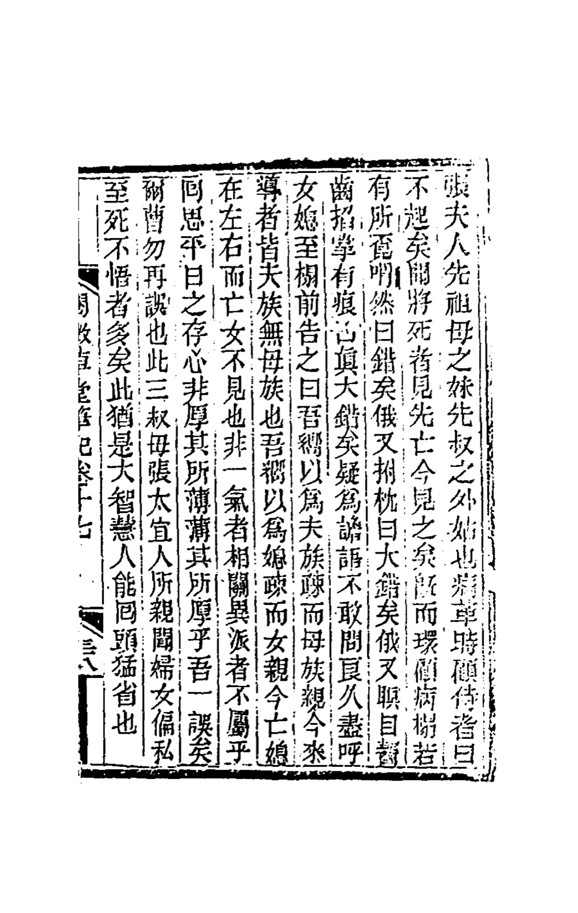
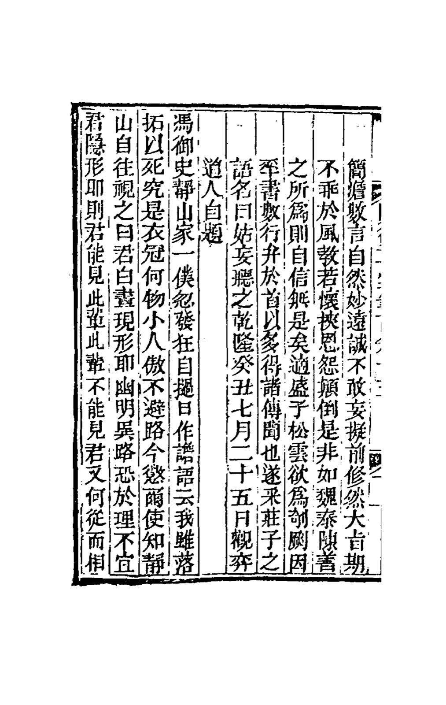
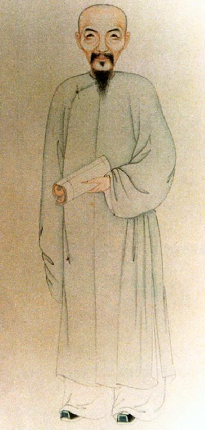
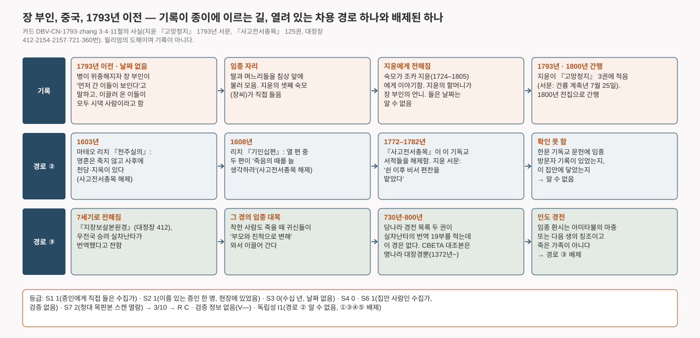

# 장 부인, 데리러 온 이들을 보다 — 청나라의 한 노부인이 임종 때 "먼저 간 이들"이 보인다고 말하고, 이끌러 온 이들이 모두 시댁 사람이라며 놀라다 (중국, 1793년 이전)

> "죽어 가는 사람은 먼저 간 이들을 본다더니, 이제 보이는구나." 청나라 사대부 집안의 노부인이 병이 위중해졌을 때 한 말이다. 그는 병상 둘레를 두리번거리다 "틀렸다"를 세 번 말하고, 딸과 며느리들에게 자기를 이끌러 온 이들이 모두 시댁 사람이고 친정 쪽은 하나도 없으며, 죽은 며느리는 곁에 있는데 죽은 딸은 보이지 않는다고 했다. 학자 지윤(紀昀)이 1793년에 이 일을 적으면서, 직접 들은 숙모의 이름을 밝혔다.

이 글은 영어 카드 [[DBV-CN-1793-zhang|Lady Zhang sees who has come for her (China, before 1793)]]의 위층("읽는 글")을 한국어로 옮긴 것이다. 출처 번호·점수·등급 판정이 있는 조사 장부는 영어 카드에만 둔다. 등급: **R C · V— · I1**.

## 무슨 일이 있었나

기록은 건륭 연간의 고위 관료이자 학자 지윤(1724–1805)이 모은 기이한 이야기 모음 속 짧은 한 편이다. 죽어 가던 사람은 장 부인으로, 지윤의 돌아가신 할머니의 여동생이자 돌아가신 숙부의 장모였다. 지윤은 그가 언제, 어디서 죽었는지 적지 않았다. 언니가 지윤의 할머니였으니, 지윤이 이 일을 적기 한 세대 이상 전의 일이다.

전문을 윌리엄이 옮긴다.

"장 부인은 돌아가신 할머니의 여동생이고, 돌아가신 숙부의 장모다. 병이 위중해졌을 때 시중드는 이들을 돌아보며 말했다. '나는 일어나지 못한다. 죽어 가는 사람은 먼저 간 이들을 본다더니, 이제 보이는구나.' 그러고는 병상 둘레를 누군가 찾듯 두리번거리다 한숨을 쉬며 '틀렸다' 했다. 조금 뒤 베개를 치며 '크게 틀렸다' 했다. 또 조금 뒤 눈을 감고 이를 갈며 손바닥에 손톱자국이 나도록 쥐고 '참으로 크게 틀렸다!' 했다. 사람들은 헛소리라 여겨 감히 묻지 못했다. 한참 뒤 딸과 며느리들을 모두 침상 앞에 불러 말했다. '나는 여태 시댁 사람은 멀고 어머니 쪽 사람은 가깝다고 여겼다. 그런데 지금 나를 이끌러 온 이들은 모두 시댁 사람이고 어머니 쪽은 하나도 없다. 나는 며느리는 멀고 딸은 가깝다고 여겼다. 그런데 지금 죽은 며느리는 곁에 있고 죽은 딸은 보이지 않는다. 한 핏줄끼리는 서로 이어지고 갈래가 다른 이는 속하지 않는다는 것인가? 평소 품은 마음을 돌아보니, 박하게 대할 이를 두터이 하고 두터이 할 이를 박하게 하지 않았던가? 나는 한 번 잘못했으니 너희는 다시 잘못하지 마라.' 이는 셋째 숙모 장 태의인(太宜人)이 직접 들은 것이다. 부녀자가 치우친 마음을 죽을 때까지 깨닫지 못하는 일이 많은데, 이분은 큰 지혜가 있어 고개를 돌려 크게 깨달은 사람이다."

*인쇄된 원문. 청대 목판본 지윤 『열미초당필기』 17권 38장(이 글은 넷째 모음 『고망청지』 3권에 속한다). 오른쪽 張夫人("장 부인")에서 시작해 왼쪽 能回頭猛省也("고개를 돌려 크게 깨달았다")로 끝난다 · 북경대학 도서관 소장본, 중미 디지털 학술도서관(CADAL) 스캔, archive.org `02099125.cn` 76번 이미지 · 저작권 만료 저작물*

지윤은 이 글을 자기 필기의 다섯 모음 가운데 넷째인 『고망청지』("그냥 흘려 들으시라")에 넣었다. 그 서문에는 건륭 계축년 7월 25일, 곧 1793년이라는 날짜가 있다. 같은 서문에서 그는 이제 늙어 "옛날 들은 것을 뒤늦게 적는다", "대부분 전해 들은 것이다", 큰 뜻은 "풍교(風敎)에 어긋나지 않게 하는 것"이라고 하고, 성송운이 책으로 새기려 한다고 적었다. 다섯 모음은 1800년에 한데 묶여 간행됐다.

*지윤의 『고망청지』 서문 끝. "…장자의 말을 따서 『고망청지』라 이름한다. 건륭 계축(1793) 7월 25일, 관혁도인(觀弈道人)이 스스로 적다"(관혁도인은 그의 호) 뒤로 1권의 첫 이야기가 이어진다 · 같은 판본, archive.org `02099123.cn` 3번 이미지 · 저작권 만료 저작물*

*참고 그림 · 위키미디어 공용에서 지윤(1724–1805)의 초상으로 소개한 그림. 18세기, 화가 미상. 초상이 지윤이라는 것은 공용의 설명이며 더 확인하지 않았다. 기록한 사람이며 증인이 아니다 · Wikimedia Commons · 퍼블릭 도메인*

## 이 기록은 어디까지 믿을 수 있나

이것은 직접 들은 이야기를 한 번 건너 적은 기록이다. 증인은 그 시대 그 계층의 여성이 불리던 방식대로, 친족 관계와 성으로 밝혀져 있다. 지윤의 셋째 숙모 장씨로, 태의인이라는 봉호를 받은 사람이다. 그가 그 말을 직접 들었고, 지윤은 그에게서 들었다. 지윤은 일이 있고 수십 년 뒤, 스스로 옛날 들은 것을 교훈을 위해 적은 책이라고 밝힌 책에 이것을 썼다. 날짜도, 장소도, 의사도, 두 번째 증인도, 이 죽음에 대한 다른 기록도 없다. 이 연구의 등급표로는 상한에 걸리지는 않지만 낮은 등급, **C** 구간의 맨 아래다.

검증 정보의 주장은 없다. 나타난 이들은 모두 죽은 줄 알던 사람들이므로, 이 사건은 구조 층에만 속한다. 죽어 가는 사람이 자기를 데리러 온 죽은 가족을 보는 구조다.

이 글이 교훈담에 그치지 않는 데는 두 가지 이유가 있다. 첫째, 죽어 가던 사람이 그 믿음을 스스로 말한다. "죽어 가는 사람은 먼저 간 이들을 본다더니." 임종 환시라는 생각이 그 집안에 이미 상식으로 돌고 있었다. 둘째, 그가 본 것은 그가 기대했다고 말한 것과 달랐다. 그는 자기 친정 사람과 자기 딸을 기대했는데, 시댁 사람과 며느리를 보았다. 그는 거기서 스스로 규칙을 끌어냈다. "한 핏줄끼리는 서로 이어진다." 그것은 그 사회의 부계 질서이므로 이 환시가 문화의 기대를 벗어난 것은 아니다. 그러나 그 자신의 바람도 아니었다.

독립성은 이 구조를 다른 문화에서 빌려 왔을 수 있느냐는 물음이다. 한 경로가 열려 있다. 영혼과 죽음에 관한 기독교 서적이 1603년부터 한문으로 간행됐고, 1770–80년대에 지윤의 편찬실이 황실 장서 목록을 만들며 그 책들을 해제했다. 그 책이 이 집안에 닿았다는 증거도, 닿지 않았다는 증거도 없다. 카드를 처음 낼 때 열려 있던 두 번째 경로는 그 뒤 닫혔다. 한문 불교 경전 가운데 죽어 가는 사람이 "부모와 친척으로 변한" 귀신들이 와서 데려가는 것을 본다는 경전이 있고, 인도 말에서 옮긴 것으로 전해진다. 그런데 번역자로 알려진 승려의 번역 19부를 모두 적은 당나라 경전 목록(730년·800년) 두 권에 이 경이 없다. 또 대장경 속 인도 경전을 찾아본 범위에서, 임종 환시는 아미타불의 마중이나 다음 생의 징조였고 죽은 가족이 아니었다. 그래서 "죽은 가족이 데리러 온다"는 생각은 남아시아에서 들어온 것이 아니라 동아시아 자신의 것이다(2026-11-06 확인). 기독교 경로가 남아 있으므로 등급은 그대로 **I1**이다. 집계에는 들지 않지만, 동아시아의 첫 기록이자, 독립된 기록을 어디서 찾아야 하는지 알려 주는 표지로 남긴다.

## 다르게 설명하면

- **방문자가 아니라 죽어 가는 뇌.** 그는 죽을병이 위중한 고비에 있었다. 곁의 사람들이 먼저 떠올린 것도 가장 뻔한 설명이었다. "헛소리라 여겼다." 그 뒤 길고 조리 있는 말이 이어진 것은 그 순간 정신이 맑았다는 쪽에 무게를 주지만, 그가 본 것의 출처에 대해서는 아무것도 증명하지 않는다.
- **문화가 가르친 기대.** 그는 그 믿음을 스스로 인용한다. 그리고 내용은 시집간 여성의 죽은 이들은 남편 집안의 죽은 이들이라는 그 사회의 규칙을 따른다. 그 자신의 것은 세부뿐이다.
- **되풀이 전해지며 다듬어진 좋은 이야기.** 숙모는 몇 해 뒤 기억으로 전했고, 지윤은 그보다 더 뒤에 기억으로 적었으며, 그가 밝힌 목적은 교훈이었다. 이야기는 바로 그런 교훈, 딸만 감싸는 부녀자의 치우침에 대한 말로 끝난다. 다시 전해지며 모양이 잡혔을 가능성은 충분하다.
- **선별.** 이 이야기가 남은 것은 천이백 편쯤 되는 기이한 이야기책에서 좋은 교훈이 됐기 때문이다. 그 집안에서 아무도 보이지 않았던 임종들은 아무도 세지 않았다.
- **지어냄.** 돈도 명예도 걸려 있지 않고, 이야기는 오히려 죽어 가던 사람의 지난 처신을 조금 깎아내린다. 아무도 확인하지 않았으므로 지어냄은 "부분" 배제다.

이 기록은 의식의 사후 존속과도, 모든 평범한 설명과도 양립한다. 이 기록의 값은, 이 연구의 기준 연도보다 한 세기 앞서 동아시아에서 이 구조가 적혔고, 이름 있는 증인이 있으며, 죽어 가던 사람이 그 믿음을 스스로 말했다는 데 있다.

*기록이 종이에 이른 길, 독립성을 I1에 묶어 두는 경로(②)와 2026-11-06에 배제된 경로(③). 카드 3·4·11절에서 그렸다. 윌리엄의 도해이며 **기록이 아니다** · 생성 코드 `tools/diagrams/DBV-CN-1793-zhang.py`*

## 출처

출처 번호, 점수, 검증 정보, 평범한 설명, 가설, 반대 자료, 연결, 문화적 독립성, 메모, 자료 목록은 영어 카드 [[DBV-CN-1793-zhang|Lady Zhang sees who has come for her (China, before 1793)]]의 조사 장부 §1–§13에 있다. 핵심 출처는 청대 목판본 『열미초당필기』 17권 38장과 『고망청지』 서문(북경대학 도서관 소장본, archive.org 스캔 확인), 『사고전서총목제요』 125권(위키문헌 전사본), 『지장보살본원경』(대정장 412번, CBETA), 당나라 경전 목록 『개원석교록』(730)·『정원신정석교목록』(800), 『정법념처경』·『무량수경』이다. 『지장경』의 중국 찬술설을 다룬 버스웰(1990)과, 처음 계획했던 오시스·하랄드손의 인도 조사(1977)는 열어 보지 못했다.
