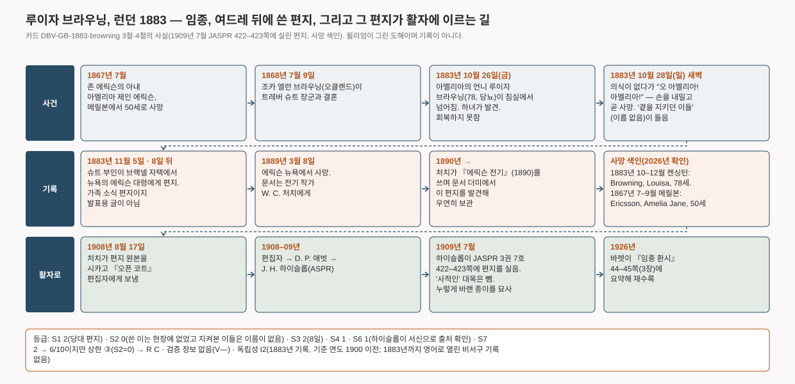

# 루이자 브라우닝, 언니의 이름을 부르다 — 넘어진 뒤 의식이 없던 일흔여덟의 여성이 "오 아멜리아! 아멜리아!" 하고 손을 내밀고 숨을 거두다. 조카가 여드레 뒤에 편지로 적다 (런던, 1883)

> 1883년 10월 28일 일요일 새벽. 이틀 전 넘어진 뒤로 의식이 없던 노부인이 갑자기 "오 아멜리아! 아멜리아!" 하고는 "그들의 지상의 눈에는 허락되지 않은 누군가를 맞이하려" 손을 내밀고 숨을 거두었다. 아멜리아는 16년 전에 죽은 언니였다. 여드레 뒤 조카가 이 일을, 언니의 남편인 뉴욕의 기술자 존 에릭슨에게 보내는 가족 편지에 적었다. 발표할 생각으로 쓴 글이 아니었다. 이 편지가 남은 것은 에릭슨이 유명했기 때문이다.

이 글은 영어 카드 [[DBV-GB-1883-browning|Louisa Browning calls her sister's name (London, 1883)]]의 위층("읽는 글")을 한국어로 옮긴 것이다. 출처 번호·점수·등급 판정이 있는 조사 장부는 영어 카드에만 둔다. 등급: **R C · V— · I2**.

## 무슨 일이 있었나

루이자 브라우닝은 일흔여덟이었고, 여러 해 당뇨를 앓아 "뼈만 남은" 상태였다. 1883년 10월 26일 금요일 침실에서 크게 넘어져 바닥에 쓰러진 채 "극심한 고통 속에" 하녀에게 발견됐고, 끝내 회복하지 못했다. 일요일 새벽에 숨을 거두었다. 1883년 마지막 분기의 사망 색인에 그가 있다. Browning, Louisa, 78세, 런던 켄싱턴 등록구.

임종의 자리에서 있었던 일은 한 단락으로만 전해진다. 곁을 지키던 사람들은, "그 전까지는 의식이 전혀 없었는데도" 그가 "오 아멜리아! 아멜리아!" 하고 말하는 것을 들었다. 그는 "그들의 지상의 눈에는 허락되지 않은 누군가를 맞이하려" 손을 내밀었고, "그러고는 모든 것이 끝났다." 아멜리아는 그의 언니 아멜리아 제인 에릭슨으로, 1867년 7월 메릴본에서 쉰 살로 죽었다.

*참고 사진 · 존 에릭슨(1803–1889). 남북전쟁의 철갑함 모니터호를 설계한 스웨덴계 미국 기술자. 1860년대 뉴욕에서 찍은 사진. 아멜리아의 남편이자 편지를 받은 사람이며, 임종의 자리에는 없었다 · Charles D. Fredricks & Co., 미국 의회도서관, Wikimedia Commons · 퍼블릭 도메인*

아멜리아의 남편은 남북전쟁 때 철갑함 *모니터*를 만든 기술자 존 에릭슨으로, 뉴욕에 살았다. 죽음 여드레 뒤인 1883년 11월 5일, 루이자의 조카 엘런, 곧 슈트 부인(레이디 슈트)이 버크셔 브랙넬의 자택 '에그몬트'에서 그에게 편지를 썼다. 엘런은 "오클랜드의" 브라우닝 집안에서 태어나 1868년 트레버 슈트 장군과 결혼한 사람이다. 편지는 가족 소식이다. 자기 인생의 "또 한 쪽이 넘어갔다"는 말, 숙모가 넘어진 일, 하녀, 당뇨, 나이, 그리고 위의 단락. 거기에 언니가 "아마도 더 밝은 곳으로 맞아들이는 천사였을 것"이라는 자기 해석을 붙였다. 끝은 "진심을 담아, 엘런 슈트"다.

에릭슨은 편지를 간직했다. 1889년 그가 죽자 문서는 전기 작가 윌리엄 코넌트 처치에게 넘어갔고, 처치는 『전기』를 쓰다 이 편지를 발견해 "우연히 보관했다." 1908년 8월 처치는 원본을 시카고의 잡지 『오픈 코트』 편집자에게 보냈고, 편집자는 『영매의 무대 뒤』의 저자 데이비드 P. 애벗에게, 애벗은 미국심령연구회(ASPR)의 제임스 H. 하이슬롭에게 넘겼다. 하이슬롭은 1909년 7월 연구회 학술지에 "죽어 가는 이의 환시"라는 제목으로 이 편지를 실으면서, 어떤 경로로 자기 손에 왔는지 적고 물건 자체도 묘사했다. "종이는 세월에 누렇게 바랬고 가장자리는 검으며, 칼을 쥔 손과 'Fortune de guerre'라는 표어가 찍힌 도장이 있고, 보이는 대로 영국에서 날짜를 적었다." 그는 처치에게 편지를 보내 출처를 확인했고, "사적인 성격의 대목"은 뺐다고 밝혔다. 함께 실린 처치의 설명 편지가 인물을 밝힌다. 슈트 부인은 "영국군 트레버 슈트 장군 K.C.B.의 아내", 아멜리아는 "에릭슨 대령의 아내", 그리고 "존 에릭슨 부인은 1867년 7월에 죽었다."

*『미국심령연구회 학술지』 3권 7호(1909년 7월) 422쪽. 하이슬롭의 설명과 1883년 11월 5일 편지의 앞부분. 뒷부분과 처치의 설명 편지는 423쪽에 있다 · archive.org 사본에서 · 1909년 미국 출판물, 퍼블릭 도메인*

1926년 윌리엄 바렛이 『임종 환시』에 이 편지를 줄여서 다시 실었고, 뒤의 독자 대부분은 거기서 이 사건을 만났다. 인쇄된 모든 판본은 1909년의 단 하나의 전사본으로 거슬러 올라간다. 원본 편지는 이 카드를 위해 보지 못했다.

*사건, 기록, 활자에 이르는 길. 카드 3절·4절에서 그렸다. 윌리엄의 도해이며 **기록이 아니다** · 생성 코드 `tools/diagrams/DBV-GB-1883-browning.py`*

## 이 기록은 어디까지 믿을 수 있나

이 사건의 힘은 편지의 날짜에 있다. 죽음 여드레 뒤에 가족이 가족에게, 심령 연구 같은 것은 염두에 없이, 감동시킬 독자도 없이 쓴 글이다. 누가 수집하지도, 면담하지도, 몇 해 뒤 기억으로 다시 쓰지도 않았다. 인물은 호적 색인과 맞는다. 1883년 마지막 분기에 켄싱턴에서 78세의 루이자 브라우닝이 죽었고, 1867년 셋째 분기에 메릴본에서 50세의 아멜리아 제인 에릭슨이 죽었다. 처치의 말 그대로다.

약점도 똑같이 분명하다. 엘런 슈트는 그 방에 없었다. 켄싱턴에서 죽은 숙모에 대해 브랙넬에서 썼고, "곁을 지키던 사람들"이 들은 것을 전한다. 그들의 이름은 적지 않았고, 그들 중 누구도 무엇을 적지 않았다. 그러니 이 기록은 현장에 있던 이름 없는 사람들의 전언을 당대에 적은 문서다. 이 연구의 등급표에서는 그것으로 목격자 축이 0점이 되고, 편지가 아무리 좋아도 기록 등급은 **C**에 묶인다. 이것을 풀 수 있는 것은 그 자리에 있던 누군가의 진술인데, 알려진 것이 없다.

검증 정보의 주장은 없다. 루이자는 언니가 16년 전 죽은 것을 잘 알고 있었으므로, 이 사건은 이 연구의 구조 층에만 속한다. 죽어 가는 사람이 자기를 데리러 온 듯한 죽은 가족을 맞이하는 구조다. 독립성으로 보면 기록은 1883년, 대중매체 노출을 가정하기 시작하는 해(1900) 이전이고, 조사자가 손을 대지 않았으며, 비서구 임종 문헌의 영어 번역은 아직 없었고, 어법은 글쓴이 자신의 기독교이지 들여온 교리가 아니다. 등급은 **I2**, 이 연구에서 처음 나온 I2다. 다만 혼자서는 집계에 들어가지 못한다. 상한에 걸린 C 카드는 세지 않기 때문이다. 같은 문화권에서 같은 질의 C 카드가 하나 더 나오면 METHOD 8절의 짝 규칙으로 서유럽 자리를 채울 수 있다.

이 편지가 남은 사정에 대해 두 가지를 적어 둔다. 편지는 받은 사람이 유명했기 때문에 남았다. 전기 작가가 보관했고, 편집자들이 내용이 인상적이라 돌렸다. 그것은 선별이고, 아래 "선택적 보고" 항목을 열어 두는 이유다. 그리고 인쇄된 글은 하이슬롭이 1909년에 "사적인" 대목을 뺀 전사본이다. 무엇을 뺐는지는 모른다.

## 다르게 설명하면

- **방문자가 아니라 죽어 가는 뇌.** 루이자는 "여러 해" 당뇨를 앓았고, 이틀 전 크게 넘어졌으며, "의식이 전혀 없었다". 저혈당이든 고혈당이든, 머리 손상이든, 1883년의 의사가 썼을 아편제든, 각각으로도 사랑한 이름을 마지막으로 부르며 손을 내미는 일은 충분히 생긴다. 편지는 치료를 하나도 적지 않았다. 이 설명은 온전히 살아 있고, 연구는 이것으로 점수를 깎지 않는다. 뇌의 상태와 방문자는 침상 곁에서 보면 똑같기 때문이다.
- **지켜본 이들이 두 마디와 손짓을 환시로 읽었다.** 기록된 것은 언니의 이름을 부르고 손을 내밀었다는 것뿐이다. "보는 듯했다"는 집안사람들의 해석이고, 그것을 적은 사람은 그 자리에 없었다.
- **빅토리아 시대의 가족이 기대한 장면.** 엘런 슈트 자신이 틀을 준다. 언니는 "더 밝은 곳으로 맞아들이는 천사". 내용은 그 기대에 꼭 맞고, 루이자의 것은 이름과 손짓뿐이다.
- **되풀이 전해지며 생긴 왜곡.** 여드레는 짧고 이 편지가 첫 기록이라 가능성은 낮다. 다만 인쇄본은 1909년에 줄인 것이고, 원본은 보지 못했다.
- **지어냄.** 동기가 없다. 해외의 친척에게 보낸 사적인 부고 편지가 우연히 보관됐다. 지켜본 이들을 아무도 확인하지 않았으므로, 규칙상 사기는 "부분" 배제다.

이 기록은 의식의 사후 존속과도, 모든 평범한 설명과도 양립한다. 그것들을 가를 만한 것은 하나도 없다. 이 연구에서 이 사건의 값은, 서유럽에서 1900년 이전에 날짜가 있고 유도되지 않은 채 적힌 구조의 기록이라는 데 있지, 구조 너머의 무엇을 뒷받침한다는 데 있지 않다.

## 출처

출처 번호, 점수, 검증 정보, 평범한 설명, 가설, 반대 자료, 연결, 문화적 독립성, 메모, 자료 목록은 영어 카드 [[DBV-GB-1883-browning|Louisa Browning calls her sister's name (London, 1883)]]의 조사 장부 §1–§13에 있다. 핵심 출처는 하이슬롭이 편집한 『미국심령연구회 학술지』 1909년 7월호 422–423쪽(archive.org, 퍼블릭 도메인, 전문과 쪽 스캔 확인), 잉글랜드·웨일스 사망 색인(FreeBMD, 1883년 4분기 켄싱턴·1867년 3분기 메릴본), 바렛 『임종 환시』 1926년 44–45쪽(Wellcome Collection)이다. 처치의 『존 에릭슨 전기』(1890)와 편지 원본은 열어 보지 못했다.
