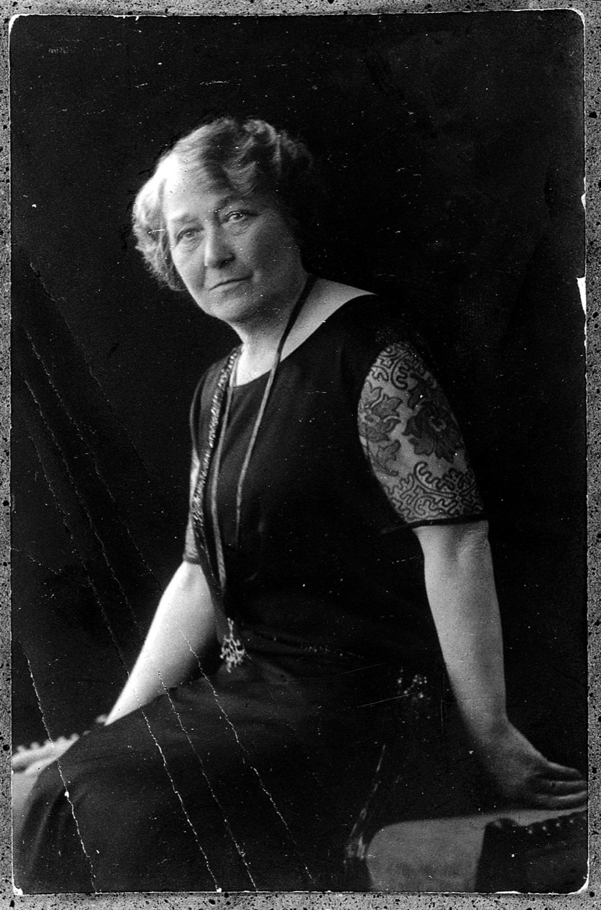
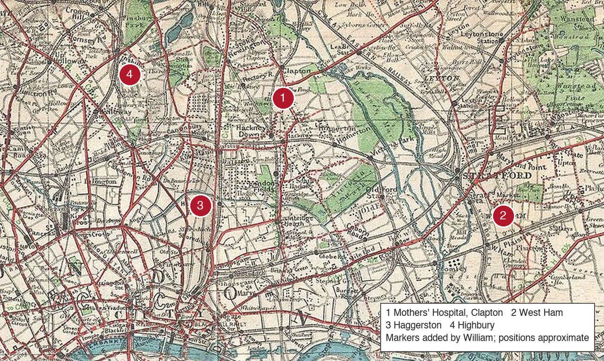
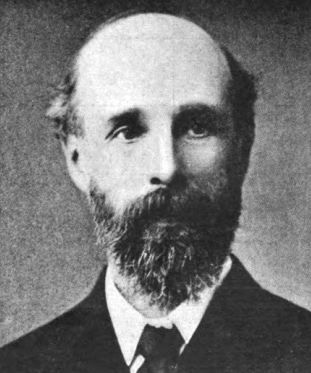
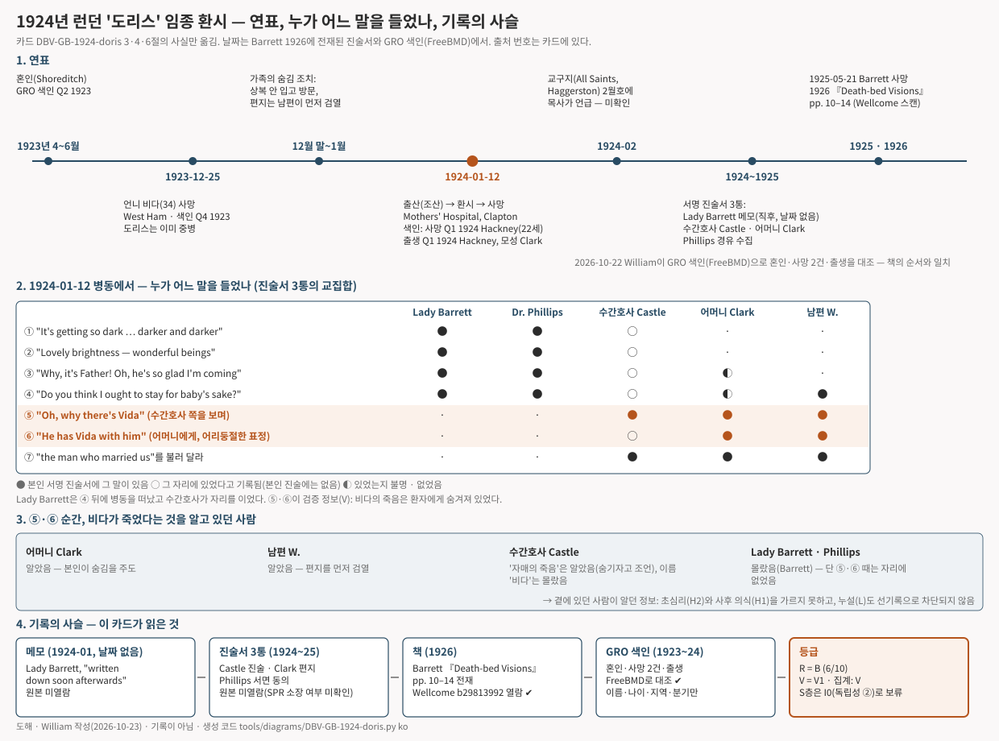

# 런던 클랩턴 "도리스" — 임종 직전 아버지와, 죽음을 숨겨 둔 언니 비다를 본 산모 (1924, 영국)

> 1924년 1월, 런던 동북부의 한 산과 병원. 아이를 낳고 죽어 가던 스물두 살 산모가 병실 한쪽을 바라보며 말했다. "어, 아버지예요!" 조금 뒤에는 어리둥절한 얼굴로 덧붙였다. "아버지가 비다를 데리고 있어요." 언니 비다는 18일 전에 죽었다. 가족은 그 죽음을 산모에게 끝까지 숨기고 있었다.

이 글은 영어 카드 [[DBV-GB-1924-doris|Doris sees Vida (London, 1924)]]의 위층("읽는 글")을 한국어로 옮긴 것이다. 출처 번호·점수·등급 판정이 있는 조사 장부는 영어 카드에만 둔다. 등급: **R B · V1 · I0**.

## 무슨 일이 있었나

도리스는 스물두 살이었다. 1923년에 결혼해 아직 1년이 안 됐고, 1924년 1월 런던 클랩턴의 Mothers' Hospital에서 아이를 낳았다. 구세군이 운영하는 산과 병원이었다. 아이는 예정보다 일찍 나왔지만 무사했다. 산모는 그렇지 못했다. 분만 중에 심한 심부전이 왔고, 의사들은 살릴 수 없다는 것을 알았다.

*사건 장소 Mothers' Hospital(런던 Lower Clapton Road)의 정면 건물, 2018년. 1824년에 지은 주택을 병원 정면으로 썼고 병동은 뒤편이었다. 병원은 1986년에 닫혔고 지금은 주거 단지다. 1924년 당시 사진은 아니다 · Paul the Archivist, Wikimedia Commons · CC BY-SA 4.0*

그 병원의 산과 외과의 가운데 한 사람이 플로렌스 바렛, 당시 호칭으로 레이디 바렛이었다. 레지던트 의사 필립스가 급히 와 달라고 전갈을 보냈고, 레이디 바렛은 다른 환자들을 본 뒤 병동으로 돌아왔다. 그때 들은 말을 "직후에" 적어 두었다. 그 메모가 이 사건의 첫 기록이다.

메모에 따르면 도리스는 먼저 두 손을 내밀며 아기를 받아 줘서 고맙다고 했고, 남자아이인지 여자아이인지 물었다. 그러고는 밝게 불이 켜진 병동을 올려다보며 "어두워지게 두지 마세요, 점점 어두워져요"라고 했다. 남편과 어머니를 부르러 사람을 보냈다. 갑자기 도리스가 방의 한 곳을 바라보며 환하게 웃었다. "아, 아름다워요, 아름다워요." 무엇이 아름답냐고 묻자 "눈부신 밝음, 놀라운 존재들"이라고 답했다. 그러다 기쁜 외침처럼 말했다. "어, 아버지예요! 내가 가는 걸 저렇게 기뻐하시네요." 간호사가 아기를 데려오자 도리스는 아기를 바라보더니 물었다. "아기를 위해 남아야 할까요?" 그러나 곧 다시 그쪽을 보며 말했다. "못 있겠어요. 당신이 내가 보는 걸 본다면 알 거예요." 뒤늦게 들어온 남편에게는 아기를 사랑하지 않을 사람에게 보내지 말라고 부탁했다. 그리고 남편을 옆으로 밀며 말했다. "저 아름다운 빛을 보게 해 주세요."

*레이디 플로렌스 바렛(1867–1945). 첫 기록자이자 증인이고, 사건 당시 이 병원의 산과 외과의였다. 촬영 연도 미상 · Wellcome Collection L0004411, Wikimedia Commons · CC BY 4.0*

레이디 바렛은 곧 자리를 떴다. 그 뒤로는 수간호사 미리엄 캐슬과 어머니, 남편이 곁을 지켰다. 수간호사의 진술에 따르면, 남편이 몸을 숙여 말을 걸자 도리스는 그를 밀어내며 "가리지 마세요, 너무 아름다워요"라고 했다. 그러고는 침대 반대편에 선 수간호사 쪽을 보며 말했다. "어, 비다가 있네." 어머니는 같은 순간을 편지에 이렇게 적었다. 도리스가 아버지를 보고 "아버지가 날 원하세요, 외로우신가 봐요"라고 한 뒤, 같은 곳을 다시 보더니 **어리둥절한 표정으로** "아버지가 비다를 데리고 있어요"라고 했다고.

비다는 도리스의 언니였다. 서른네 살이었고 몇 해째 병약했다. 1923년 12월 25일, 런던 동쪽 웨스트햄에서 죽었다. 그때 도리스는 이미 입원 중이었고 상태가 나빴다. 수간호사는 언니의 죽음을 알리지 않는 편이 좋겠다고 했고, 가족은 그 말을 따랐다. 상복을 벗고 평소 옷으로 면회를 왔다. 바깥 친구가 편지에 부고를 쓸까 봐 남편이 모든 편지를 먼저 읽고 건넸다. 도리스가 "비다"라고 말한 순간, 어머니는 그래서 놀랐다. 도리스는 그 뒤 자기들을 결혼시켜 준 목사를 보고 싶다고 했다. 사람을 보냈지만 목사가 왔을 때는 이미 말을 못 하는 상태였다. 도리스는 한 시간쯤 더 살았다. 마지막까지 자기가 보는 밝은 형상과 병상 옆 사람들을 함께 의식했고, 조산아를 병원에 얼마나 두어야 할지 수간호사와 의논했다.

*1920년 베이컨(Bacon) 런던 포켓 지도의 동북부. ① 도리스가 아이를 낳고 죽은 Mothers' Hospital(클랩턴, Lower Clapton Road) ② 언니 비다가 18일 먼저 죽은 웨스트햄 ③ 1923년 도리스가 결혼한 해거스턴 올 세인츠 교회 일대 ④ 어머니가 편지를 보낸 하이버리. 번호 표시는 William이 대략의 위치에 덧붙인 것이다(그림 안의 설명은 영어) · George Washington Bacon, 1920 · Geographicus, Wikimedia Commons · 퍼블릭 도메인*

이 이야기가 책이 된 데는 사정이 있다. 레이디 바렛의 남편은 윌리엄 바렛 경이었다. 물리학자이고, 1882년 심령연구학회(SPR)를 세운 사람 중 하나였다. 그는 오래전부터 죽어 가는 사람이 "이미 죽은 줄 몰랐던 사람"을 보는 사례를 모으고 있었다. 아내의 이야기를 듣고 그는 필립스 의사에게 메모에 동의하는지 서면으로 물었고, 수간호사의 서명 진술서와 어머니의 편지를 받아 모았다. 바렛은 1925년 5월에 죽었고, 이 사례는 이듬해 나온 책 『Death-bed Visions』 2장의 첫 사례로 실렸다.

*윌리엄 F. 바렛 경(1844–1925). 이 사례를 모아 책으로 낸 사람. 1907년 출판물에 실린 초상 · James Creelman, Wikimedia Commons · 퍼블릭 도메인*

나는 책 바깥에서 이 이야기를 확인할 수 있는 것을 찾았다. 잉글랜드·웨일스의 출생·혼인·사망 색인이 무료로 열린다. 거기에 1923년 4분기 웨스트햄에서 죽은 서른네 살 비다 M. 클라크가 있다. 1924년 1분기 해크니에서 죽은 스물두 살 도리스 G. 바저리가 있다. 같은 분기 해크니에서 태어난, 어머니 성이 클라크인 바저리 성의 여자아이가 있다. 1923년 2분기 쇼디치에서 결혼한 도리스 G. 클라크와 스탠리 바저리가 있다. 언니가 먼저 죽은 순서, 두 사람의 나이, 결혼과 출산의 장소가 책과 맞는다. 다만 색인은 이름과 나이와 장소만 말한다. 환시에 대해서는 아무것도 말하지 않는다.

*도해 · 결혼에서 책까지의 연표, 누가 어느 말을 들었는지, 비다의 죽음을 알고 있던 사람, 기록이 이어진 사슬. 영어 카드 조사 장부의 3·4·6절을 그림으로 옮긴 것으로 **기록이 아니다** · William 작성, 생성 코드 `tools/diagrams/DBV-GB-1924-doris.py`*

## 이 기록은 어디까지 믿을 수 있나

이 연구는 사건이 놀라운지를 묻지 않는다. 기록이 얼마나 좋은지를 묻는다. 그 기준으로 이 사례는 꽤 좋은 편이다. 네 사람이 각자 적었다. 의사가 직후에 쓴 메모, 다른 의사의 서면 동의, 수간호사의 서명 진술, 어머니의 편지. 사건 2년 안에 책으로 나왔다. 공식 색인이 사람들의 존재와 죽음의 순서를 받쳐 준다. 기록의 질을 A부터 D까지 매기는 이 연구의 등급표로 **B**다.

핵심 질문은 하나다. 도리스가 알 수 없었던 사실이 그 말 속에 들어 있었는가. 들어 있었다. 언니가 죽었다는 사실이다. 그래서 이 사례는 "검증 정보가 있는 사례"로 센다. 그러나 가장 높은 등급은 아니다. 두 가지가 모자란다. 첫째, 도리스가 "비다"라고 말한 순간, 그 뜻을 아는 사람들이 바로 옆에 있었다. 어머니도, 남편도, 수간호사도 언니의 죽음을 알고 있었다. 말을 미리 날짜 있는 문서로 적어 둔 뒤 사실을 확인한 것이 아니라, 뜻을 이미 아는 사람들이 나중에 적은 것이다. 둘째, 언니가 몇 해째 아팠으니 도리스가 "혹시" 하고 짐작했을 가능성을 아무도 묻지 않았다. 그래서 검증 정보 등급은 세 단계 중 가운데인 **V1**이다.

또 하나 짚을 것이 있다. 첫 기록자가 바렛의 아내라는 점이다. 바렛은 이미 1917년 책에서 같은 종류의 사례를 다뤘고, "죽은 줄 몰랐던 사람이 보인다"는 이야기 틀은 1882년부터 영어권 심령연구 문헌에 돌고 있었다. 이 연구가 세려는 것은 "서로 접촉이 없던 문화에서 같은 이야기가 따로 나왔는가"다. 그 셈에서 이 사례는 영국 쪽 표본이 될 수 없다. 기록자가 그 이야기 틀을 이미 아는 집안이기 때문이다. 영국 쪽 표본은 심령연구학회 바깥의 기록으로 채워야 한다. 그래서 독립성은 **I0**다. "같은 구조가 따로 나왔는가"의 셈에는 넣지 않고, 검증 정보의 셈에만 넣는다.

이 사건을 특정해서 반박한 글은 찾지 못했다. 그렇다고 사기가 "배제됐다"고 쓰지는 않는다. 폭로가 없다는 것과, 이해관계 없는 조사자가 확인했다는 것은 다른 일이다.

## 다르게 설명하면

- **기억이 다듬어졌을 수 있다.** 레이디 바렛의 메모는 "직후"라지만 날짜가 없다. 수간호사와 어머니는 그 말의 뜻을 안 뒤에, 바렛의 요청을 받고 썼다. 진술 사이의 작은 차이는 그대로 남아 있다. 언니가 "3주 전"에 죽었다는 말과 "2주 4일 전"이라는 말, 메모의 "남자아이"와 색인의 여자아이, 책의 남편 머리글자 "W."와 색인의 "스탠리".
- **누군가 말해 줬을 수 있다.** 가족의 숨김은 구체적으로 기록돼 있다. 그러나 병원 직원 가운데 누가 알았고 누가 환자 곁에 있었는지는 아무도 조사하지 않았다.
- **우연일 수 있다.** 죽어 가는 사람이 먼저 간 가족을 본다고 말하는 일은 흔하다. 언니는 오래 아팠다.
- **고른 이야기일 수 있다.** 바렛은 사후 생존을 지지하는 사례를 모아 책을 냈고, 어떤 기준으로 골랐는지 쓰지 않았다. 첫 보고자는 그의 아내였다.
- **죽어 가는 뇌의 일일 수 있다.** 산후 심부전, 산소 부족. 밝은 빛과 가족의 모습 자체는 그렇게 설명된다. 다만 "언니"라는 세부는 그것만으로는 설명되지 않는다.

그래서 이 기록은 "의식은 죽음 뒤에도 이어진다"는 가설과 **양립한다**. 그러나 그 가설만 남기지는 못한다. 곁에 있던 사람이 아는 사실을 말한 사례는 늘 그렇다. 몰랐던 죽음은 보통 가족이 아는 죽음이다.

## 출처

이 글의 모든 사실은 영어 카드 [[DBV-GB-1924-doris|Doris sees Vida]]의 조사 장부 3절·4절에 출처 번호와 함께 있다. 주요 출처는 다음과 같다.

- Barrett WF. *Death-bed Visions*. London, 1926, pp.10–14 — 레이디 바렛의 메모, 필립스 의사의 동의, 수간호사 캐슬의 진술서, 어머니 클라크의 편지를 전재. Wellcome Collection b29813992에서 전문과 쪽 이미지가 공개돼 있다(열람 확인).
- 잉글랜드·웨일스 GRO 출생·혼인·사망 색인(FreeBMD, 2026-10-22 검색) — 비다·도리스의 사망, 아기의 출생, 1923년 혼인.
- 미확인: All Saints Haggerston 교구지 1924년 2월호(디지털 사본 없음), 1924년 신문 보도(무료 아카이브 접근 불가).
