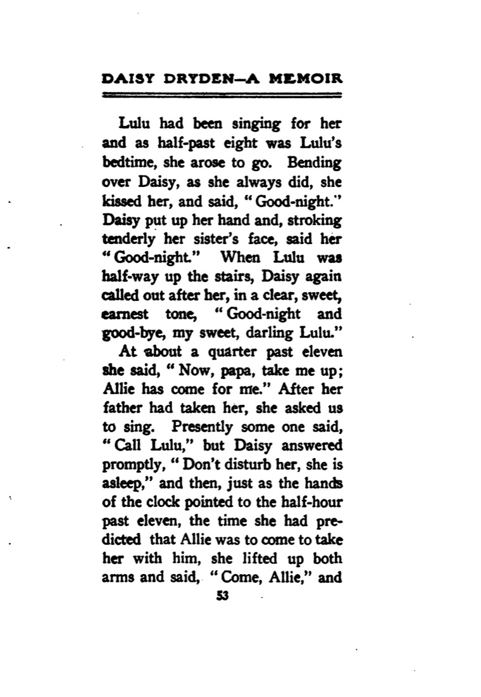
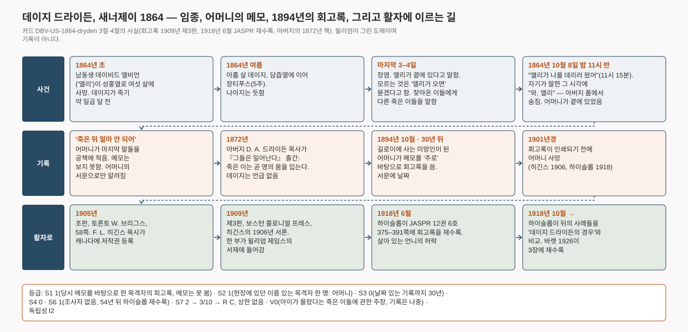

# 데이지 드라이든, "앨리가 나를 데리러 왔어" — 열병으로 죽어 가던 열 살 소녀가 사흘 동안 죽은 남동생이 곁에 있다고 말하고, 동생이 데리러 올 시각을 말한 뒤 그 시각에 숨지다. 어머니가 메모를 바탕으로 30년 뒤에 적다 (캘리포니아 새너제이, 1864)

> 1864년 10월 8일 밤 11시 15분, 캘리포니아 새너제이. 아버지 품에 안긴 열 살 소녀가 말했다. "이제 아빠, 나를 안아 올려 줘. 앨리가 나를 데리러 왔어." 세 시간 전에는 앨리가 11시 반에 올 거라고 했다. 11시 반, 소녀는 두 팔을 들어 올리고 "와, 앨리" 하고 숨을 거두었다. 앨리는 약 일곱 달 전 여섯 살에 성홍열로 죽은 남동생이었다. 어머니가 그 방에 있었다. 어머니는 죽음 뒤 얼마 안 되어 마지막 며칠을 공책에 적었고, 1894년 미망인이 되어 그 메모로 회고록을 썼다.

이 글은 영어 카드 [[DBV-US-1864-dryden|Daisy Dryden: "Allie has come for me" (San Jose, 1864)]]의 위층("읽는 글")을 한국어로 옮긴 것이다. 출처 번호·점수·등급 판정이 있는 조사 장부는 영어 카드에만 둔다. 등급: **R C · V0 · I2**.

## 무슨 일이 있었나

데이지 아이린 드라이든은 1854년 9월 9일 캘리포니아 메리스빌에서 태어났다. 아버지 데이비드 앤더슨 드라이든은 1851년 캘리포니아로 온 감리교 목사였고, 어머니는 S. H. 드라이든이라고 서명했다. 1864년 여름 새너제이에서 데이지는 담즙열에 이어 장티푸스를 5주 앓았다. 나아지는 듯했고 의사는 "고비를 넘겼다"고 했다. 두 주쯤 뒤 어느 오후, 아버지는 딸이 "기쁨과 놀람"의 표정으로 문 위 한 곳을 바라보는 것을 보았다. 딸은 예수라고 했다. 그날 밤 장염이 왔고, 데이지는 나흘을 더 살았다.

마지막 사흘 동안 데이지는 어머니의 말로 "두 세계에" 있었다. 남동생 데이비드 앨비언, 곧 앨리는 일곱 달 전 여섯 살에 성홍열로 죽었다. 데이지는 앨리가 대부분의 시간 곁에 있다고 했다. 대답할 수 없는 것을 물으면 "앨리가 오면 물어볼게" 했다. 어머니에게는 앨리가 "엄마 옆에 서 있다"고, 둘은 "생각으로" 이야기한다고 했다. 침상을 찾아온 이웃들에게는 그들의 죽은 이들을 말했다. B 부인의 막 죽은 열두 살 아들 베이트먼, 주일학교 교사 H 부인의 몇 해 전에 죽은 두 아이(데이지는 그들을 다 자란 모습으로 묘사했다), 또 다른 부인의 죽은 딸. 그 어머니는 묘사만으로는 딸을 알아보지 못하다가, 데이지가 "목 왼쪽에 점이 있었는데 지금은 없어요"라고 하자 믿었다. 데이지는 의사에게 기도하느냐고 묻고, 열어 준 덧문 너머로 하늘과 나무에 작별 인사를 하고, "새로운 영의 몸"을 이야기했다.

10월 8일 저녁 8시 반, 아버지에게 기대어 있던 데이지가 말했다. "지금 8시 반이야. 11시 반이 되면 앨리가 나를 데리러 올 거야." 자러 올라가는 언니 룰루에게 작별 인사를 했다. 11시 15분쯤 "이제 아빠, 나를 안아 올려 줘. 앨리가 나를 데리러 왔어" 하고 말했다. 방 안의 사람들에게 노래를 불러 달라고 했다. 누가 룰루를 부르자고 하자 "깨우지 마, 자고 있어" 했다. 그리고 "시계 바늘이 11시 반을 가리키는 바로 그때" 두 팔을 들어 올리고 "와, 앨리" 하고 더 숨을 쉬지 않았다. 데이지는 스톡턴 묘지의 앨리와 언니 헬렌 곁에 묻혔다.

*S. H. 드라이든 『데이지 드라이든 회고록』 제3판(보스턴 콜로니얼 프레스, 1909) 53쪽. 스캔한 책은 윌리엄 제임스의 서재에서 하버드로 간 것이다 · archive.org `daisydrydenamem00higggoog`(구글 스캔, 하버드대) · 1909년 출판(초판 1905), 퍼블릭 도메인*

어머니는 서문에 "죽은 뒤 얼마 안 되어" 딸의 임종 경험을 "공책에 적었고", 회고록의 마지막 며칠 부분은 "주로" 그 메모로 썼다고 밝혔다. 서문 날짜는 "길로이, 1894년 10월"로, 남편이 죽고 석 달 뒤다. 본문에는 "30년이 흘렀다"고 썼다. 회고록은 어머니가 죽은 뒤인 1905년 토론토에서 처음 인쇄됐다. 캐나다의 F. L. 히긴스 목사가 저작권을 등록하고 서론을 써서, 저자와 "그 아이를 알았던, 아직 살아 있는 다른 이들"을 보증했다. 1909년 보스턴에서 제3판이 나왔다. 1918년 6월 제임스 H. 하이슬롭이 데이지의 살아 있는 언니의 허락을 받아 회고록 전체를 『미국심령연구회 학술지』에 다시 실었다.

*사건, 기록, 활자에 이르는 길. 카드 3절·4절에서 그렸다. 윌리엄의 도해이며 **기록이 아니다** · 생성 코드 `tools/diagrams/DBV-US-1864-dryden.py`*

## 이 기록은 어디까지 믿을 수 있나

목격자는 좋고 시점은 나쁘다. 글을 쓴 사람은 마지막 며칠 내내 그 방에 있었고, 죽음 직후 메모를 했다고 말한다. 그러나 메모는 남아 있지 않거나 적어도 보지 못했다. 있는 것은 30년 뒤 날짜를 적은 회고록이다. 어머니의 슬픔과 믿음이 죽어 가는 아이의 말에 작용하기에는 긴 시간이다. 회고록은 위로하려고 썼고("사랑하는 이를 떠나보낸 슬픈 마음들에게"), 교리의 논거로 삼은 목사가 저자 사후에 펴냈다.

회고록에 불리한 확인이 하나 있다. 1872년 아버지는 부활에 관한 책 『그들은 일어난다』를 냈다. 그 교리는 회고록이 데이지의 입으로 말하게 하는 것과 같다. 죽은 이는 곧 영의 몸을 입고, 아이의 영혼은 계속 자란다. 히긴스는 아버지가 이것을 죽어 가는 딸에게서 배웠다고 한다. 그런데 1872년 책에는 딸이 나오지 않는다. 책 전문에서 이름과 "딸", "아이"를 찾았지만 그에 관한 대목은 없었다. 아버지가 출처를 밝히지 않았을 수도 있고, 30년 사이 어머니의 기억이 아버지의 신학을 아이에게 입혔을 수도 있다. 기록으로는 어느 쪽인지 가릴 수 없다. 아래 "나중의 윤색" 항목을 열어 두는 이유다.

이 회고록이 쓸모 있는 것은 단순한 구조다. 어머니가 지어냈을 법하지 않고 신학과도 상관없는 부분이다. 죽어 가는 아이가 죽은 동생이 곁에 있다고 말하고, 동생이 데리러 올 시각을 말하고, 그 시각에 손을 뻗어 동생 이름을 부르고 숨진다. 가족, 아버지의 목회와 책은 실재하며 회고록 밖의 인쇄물로 확인된다. 아이의 사망일은 다른 기록으로 확인하지 못했다.

아이가 알 수 없었던 정보라는 주장도 있다. 어머니 말로는 데이지가 들어 본 적 없는 이웃의 죽은 아이들, 그리고 다른 부인의 죽은 딸 목에 있던 점이다. 이것들은 일이 끝난 뒤에야 적혔고, 작은 마을의 평범한 이야기에서 왔을 수 있다. 어머니 자신도 그중 하나를 그렇게 설명한다. 죽은 E 부인 이야기를 할 때 데이지가 그 방에 있었다는 것을 나중에 떠올렸다. 이 주장은 적어 두되(V0) 무엇의 증거로도 쓰지 않는다.

독립성으로 보면, 이 기록은 캘리포니아 감리교 가정의 사적인 회고록이고, 1864년의 메모를 바탕으로 1894년에 썼다. 사건 뒤 54년 동안 어떤 조사자도 손대지 않았다. 어법은 그 가족 자신의 기독교이고, 그때 영어로 읽을 수 있는 다른 문화권의 "죽은 가족이 데리러 오는" 임종 기록은 없었다. 등급은 **I2**다. 그래서 이 카드는 카드 [[DBV-GB-1883-browning]](런던, 1883)과 같은 종류의 두 번째 C 카드다. 기록자도 나라도 다르다. METHOD 8절의 짝 규칙으로 두 장이 함께 임종 환시 구조 층의 서구 자리를 채운다. 이 연구에서 처음으로 채워진 문화권이다.

## 다르게 설명하면

- **열병으로 죽어 가는 아이.** 몇 주의 병 끝에 장티푸스, 이어 장염, "극도로 여윈" 몸. 열과 탈진은 환시를 만든다. 어머니는 데이지가 정신이 맑았다고 강조한다. 모든 사람을 알아보았고 찬송가 쪽수를 말했으며 언니가 자고 있다는 것을 알았다. 그러나 그것은 30년 뒤 어머니의 판단이고, 치료에 대해서는 아무것도 모른다.
- **가족이 기대한 장면.** 아이를 막 잃은 목사 가정, 침상 곁의 성경 낭독("내 아버지 집에 거할 곳이 많도다"), "오 천사들이여 와서… 나를 데려가 주오"라는 찬송. 이 모든 것을 들은 죽어 가는 아이가, 가장 보고 싶은 사람인 죽은 동생을 보는 데에는 더 필요한 것이 없다.
- **30년의 기억.** 확인할 수 없는 메모로 썼다. 아이 입의 신학이 아버지의 뒤의 책과 맞는다. 어떤 말은 다듬어지거나 옮겨지거나 더해졌을 수 있다. 핵심(앨리, 시각, "와, 앨리")은 가족이 기억할 만한 종류의 세부지만, 그것은 짐작이다.
- **시각.** "앨리가 11시 반에 온다"고 한 아이가 11시 반에 죽은 것은 인상적이다. 그러나 죽어 가는 사람은 때로 죽음이 가까운 것을 느끼고, 사망 시각은 그 시각을 기다리던 사람들이 적었다.
- **지어냄.** 위로하고 가르치려는 동기는 있지만, 사기의 흔적도 얻을 것도 없다. 책은 저자가 죽은 뒤에 나왔다. 당시 아무도 확인하지 않았으므로 사기는 "부분" 배제다.

이 기록은 의식의 사후 존속과도, 모든 평범한 설명과도 똑같이 맞는다. 그것들을 가를 것은 없다. 이 연구에서 이 사건의 값은, 1900년 이전에 목격자가 심령 연구의 수집 밖에서 적은 구조의 기록이라는 데 있다.

## 출처

출처 번호, 점수, 검증 정보, 평범한 설명, 가설, 반대 자료, 연결, 문화적 독립성, 메모, 자료 목록은 영어 카드 [[DBV-US-1864-dryden|Daisy Dryden: "Allie has come for me" (San Jose, 1864)]]의 조사 장부 §1–§13에 있다. 핵심 출처는 S. H. 드라이든 『데이지 드라이든 회고록』 제3판(1909, archive.org, 전문과 쪽 스캔 확인), 하이슬롭의 재수록 『미국심령연구회 학술지』 1918년 6월호 375–391쪽(전문 확인), 아버지 D. A. 드라이든의 『그들은 일어난다』(1872, 전문 검색), 캐나다 국립 디지털 컬렉션(Canadiana)의 1905년 초판 목록이다. 어머니의 공책과 1864년 10월의 신문 부고는 보지 못했다.
