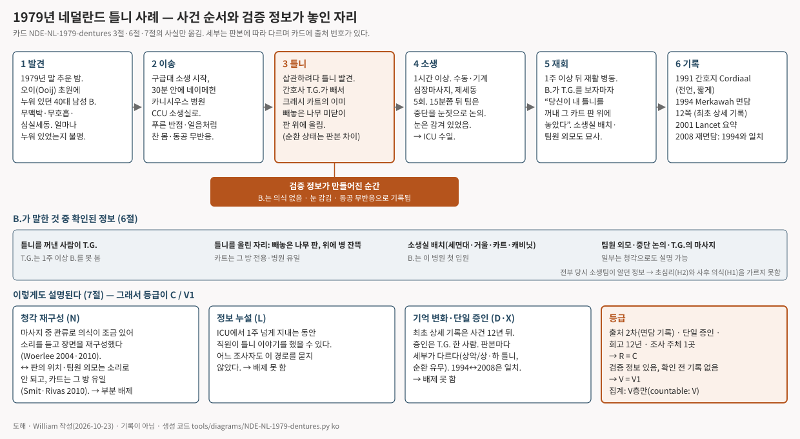

# 네이메헌 "틀니의 남자" — 심정지 소생 중 체외 시점에서 틀니를 치운 간호사와 카트를 묘사한 환자 (1979, 네덜란드)

> 1979년 말, 네덜란드 네이메헌 근교의 추운 밤. 한 남자가 초원에 쓰러진 채 발견됐다. 심장은 멎어 있었다. 병원에서 한 시간 넘게 심폐소생을 받는 동안 간호사는 그의 입에서 틀니를 빼내 카트의 나무 선반에 올려 두었다. 일주일 넘게 지나 그 간호사가 다른 병동에 들어서자, 남자가 먼저 말했다. "당신, 당신은 내 틀니가 어디 있는지 알지."

이 글은 영어 카드 [[NDE-NL-1979-dentures|The man with the dentures (Nijmegen, 1979)]]의 위층("읽는 글")을 한국어로 옮긴 것이다. 출처 번호·점수·등급 판정이 있는 조사 장부는 영어 카드에만 둔다. 등급: **R C · V1 · I1**.

## 무슨 일이 있었나

남자는 B.라고만 적는다. 네이메헌 동쪽 오이(Ooij) 마을 출신의 철근공이고, 마흔 살 남짓이었다. 1979년 말 어느 추운 밤, 지나가던 사람이 초원에 누워 있는 그를 발견해 구급차를 불렀다. 얼마나 오래 누워 있었는지는 아무도 모른다. 구급대가 도착했을 때 맥박도 호흡도 없었고 심장은 가늘게 떨리고만 있었다. 구급대는 소생을 시작하며 30분 안에 카니시우스 병원 관상동맥 병동의 소생실로 옮겼다.

*참고 · 오이(Ooij) 근처 발(Waal)강 범람원의 겨울, 2021년 2월. B.가 발견된 초원이 어디인지는 기록에 없다 · Lendskaip, Wikimedia Commons · CC0*

소생실에 도착한 B.의 피부에는 시반 같은 푸른 반점이 있었다. 몸은 얼음처럼 차가웠고, 동공은 커진 채 빛에 반응하지 않았고, 눈은 감겨 있었다. 소생팀은 간호사 T.G.와 학생 간호사 두 명, 그리고 중단 결정을 내리지 못한 젊은 의사였다. 관을 넣으려다 틀니가 발견됐다. T.G.가 틀니를 빼내 소생실 크래시 카트의 나무 미닫이 판 위에 올렸다. 주사기를 준비하느라 이미 빼놓은 판이었다. 그 카트는 병원 기술진이 그 방을 위해 직접 만든 것으로, 병원 어디에도 같은 것이 없었다. 소생은 한 시간 넘게 이어졌다. 손과 기계로 심장을 눌렀고 전기 충격을 다섯 번 주었다. 15분쯤 지나자 팀은 죽은 사람에게 하고 있다고 느꼈고 그만둘까 서로 눈짓했다. 그러나 환자가 젊었고 의사가 결정을 내리지 못해 계속했다. 마침내 심장이 다시 뛰었다. B.는 중환자실로 옮겨져 며칠 동안 인공호흡기를 달았다.

*네이메헌 성 카니시우스 병원의 본관과 정문, 1960년. 1926년부터 1992년까지 St. Annastraat에 있던 건물로, 1979년 소생이 이뤄진 병원이다. 소생실이 어느 동에 있었는지는 기록이 없다 · Regionaal Archief Nijmegen F12159, Fotopersbureau Gelderland, Wikimedia Commons · CC BY-SA 4.0*

T.G.는 그날 밤 근무를 끝으로 닷새를 쉬었고, 복귀한 뒤에는 다른 부서로 배치됐다. 그래서 일주일 넘게 B.를 보지 못했다. 그 사이 B.는 중환자실에서 깨어나 틀니가 어디 갔느냐고 물었다. 아무도 몰랐다. 틀니는 정리 중에 없어졌다. 어느 밤 T.G.가 약을 나눠 주러 재활 병동에 들어섰다. B.가 먼저 알아보고 말했다. 당신이 내 입에서 틀니를 꺼내 그 카트 위에 놓았다고. 병이 잔뜩 실려 있고 많이 덜걱거렸고, 틀니를 올린 미닫이 판이 있었다고. B.는 소생실도 묘사했다. 아주 작은 방, 침대 오른쪽의 세면대와 소독제, 거울의 위치, 왼쪽의 장비 카트, 주입 펌프를 넣은 좁은 금속 캐비닛. 자기는 그 캐비닛 위, 방의 왼쪽 위 구석에서 내려다보고 있었다고 했다. 팀원들의 외모를 말했고, 심장을 누른 사람이 T.G.라는 것도 알았다. "아파, 그만해, 나 여기 있어, 내 심장은 멈추지 않았어"라고 계속 말하려 했는데 아무도 듣지 못했다고 했다. 터널도, 빛도, 지나온 삶의 회고도 없었다. B.는 4주 뒤 퇴원했다.

*참고 · 오늘날의 크래시 카트 예(스페인, 2014). 1979년 카니시우스 소생실의 카트는 그 방을 위해 만든 유일한 것이었고 사진은 남아 있지 않다 · Manuel Ramallo, Wikimedia Commons · CC0*

이 이야기는 오랫동안 기록되지 않았다. 당시 관행대로 진료 기록에는 적히지 않았고, 기록 자체도 뒤에 파기됐다. T.G.는 동료들에게 이야기했을 뿐이다. 12년이 지난 1991년, 그 이야기를 들은 동료 한 사람이 네덜란드 임사체험 연구 재단 Merkawah 쪽에 전했고, 간호 전문지에 짧게 실렸다. 1994년 2월 재단 직원이 T.G.를 찾아 오래 면담하고 12쪽 기록을 남겼다. 같은 대목을 여러 번 되묻게 했지만 말이 거의 바뀌지 않았다. 2001년, 심장내과 의사 핌 판 로멀이 의학 저널 『Lancet』에 네덜란드 임사체험 연구를 발표하면서 이 사례를 간호사의 1인칭 요약으로 실었다. 연도도 장소도 없이. 그 뒤 "틀니의 남자"는 세계에서 가장 자주 인용되는 임사체험 일화가 됐다. 2008년 재단의 루돌프 스밋이 T.G.를 다시 찾아 면담했고, 1994년의 말과 거의 정확히 일치했다. 환자 B.는 끝내 면담되지 못했다. 재단도 그를 찾으려 했지만 실패했고, T.G.는 몇 해 뒤 신문에서 그의 부고를 봤다. 2010년 마취과 의사 부를레이(G. M. Woerlee)가 이 사례를 반박하는 글을 냈고, 스밋과 티투스 리바스가 다시 반박했다.

*도해 · 발견에서 재회까지의 순서와, B.가 말한 것 가운데 무엇을 누가 확인했는지. 영어 카드 조사 장부의 3·6·7절을 그림으로 옮긴 것으로 **기록이 아니다** · William 작성, 생성 코드 `tools/diagrams/NDE-NL-1979-dentures.py`*

## 이 기록은 어디까지 믿을 수 있나

가장 유명한 일화가 가장 좋은 기록은 아니다. 이 사례가 그렇다. 증인은 한 사람, T.G.뿐이다. 그 자리에 있던 학생 간호사 두 명과 의사는 누구도 면담하지 않았다. 환자 본인도 면담되지 못했다. 첫 기록은 사건 12년 뒤에, 그것도 현장에 없던 동료의 전언으로 나왔다. 조사한 곳은 임사체험이 실재한다고 보는 단체 한 곳이다. 판본 사이에 차이도 있다. 1991년 글에서는 B.가 "팀이 멈출까 두려워했다"이고, 1994년 면담에서는 "아프니 멈추라고 했다"이다. 틀니가 위아래 모두였는지 위쪽만이었는지, 틀니를 뺄 때 심장이 눌리고 있었는지 아예 순환이 없었는지도 판본마다 다르다. 기록의 질을 A부터 D까지 매기는 이 연구의 등급표로 **C**다. 사건이 약해서가 아니라 기록이 약해서다.

그래도 이 사례를 세는 이유가 있다. B.는 눈을 감고 심장이 멎은 채 소생실에 실려 들어왔다. 그런 사람이 알기 어려운 것들을 말했고, 그 자리에 있던 사람이 맞다고 했다. 틀니를 꺼낸 사람이 누구인지, 어디에 올렸는지, 그 판이 어떻게 생겼는지, 방이 어떻게 생겼는지. 그래서 "검증 정보가 있는 사례"로 센다. 다만 가장 높은 등급은 아니다. B.가 한 말을 날짜 있는 문서로 적어 둔 뒤 확인한 것이 아니라, 확인한 사람의 기억이 12년 뒤에 기록됐기 때문이다. 그리고 B.가 말한 것은 전부 소생팀이 알고 있던 일이다. 그래서 검증 정보 등급은 세 단계 중 가운데인 **V1**이다.

구조로 보면 이 체험은 전형적인 임사체험과 다르다. 터널도 빛도 없이 "위에서 내려다봤다"는 것 하나뿐이다. 그래서 "같은 구조의 이야기가 여러 문화에서 따로 나왔는가"를 세는 셈에는 넣지 않는다. 검증 정보를 세는 셈에만 넣는다.

## 다르게 설명하면

- **기억이 바뀌었을 수 있다.** 12년이다. 1991년과 1994년 사이의 차이는 실제로 기록돼 있다. 1994년과 2008년이 일치하는 것은 같은 사람이 같은 이야기를 되풀이한 것이라 기억이 바뀌지 않았다는 증거는 못 된다.
- **누군가 말해 줬을 수 있다.** 2008년 면담에서 카트를 미리 봤을 길(견학, 안내 책자)을 물었고 T.G.는 없다고 했다. 그러나 중환자실 직원이 "그 간호사가 네 틀니를 꺼냈다"고 말해 줬을 가능성은 어느 조사자도 묻지 않았다.
- **소생 중에 의식이 있었을 수 있다.** 반박자 부를레이의 주장이다. 저체온은 겉으로 보이는 죽음의 징후를 믿을 수 없게 만든다. 가슴을 누르는 동안 의식이 돌아오는 사례가 의학 문헌에 있다. 들리는 소리로 장면을 짜 맞췄을 수 있다. 다만 틀니를 올린 판의 생김새나 "왼쪽 위 구석"이라는 시점 같은 시각 세부는 소리만으로 설명하기 어렵다. 그러나 그 세부가 있었다는 근거도 T.G.의 기억뿐이다.
- **우연일 수 있다.** 세 가지 넘는 세부가 맞아떨어진 것을 우연으로 보기는 어렵다. 그러나 맞았다는 것을 미리 적어 둔 기록이 없다.
- **고른 이야기일 수 있다.** 임사체험을 모으는 단체가 모은 일화다. 맞지 않은 이야기가 얼마나 있었는지는 알 수 없다.

그래서 이 기록은 "의식은 죽음 뒤에도 이어진다"는 가설과 **양립한다**. 그러나 그 가설을 다른 설명과 가르지는 못한다. 이 사례가 보여주는 것은 오히려 왜 미리 표적을 숨겨 두고 기다리는 전향 연구가 필요한가다.

## 출처

이 글의 모든 사실은 영어 카드 [[NDE-NL-1979-dentures|The man with the dentures]]의 조사 장부 3절·4절에 출처 번호와 함께 있다. 주요 출처는 다음과 같다.

- Smit RH. Corroboration of the dentures anecdote involving veridical perception in a near-death experience. *Journal of Near-Death Studies* 2008;27(1):47-61 — 1994년 면담 기록 발췌와 2008년 재면담. 핵심 출처. UNT 디지털 도서관에서 전문 열람 확인.
- Woerlee GM. Response to "Corroboration of the dentures anecdote…". *JNDS* 2010;28(4):181-191 — 반박. / Smit RH, Rivas T. Rejoinder. *JNDS* 2010;28(4):193-205 — 재반박, 증인의 2008년 진술 영역. 둘 다 전문 열람 확인.
- van Lommel P 외. Near-death experience in survivors of cardiac arrest. *Lancet* 2001;358:2039-45 — 간호사 보고의 1인칭 요약. 해당 단락만 전재본으로 확인(전문 유료).
- 미확인: Meijers 1991 *Cordiaal* 기사(최초 기록), Addink 1994 면담 기록 원본(비공개), Rivas 2008·T.G. 2008 *Terugkeer*(네덜란드어 원문), 1979년 지역 신문(Delpher에 De Gelderlander 1979년치 없음).
