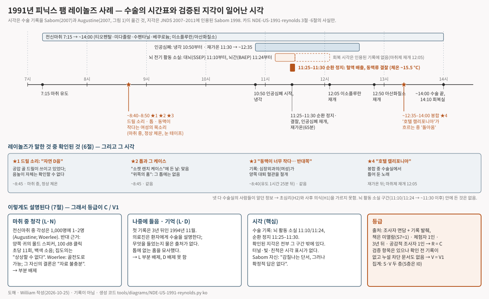

# 팸 레이놀즈와 뼈톱 — 뇌동맥류 수술로 심장을 멈춘 여성이 전신마취 중의 뼈톱, 동맥에 관한 대화, 수술실의 노래를 묘사하다 (피닉스, 1991)

> 1991년 8월, 애리조나주 피닉스. 서른다섯 살의 싱어송라이터가 눈을 테이프로 봉하고 양쪽 귀에 100데시벨로 딸깍거리는 성형 스피커를 꽂은 채 수술대에 누워 있었다. 뇌 바닥의 거대 동맥류에 손을 대려면 체온을 약 15.5 °C까지 낮추고 심장을 멈추고 머리의 피를 빼내야 했다. 3년 뒤 그녀는 한 심장내과 의사에게 두개골이 열리는 동안 듣고 본 것을 말했다. 전동 칫솔처럼 생긴 톱, 동맥이 너무 가늘다는 여자 목소리, 그리고 돌아올 때 흐르던 이글스의 "호텔 캘리포니아".

이 글은 영어 카드 [[NDE-US-1991-reynolds|Pam Reynolds and the bone saw (Phoenix, 1991)]]의 위층("읽는 글")을 한국어로 옮긴 것이다. 출처 번호·점수·등급 판정이 있는 조사 장부는 영어 카드에만 둔다. 등급: **R C · V1 · I0**.

## 무슨 일이 있었나

팸 레이놀즈는 애틀랜타의 심장내과 의사 마이클 세이봄(Michael Sabom)이 1998년에 그녀를 소개하면서 쓴 가명이다. 본명은 나중에 알려졌고 그녀는 2010년에 세상을 떠났으므로, 이 카드는 문헌이 쓰는 이름을 그대로 쓴다. 1991년 그녀는 서른다섯 살의 음악가·싱어송라이터였고, 뇌 바닥을 지나는 큰 동맥인 뇌바닥동맥에 거대 동맥류가 있었다. 집도의는 기록에 "극도로 크고" 뇌 안쪽으로 뻗어 있다고 적었다. 피가 흐르는 상태에서는 클립을 걸 수 없는 위치였다. 피닉스 배로 신경학연구소의 로버트 스페츨러(Robert Spetzler)는 자기 팀이 1988년 논문으로 발표했고 당시 몇 곳만 시행하던 수술을 제안했다. 저체온 심정지, 이른바 "스탠드스틸(standstill)"이다. 인공심폐기로 체온을 약 15.5 °C(60 °F)까지 낮추고 심장을 멈춘 뒤 머리의 피를 빼내면 동맥류가 "바람 빠진 풍선처럼" 꺼져 클립을 걸 수 있고, 그 다음 피를 돌려보내고 몸을 다시 데운다.

*참고 · 2019년의 피닉스 배로 신경학연구소. 사진의 건물은 집도의 이름을 딴 로버트 F. 스페츨러 신경과학 타워로, 뒤에 지어진 것이다. 1991년의 수술실은 찍혀 있지 않고, 1991년 당시 연구소의 사진은 쓸 수 있는 라이선스로 찾지 못했다 · BarrowWebmaster, Wikimedia Commons · CC BY-SA 4.0*

수술은 1991년 8월에 있었다. 그날 아침 7시 15분 직후 전신마취가 시작됐다. 티오펜탈, 이어 미다졸람, 아편계 진통제 수펜타닐, 근이완제 베쿠로늄, 그리고 아산화질소와 이소플루란. 팔다리는 수술대에 묶였고, 눈은 윤활제를 바른 뒤 테이프로 봉했으며, 양쪽 귀에는 작은 성형 스피커를 꽂고 "테이프와 거즈 더미"로 덮었다. 뇌간을 감시하기 위해 그 스피커에서 약 100데시벨의 딸깍 소리가 1초에 열한 번 울렸고, 3분마다 좌우 귀를 바꿔 가며 반대쪽 귀에는 백색소음을 틀었다. 머리는 일부만 밀었다. 마취 시작 약 1시간 25분 뒤 스페츨러는 공압식 마이더스 렉스(Midas Rex) 기구로, 먼저 드릴 비트로 그 다음 왕복톱으로 두개골을 열었다. 같은 시간 심장외과 의사(여성, 이 카드에서는 M 박사)는 인공심폐기를 연결할 사타구니의 혈관을 준비하고 있었다. 오른쪽 혈관이 너무 가늘어 왼쪽도 열었고, 수술 기록은 이를 "양측 대퇴 절개"라고 적었다. 10시 50분 인공심폐기가 피를 식히기 시작했다. 11시 10분 손목 자극에 대한 대뇌피질의 반응이 평탄해졌고, 11시 24분 딸깍 소리에 대한 뇌간의 반응이 평탄해졌다. 11시 25분 수술대의 머리 쪽을 들어올리고 기계를 끄고 머리의 피를 "자동차에서 기름을 빼듯" 빼냈다. 스페츨러가 꺼진 동맥류에 클립을 걸었다. 11시 30분 기계를 다시 돌려 65분에 걸쳐 몸을 데웠다. 깊은 냉각 동안 멈췄던 마취 가스는 12시 5분(이소플루란)과 12시 50분(아산화질소)에 다시 들어갔다. 12시 32분쯤 체온 32 °C(89.6 °F)에서 인공심폐기를 뗐고, 상처를 닫았으며, 수술은 오후 2시쯤 끝났다. 2시 10분 그녀는 삽관된 채 안정된 상태로 회복실로 옮겨졌다.

세이봄은 수술에서 3년이 지난 1994년 11월 11일에 처음 그녀를 면담했고, 그 진술을 1998년 책 *Light & Death*에 실었다. 그녀가 처음 기억하는 것은 소리였다. "자연음 D였다. 그 소리를 듣고 있으니 그것이 나를 머리 꼭대기로 끌어내는 것 같았다. 몸에서 더 멀리 나올수록 그 음은 더 또렷해졌다." 그녀는 위에서 내려다보고 있다고 느꼈다. "비유하자면 스페츨러 박사의 어깨 위에 앉아" 있었고, 시야는 "평소보다 더 밝고 더 초점이 맞고 더 선명"했다. "머리를 민 방식이 아주 이상하다고 생각했다. 머리카락을 다 밀 줄 알았는데 그러지 않았다." 그녀가 소리를 싫어했던 기구는 "전동 칫솔처럼 생겼고 움푹 들어간 데가 있었다. 톱날이 손잡이로 들어가는 것처럼 보이는 홈이 위에 있었는데, 실제로는 그렇지 않았다. 그리고 톱에는 갈아 끼우는 날들도 있었는데, 그 날들은 소켓 렌치 케이스처럼 생긴 것 안에 들어 있었다." 그녀는 톱이 "시동 걸리는" 소리를 들었다. "비교적 높은 음으로 윙윙거리다가 갑자기 브르르르르! 하고 갔다." 어떤 여자 목소리가 자기 정맥과 동맥이 아주 가늘다고 말하는 것을 들었고, 뇌 수술인데 저 아래에서 무엇을 하는 걸까 의아해했다. 그 다음 "터널 같지만 터널은 아닌" 것 속으로 끌려갔고, 그 끝에서 점점 커지는 작은 빛점을 향했다. 할머니가 자기를 부르는 소리를 들었지만 "귀로 들은 것은 아니었다". 빛 속에서 할머니, 삼촌, 먼 윗대의 할머니뻘 친척, 할아버지의 모습을 알아보았다. 빛 속으로 끝까지 들어가면 다시 몸에 돌려놓을 수 없다는 것을 알게 됐다. 삼촌이 그녀를 데려와 몸 안으로 밀어 넣었고, 그것은 "얼음물 수영장에 뛰어드는" 느낌이었다. "내가 돌아왔을 때 그들은 '호텔 캘리포니아'를 틀고 있었고, 가사는 '언제든 체크아웃할 수 있지만 결코 떠날 수는 없어'였다." 그녀는 나중에 담당 의사 한 사람(B 박사)에게 그것이 "믿을 수 없을 만큼 무신경했다"고 말했다. 의식을 되찾았을 때 그녀는 아직 인공호흡기를 달고 있었다. 이 경험을 처음 입에 올린 것은 며칠 뒤 회진 온 스페츨러에게였다.

*도해 · 1991년 8월 수술의 시간별 경과(세이봄과 오거스틴이 옮긴 수술 기록 기준), 검증된 네 가지 지각이 기록상 놓이는 시각, 뇌 기능이 사라진 구간, 다른 설명과 등급. 영어 카드 장부 3절·6절·7절에서 William이 그린 것이며 **기록이 아니다** · 생성 코드 `tools/diagrams/NDE-US-1991-reynolds.py`*

세이봄은 확인할 수 있는 것을 확인했다. 수술 기록을 입수해 그 시각을 썼고, 위에 적은 시각들이 그것이다. 톱에 대해서는 "매우 회의적"이었다고 썼다. 텍사스 포트워스의 제조사 마이더스 렉스가 사용 설명서의 사진을 보내 주기 전까지는. 기구는 정말 전동 칫솔을 닮았고, 갈아 끼우는 날들은 소켓 렌치 케이스 같은 상자에 들어 있었다. 기록에는 심장외과 의사가 마취 시작 약 1시간 25분 뒤 사타구니 양쪽을 절개한 사실도 있었다. 일부만 민 머리도 사실이었다. 2002년 BBC 다큐멘터리 *The Day I Died*가 이 사건을 널리 알렸다. 그 안에서 스페츨러는 수술의 그 단계에서는 아무도 보거나 들을 수 없었고, 기구들은 "포장 안에" 있었으며, "양쪽 귀에 딸깍 모듈을 꽂은" 상태에서 정상 청각 경로로 들었다는 것은 "상상할 수 없다"고 말했다. "저는 설명이 없습니다." 레이놀즈는 이 영화에서 책보다 더 날카로운 판본의 목소리를 전했다. "문제가 생겼어요. 동맥이 너무 가늘어요", 그리고 남자 목소리로 "반대쪽을 해 봐요". 2007년부터 2012년까지 이 사건은 *Journal of Near-Death Studies*에서 끝까지 논쟁됐다. 키스 오거스틴(Keith Augustine)은 수술을 시간표로 그려, 세이봄이 검증한 지각들이 냉각보다 약 두 시간 앞서 보통의 마취 상태에서 시작됐음을 보였다. 세이봄은 기록의 시각을 다시 적고 그것을 받아들이면서, 그 의미에 대해서만 반박했다. 마취과 의사 헤랄트 부를레이(G. M. Woerlee)는 딸깍 소리의 사이와 주변에서 골전도로 들을 수 있었다고 주장했고, 크리스 카터, 스튜어트 해머로프, 루돌프 스밋이 반론했으며, 스밋은 부를레이가 제안한 소리 실험을 자기 귀에 해 보고 몇 초 만에 견딜 수 없었다고 보고했다.

## 이 기록은 어디까지 믿을 수 있나

이 사건은 보통 "뇌파가 평탄한 동안의 임사체험"으로 소개된다. 기록은 그렇게 말하지 않는다. 레이놀즈가 말한 것 중 확인할 수 있는 네 가지, 드릴 소리, 톱과 케이스의 모양, 동맥에 관한 여자 목소리, 노래는 모두 그녀가 정상 체온에서 전신마취 중일 때 일어났다. 앞의 셋은 수술 기록상 8시 40분에서 50분쯤, 심장이 멈추기 약 두 시간 전이다. 노래는 마취 가스가 다시 들어간 뒤 상처를 닫는 동안 흐른 것이다. 뇌의 전기 활동은 11시 10분과 24분부터 사라졌고 혈류는 11시 25분부터 30분까지 멈췄다. 확인 가능한 진술 중 그 창 안에 드는 것은 하나도 없고, 터널·빛·친척들에 대해서는 그녀가 시각을 말하지 않았다. 오거스틴이 2007년에 이것을 그렸고, 기록을 가진 세이봄은 시각에 이의를 달지 않았다. 두 사람의 다툼은 그 의미에 관한 것이다.

이 기록은 이 연구의 척도에서 중요한 쪽으로 얇다. 체험자는 한 사람이다. 그녀의 말이 처음 기록된 것은 사건 3년 3개월 뒤, 심장내과 의사이자 신앙인인 한 조사자의 면담이다. 세이봄은 사후 생에 대한 자기 확신이 임사체험 연구가 아니라 기독교 신앙에 있다고 썼다. 수술실 인력에게 그녀의 진술을 물은 사람은 11년 뒤의 방송 제작진과 20년 뒤의 논쟁자들뿐이다. 세이봄이 진술과 검증을 실은 책은 저작권이 살아 있어 열어 보지 못했고, 이 카드는 학술지 논쟁에 그대로 전재된 긴 인용문에 기댄다. A에서 D의 척도에서 기록 등급은 **C**다.

이 기록을 받치는 것은, 세이봄이 자기가 통제하지 않는 문서, 즉 수술 기록과 제조사 설명서에 대조했고, 톱의 정확함에 충격을 받았다고 활자로 썼다는 점이다. 조건도 이런 사건치고는 이례적으로 잘 기록돼 있다. 봉한 눈, 큰 딸깍 소리를 내는 밀봉된 귀 스피커, 그리고 정상 청각은 상상할 수 없다고 공개적으로 말하는 집도의. 그래서 이 사건은 검증 정보가 있는 사건으로 센다. 그러나 그녀가 맞힌 모든 것은 방 안의 모든 사람이 알고 있었고, 그녀는 세이봄이 확인하기 전에 말로만 전했으며, 확인 전에 날짜가 찍힌 문서는 없다. 그것이 중간 등급 **V1**이다.

틀니의 남자와 달리 이것은 온전한 서사다. 몸 밖의 시점, 터널, 빛, 죽은 친척들, 귀환. 그래서 검증 정보의 집계뿐 아니라 구조의 집계에도 들어간다. 그러나 이것은 1991년의 미국, 무디의 *Life After Life*로부터 16년 뒤, 세이봄 자신의 첫 책으로부터 9년 뒤의 기록이다. 그 패턴은 그녀가 눈길을 둘 수 있는 모든 곳에 있었다. 독립 발생의 질문에는 아무것도 보태지 못한다(**I0**).

## 다르게 설명하면

- **들었을 수 있다.** 전신마취 중 각성은 1,000명에 한두 명꼴로 일어나고 대부분 청각이다. 그 지각들은 정확히 각성이 일어나는 단계에 든다. 마취됐고, 체온은 정상이고, 냉각 전이다. 반대편에는 테이프와 거즈로 밀봉된 성형 스피커, 100데시벨의 딸깍 소리, 반대쪽 귀의 백색소음, 그리고 스페츨러의 "상상할 수 없다"가 있다. 부를레이는 딸깍 소리가 1초의 100분의 1쯤만 차지하고, 차폐되는 귀는 40데시벨의 소음만 들으며, 뼈가 밀봉된 귀를 돌아 소리를 전달하고, 레이놀즈가 딸깍 소리를 한 번도 언급하지 않았다고 답한다. 스밋은 음악가라면 그 소리에 시달렸을 것이고 자신은 실험을 몇 초도 견디지 못했다고 되받는다. 부를레이 자신의 결론은 제목보다 좁다. 물리적 설명은 "가능함이 입증되고", 대안은 "입증되지 않았으며", 가용한 자료는 판정하기에 "불충분하다". 이 연구는 그 마지막 문장에 동의한다.
- **나중에 들었을 수 있다.** 그녀는 수술 며칠 뒤 스페츨러와 이야기했고, 집도의는 환자에게 수술을 설명한다. 누군가 그녀의 말을 적기까지 3년이 지났다. 여기서 읽은 어떤 글도 그 사이 그녀가 무슨 말을 들었는지 묻지 않는다.
- **기억이 다듬었을 수 있다.** 톱에는 그녀가 말한 홈이 없다. 목소리에 관한 진술은 1998년("정맥과 동맥이 아주 가늘다는 무슨 말… 확실하지는 않다")과 2002년("문제가 생겼어요. 동맥이 너무 가늘어요", "반대쪽을 해 봐요") 사이에 달라졌다.
- **골라진 사건일 수 있다.** 스페츨러 팀은 스탠드스틸 수술을 많이 했고, 이야기된 것은 이 하나다. 다른 환자들에게 물었는지는 여기서 읽은 어떤 글에도 적혀 있지 않다.
- **우연**으로 소켓 렌치 케이스를 설명하기는 어렵지만, "자연음 D"는 확인할 수 없고, 가는 혈관과 록 음악은 수술실에서 흔한 일이다.

그래서 이 기록은 뇌가 침묵할 때도 의식이 이어진다는 가설과 **양립한다**. 그러나 그것을 시험하지는 않는다. 이 기록이 검증하는 것 중 뇌가 침묵하는 동안 일어난 것은 없기 때문이다. 이 기록이 보여 주는 것은, 한 기록이 전설보다 한 면(조건의 기록)에서는 낫고 다른 면(시각)에서는 못할 수 있다는 것, 그리고 왜 전설이 기록을 앞질렀는가다.

## 출처

이 글의 모든 사실은 영어 카드 [[NDE-US-1991-reynolds|Pam Reynolds and the bone saw (Phoenix, 1991)]]의 조사 장부 3절·4절에 출처 번호와 함께 있다. 주요 출처는 다음과 같다.

- Sabom MB. *Light & Death*. Grand Rapids: Zondervan, 1998. 3장(37–51쪽)과 184–190쪽 — **미확인**(저작권, 무료 사본 없음). 아래 논문들에 그대로 전재된 인용으로만 썼다.
- Sabom MB. Commentary. *J Near-Death Stud* 2007;25(4):257–260 — 수술 기록의 시각, 감시 담당자의 개인 교신(2006). https://digital.library.unt.edu/ark:/67531/metadc799458/
- Augustine K. Does paranormal perception occur in near-death experiences? *J Near-Death Stud* 2007;25(4):203–236 — 수술 시간표(그림 1), 첫 면담 날짜, 톱의 홈. https://digital.library.unt.edu/ark:/67531/metadc799110/
- Woerlee GM. Could Pam Reynolds hear? *J Near-Death Stud* 2011;30(1):3–25 와 Rejoinder, 30(1):54–61 — 마취제, 딸깍 소리의 조건, 골전도, "자료 불충분". https://digital.library.unt.edu/ark:/67531/metadc461684/ · https://digital.library.unt.edu/ark:/67531/metadc461715/
- Carter C. Response to "Could Pam Reynolds hear?" *J Near-Death Stud* 2011;30(1):29–53 — 1998년 책 37–47쪽의 전재, BBC 인용, 스페츨러의 개인 교신(2011). https://digital.library.unt.edu/ark:/67531/metadc461722/
- Smit RH. *J Near-Death Stud* 2008;26(4):308–310 · 2012;30(3):188–192 — 스페츨러의 BBC 발언, 소리 자가 실험. https://digital.library.unt.edu/ark:/67531/metadc937967/ · https://digital.library.unt.edu/ark:/67531/metadc938051/
- Wikidata Q2499174 — 레이놀즈의 생몰년(1956–2010). https://www.wikidata.org/wiki/Q2499174
- 미확인: Sabom 1998(책 본문), BBC *The Day I Died*(2002), Spetzler 외 *J Neurosurg* 1988(본문), Tart 2007(미수집).
